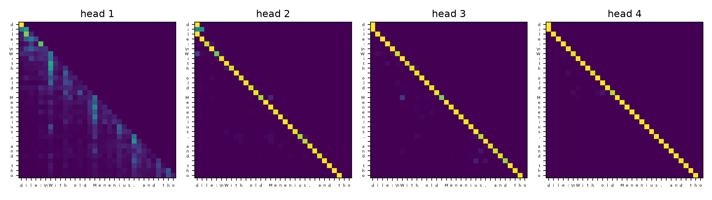

# Attention and Transformers

Code

- [Show All Code](javascript:void(0))
- [Hide All Code](javascript:void(0))

Published

Last modified: 2026-10-31

Show code

``` downlit
# The Python chunks on this page import these; reticulate provisions them.
# Attaching reticulate gives the inline R its `py` object.
library(reticulate)
source("../tools/use-torch.R")
use_torch(c("matplotlib"))
```

Brian Hutchinson’s CSCI 481/581 sets the order of topics in these notes, which follow it with his permission; this page covers his module on attention and Transformers. The exercises are new.

# 1 Welcome

## 1.1 Plan for this lecture

The [language models chapter](../chapters/language-models.llms.md) predicted each next character with a [GRU](../chapters/rnns.llms.md#def-gru), which carries everything it knows about the earlier characters in one [hidden state](https://morrison-lab.github.io/lds/chapters/cnn-rnn.html#def-hidden-state). This lecture builds a network that looks back at every earlier character directly:

1.  a weighted average whose weights the network computes from the inputs;
2.  that average applied within one sequence, and the order information it loses;
3.  several such averages side by side;
4.  a block that stacks them with the layers of the earlier chapters;
5.  a [language model](../chapters/language-models.llms.md#def-language-model) built from those blocks, trained on the same text as the [GRU](../chapters/rnns.llms.md#def-gru).

A [chapter of the DATA 371/471 notes](https://morrison-lab.github.io/lds/chapters/attention.html) builds the same weighted averages from word vectors, without code.

## 1.2 The text

Show code

``` python
import math

import matplotlib.pyplot as plt
import torch
import torch.nn.functional as F
from torch import nn

text = open("data/shakespeare.txt").read()
chars = sorted(set(text))
n_chars = len(chars)
index = {ch: i for i, ch in enumerate(chars)}
ids = torch.tensor([index[ch] for ch in text])
n_train = 90_000
train_ids, val_ids = ids[:n_train], ids[n_train:]
print(n_chars, len(text))
```

    61 100000

Show code

``` python
print(text[:60])
```

    First Citizen:
    Before we proceed any further, hear me speak.

The exercises use the text of the [language models chapter](../chapters/language-models.llms.md), a local copy, [`data/shakespeare.txt`](data/shakespeare.txt), of the first 100,000 characters of the [tiny Shakespeare text](https://raw.githubusercontent.com/karpathy/char-rnn/master/data/tinyshakespeare/input.txt) [\[1\]](#ref-karpathy2015charrnn). `ids` numbers each of its 61 distinct characters by its place in the sorted list `chars`. The first 90,000 characters are for training, and the rest for validation.

# 2 Weighted averages

## 2.1 A weighted average

> **NOTE:**
>
> **Exercise 1 (A weighted average chosen by the input)** Take the query \\\vq = (1, 0)\\ and three keys with one value each:
>
> | Key        | Value |
> |------------|------:|
> | \\(2, 0)\\ |    10 |
> | \\(0, 2)\\ |    20 |
> | \\(1, 1)\\ |    30 |
>
> What weighted average of the values do you get when the weights are the [softmax](https://morrison-lab.github.io/lds/chapters/multiclass-logistic-regression.html#def-softmax) of the keys’ [dot products](https://morrison-lab.github.io/mds/linear-algebra-vectors.html#def-dot-product) with \\\vq\\?
>
> > **TIP:**
> >
> > Score each key by its dot product with \\\vq\\, then take the softmax of the three scores.

> **NOTE:**
>
> *Solution 1*.
>
> Show code
>
> ``` python
> q = torch.tensor([1.0, 0.0])
> keys = torch.tensor([[2.0, 0.0], [0.0, 2.0], [1.0, 1.0]])
> values = torch.tensor([10.0, 20.0, 30.0])
> scores = keys @ q
> weights = torch.softmax(scores, dim=0)
> average = weights @ values
> weight_list = weights.tolist()
> print(scores, weights, average)
> ```
>
>     tensor([2., 0., 1.]) tensor([0.6652, 0.0900, 0.2447]) tensor(15.7949)
>
> The scores are 2, 0 and 1. The [softmax](https://morrison-lab.github.io/lds/chapters/multiclass-logistic-regression.html#def-softmax) turns them into the weights 0.665, 0.090 and 0.245, which sum to 1. The weighted average of the values is 15.79. The first key points the same way as the query, so its value gets the largest weight, and the second key is at right angles to the query, so its value gets the smallest.

> **NOTE:**
>
> **Definition 1 (Scaled dot-product attention)** **Scaled dot-product attention** takes \\m\\ queries, the rows of an \\m \times d_k\\ matrix \\\matr{Q}\\, and \\n\\ keys and \\n\\ values, the rows of an \\n \times d_k\\ matrix \\\matr{K}\\ and an \\n \times d_v\\ matrix \\\matr{V}\\. It returns the \\m \times d_v\\ matrix
>
> \\ \operatorname{Attention}\paren{\matr{Q}, \matr{K}, \matr{V}} \eqdef \operatorname{softmax}\paren{\frac{\matr{Q} \tp{\matr{K}}}{\sqrt{d_k}}} \matr{V}, \\
>
> with the [softmax](https://morrison-lab.github.io/lds/chapters/multiclass-logistic-regression.html#def-softmax) taken across each row [\[2, Sec. 3.2.1\]](#ref-vaswani2017attention). Row \\i\\ of the softmax holds weights \\\attnweight\_{i1}, \dots, \attnweight\_{in}\\, which are positive and sum to 1, so row \\i\\ of the output is a weighted average of the rows of \\\matr{V}\\. Bahdanau et al. [\[3\]](#ref-bahdanau2015neural) scored each key with a small network instead of a [dot product](https://morrison-lab.github.io/mds/linear-algebra-vectors.html#def-dot-product). Vaswani et al. [\[2, Sec. 3.2.1\]](#ref-vaswani2017attention) call that form additive attention.

> **NOTE:**
>
> **Example 1 (Attention in PyTorch)**  
>
> Show code
>
> ``` python
> torch_output = F.scaled_dot_product_attention(
>     q.reshape(1, 2), keys, values.reshape(3, 1)
> )
> by_hand = torch.softmax(keys @ q / math.sqrt(2), dim=0) @ values
> print(torch_output, by_hand)
> ```
>
>     tensor([[17.0802]]) tensor(17.0802)
>
> The query and keys of [Exercise 1](#exr-weights) have \\d_k = 2\\, so [scaled dot-product attention](#def-attention) divides the scores by \\\sqrt{2}\\ before the [softmax](https://morrison-lab.github.io/lds/chapters/multiclass-logistic-regression.html#def-softmax). `F.scaled_dot_product_attention` [\[4\]](#ref-pytorch_sdpa) returns 17.08, the same as the formula computed by hand. The scaled scores are closer together, so the average is nearer the plain mean of the values, 20, than the unscaled average of [Solution 1](#sol-weights), 15.79.

## 2.2 Scaling the scores

> **NOTE:**
>
> **Exercise 2 (Why divide by \\\sqrt{d_k}\\?)** Draw a query \\\vq\\ and a key \\\vecf{k}\\ in \\\reals^{d_k}\\ with independent standard normal entries. How does the variance of \\\dprod{\vq}{\vecf{k}}\\ depend on \\d_k\\?

> **NOTE:**
>
> *Solution 2*. Since \\q_j\\ and \\k_j\\ are independent, each term \\q_j k_j\\ has mean \\\E{q_j k_j} = \E{q_j} \E{k_j} = 0\\. Its variance is
>
> \\ \begin{aligned} \Var{q_j k_j} &= \E{q_j^2 k_j^2} - \paren{\E{q_j k_j}}^2 \\ &= \E{q_j^2} \E{k_j^2} - 0 && \text{(independence)} \\ &= 1 \cdot 1 && \text{(mean 0 and variance 1)} \\ &= 1. \end{aligned} \\
>
> The \\d_k\\ terms are independent, so their variances add:
>
> \\ \begin{aligned} \Var{\dprod{\vq}{\vecf{k}}} &= \Var{\sumto{j}{d_k} q_j k_j} \\ &= \sumto{j}{d_k} \Var{q_j k_j} && \text{(independent terms)} \\ &= d_k. && \text{(each variance is 1)} \end{aligned} \\
>
> Vaswani et al. [\[2, Sec. 3.2.1\]](#ref-vaswani2017attention), footnote 4 give the same argument.
>
> Show code
>
> ``` python
> generator = torch.Generator().manual_seed(0)
> dims = [4, 64, 1024]
> dot_vars = []
> for d in dims:
>     q_draws = torch.randn(10_000, d, generator=generator)
>     k_draws = torch.randn(10_000, d, generator=generator)
>     dot_vars.append((q_draws * k_draws).sum(dim=1).var().item())
> print(dot_vars)
> ```
>
>     [3.969802141189575, 64.14726257324219, 1031.2110595703125]
>
> The variance grows in proportion to \\d_k\\. From 10,000 draws, the sample variances for \\d_k = 4\\, 64 and 1024 are 4.0, 64.1 and 1031. Dividing a quantity by a constant \\c\\ divides its variance by \\c^2\\, so dividing the [dot product](https://morrison-lab.github.io/mds/linear-algebra-vectors.html#def-dot-product) by \\\sqrt{d_k}\\ gives variance \\d_k / d_k = 1\\, whatever \\d_k\\ is.

> **NOTE:**
>
> *Remark 1* (What the scaling prevents).
>
> Show code
>
> ``` python
> d_k, n_keys = 512, 64
> q_draws = torch.randn(1_000, 1, d_k, generator=generator)
> k_draws = torch.randn(1_000, n_keys, d_k, generator=generator)
> raw_scores = (q_draws @ k_draws.transpose(1, 2)).squeeze(1)
> top_raw = torch.softmax(raw_scores, dim=1).max(dim=1).values.mean().item()
> top_scaled = torch.softmax(raw_scores / math.sqrt(d_k), dim=1).max(dim=1).values.mean().item()
> print(top_raw, top_scaled)
> ```
>
>     0.9229199290275574 0.10691015422344208
>
> With \\d_k = 512\\ and 64 keys drawn as in [Exercise 2](#exr-dot-variance), the unscaled [softmax](https://morrison-lab.github.io/lds/chapters/multiclass-logistic-regression.html#def-softmax) gives its largest weight an average of 0.92, so each query mostly copies one value. After dividing by \\\sqrt{d_k}\\, the largest weight averages 0.11. Vaswani et al. [\[2, Sec. 3.2.1\]](#ref-vaswani2017attention) suggest why the scaling helps: where one weight is near 1, the softmax’s [gradient](https://morrison-lab.github.io/lds/chapters/linear-regression.html#def-gradient) is near 0, and training slows.

## 2.3 Attending to another sequence

> **NOTE:**
>
> **Exercise 3 (Where should a translator look?)** A recurrent network reads a French sentence and keeps a [hidden state](https://morrison-lab.github.io/lds/chapters/cnn-rnn.html#def-hidden-state) for each French word. A second recurrent network then writes the English sentence one word at a time. Which of the French hidden states should the second network use when it writes each English word?

> **NOTE:**
>
> *Solution 3*. All of them, weighted by how relevant each French word is to the English word being written. Earlier translation networks passed only the last French [hidden state](https://morrison-lab.github.io/lds/chapters/cnn-rnn.html#def-hidden-state) to the second network, so one vector had to hold the whole sentence. Bahdanau et al. [\[3, Sec. 3.1\]](#ref-bahdanau2015neural) let the second network compute weights over every French hidden state at each step instead, and translation of long sentences improved [\[3, Sec. 5.1\]](#ref-bahdanau2015neural).

> **NOTE:**
>
> **Definition 2 (Cross-attention (encoder-decoder attention))** **Cross-attention** is [scaled dot-product attention](#def-attention) whose queries are computed from one sequence, and whose keys and values are computed from another. Vaswani et al. [\[2, Sec. 3.2.3\]](#ref-vaswani2017attention) call it **encoder-decoder attention**, since its queries come from the network that writes the output and its keys and values from the network that read the input.

> **NOTE:**
>
> **Example 2 (Three queries and five keys)**  
>
> Show code
>
> ``` python
> _ = torch.manual_seed(0)
> cross = nn.MultiheadAttention(embed_dim=8, num_heads=1, batch_first=True)
> writer = torch.randn(1, 3, 8)
> reader = torch.randn(1, 5, 8)
> cross_out, cross_weights = cross(writer, reader, reader)
> print(cross_out.shape, cross_weights.shape)
> ```
>
>     torch.Size([1, 3, 8]) torch.Size([1, 3, 5])
>
> Show code
>
> ``` python
> print(cross_weights.sum(dim=2))
> ```
>
>     tensor([[1.0000, 1.0000, 1.0000]], grad_fn=<SumBackward1>)
>
> `nn.MultiheadAttention` [\[5\]](#ref-pytorch_multiheadattention) takes the queries’ sequence first, then the keys’ and the values’. Here the queries come from a sequence of 3 vectors and the keys and values from a different sequence of 5, so the [cross-attention](#def-cross-attention) output has one row for each of the 3 queries, and the weights form a \\3 \times 5\\ matrix whose rows each sum to 1.

# 3 Within one sequence

## 3.1 One step from any position

> **NOTE:**
>
> **Exercise 4 (How far does information travel?)** A [GRU](../chapters/rnns.llms.md#def-gru) [language model](../chapters/language-models.llms.md#def-language-model) reads 64 characters. How many times does it apply its recurrent update between reading the first character and predicting the character after the 64th?

> **NOTE:**
>
> *Solution 4*. 63 times, once for each of characters 2 to 64. Whatever the network keeps about the first character has to survive all 63 updates, and the [gradient](https://morrison-lab.github.io/lds/chapters/linear-regression.html#def-gradient) of the loss with respect to that character has to pass back through all of them in training, where it can [vanish](../chapters/backpropagation.llms.md#def-vanishing-gradient). Attention can connect the last position to the first in one step, if the queries come from the same sequence as the keys.

> **NOTE:**
>
> **Definition 3 (Self-attention)** **Self-attention** is [scaled dot-product attention](#def-attention) whose queries, keys and values all come from the same sequence. For a sequence of \\n\\ vectors in \\\reals^d\\, the rows of an \\n \times d\\ matrix \\\matr{X}\\, it computes
>
> \\ \matr{Q} = \matr{X} \matr{W}\_Q, \qquad \matr{K} = \matr{X} \matr{W}\_K, \qquad \matr{V} = \matr{X} \matr{W}\_V, \\
>
> and returns \\\operatorname{Attention}\paren{\matr{Q}, \matr{K}, \matr{V}}\\, where the matrices \\\matr{W}\_Q\\, \\\matr{W}\_K\\ and \\\matr{W}\_V\\, of size \\d \times d_k\\, \\d \times d_k\\ and \\d \times d_v\\, are [parameters](https://morrison-lab.github.io/lds/chapters/big-ideas.html#def-parameter) learned in training [\[2, Sec. 3.2.3\]](#ref-vaswani2017attention). Each position’s output is a weighted average over every position of the sequence, itself included.

> **NOTE:**
>
> **Example 3 (Self-attention over “First Citizen”)**  
>
> Show code
>
> ``` python
> _ = torch.manual_seed(0)
> embed = nn.Embedding(n_chars, 8)
> attend = nn.MultiheadAttention(embed_dim=8, num_heads=1, batch_first=True)
> line = ids[:13].unsqueeze(0)
> n_line = line.shape[1]
> with torch.no_grad():
>     x = embed(line)
>     self_out, self_weights = attend(x, x, x)
> print(repr(text[:13]))
> ```
>
>     'First Citizen'
>
> Show code
>
> ``` python
> print(self_out.shape, self_weights.shape)
> ```
>
>     torch.Size([1, 13, 8]) torch.Size([1, 13, 13])
>
> The first line of the text begins with the 13 characters `"First Citizen"`. An [embedding layer](../chapters/rnns.llms.md#def-embedding) turns each into a vector of 8 numbers, and passing the same [tensor](../chapters/pytorch-basics.llms.md#def-tensor) as queries, keys and values makes `nn.MultiheadAttention` compute [self-attention](#def-self-attention), followed by a linear layer. The weights form a \\13 \times 13\\ matrix: one row of weights over all 13 characters for each character.

## 3.2 Order

> **NOTE:**
>
> **Exercise 5 (Reading backwards)** Feed the 13 characters of [Example 3](#exm-self-attention) to the same [self-attention](#def-self-attention) layer in reverse order. How do its outputs change?

> **NOTE:**
>
> *Solution 5*.
>
> Show code
>
> ``` python
> with torch.no_grad():
>     x_reversed = embed(line.flip(1))
>     reversed_out, _ = attend(x_reversed, x_reversed, x_reversed)
> reverse_gap = (reversed_out - self_out.flip(1)).abs().max().item()
> print(reverse_gap)
> ```
>
>     5.960464477539063e-08
>
> The outputs come out in reverse order and are otherwise unchanged: the largest difference between the new outputs and the old ones reversed is 6e-08, a rounding error. Each character’s output is a weighted average whose weights depend on the vectors and not on where they sit, so [self-attention](#def-self-attention) on its own cannot tell `"First Citizen"` from `"nezitiC tsriF"`.

> **NOTE:**
>
> **Definition 4 (Permutation equivariance)** A function \\f\\ from sequences of vectors to sequences of vectors of the same length is **permutation equivariant** when reordering its input reorders its output the same way: \\f(\pi(\matr{X})) = \pi(f(\matr{X}))\\ for every sequence \\\matr{X}\\ and every reordering \\\pi\\ of its positions [\[6, Sec. 2\]](#ref-zaheer2017deep). [Self-attention](#def-self-attention) is permutation equivariant, as [Solution 5](#sol-reverse) found for one reordering.

> **NOTE:**
>
> **Example 4 (A GRU is not permutation equivariant)**  
>
> Show code
>
> ``` python
> _ = torch.manual_seed(0)
> gru = nn.GRU(8, 8, batch_first=True)
> with torch.no_grad():
>     gru_out, _ = gru(x)
>     gru_reversed, _ = gru(x_reversed)
> gru_gap = (gru_reversed - gru_out.flip(1)).abs().max().item()
> print(gru_gap)
> ```
>
>     0.5011376142501831
>
> A [GRU](../chapters/rnns.llms.md#def-gru) layer given the same 13 vectors forwards and backwards does not just reverse its outputs: the largest difference between the two is 0.50, against 6e-08 for [self-attention](#def-self-attention) in [Solution 5](#sol-reverse). Each [hidden state](https://morrison-lab.github.io/lds/chapters/cnn-rnn.html#def-hidden-state) depends on the vectors before it, so the GRU is not [permutation equivariant](#def-permutation-equivariance).

## 3.3 Positions

> **NOTE:**
>
> **Exercise 6 (Telling positions apart)** How could we change the input vectors of [Example 3](#exm-self-attention) so that the same character at two different positions gets two different vectors?

> **NOTE:**
>
> *Solution 6*. Add to each character’s vector a second vector that depends only on the character’s position. The letter `i` at positions 2, 8 and 10 of `"First Citizen"` then enters the layer as three different vectors, and reordering the characters changes the inputs as well as their order.

> **NOTE:**
>
> **Definition 5 (Positional encoding)** A **positional encoding** is a vector \\\vp_t \in \reals^d\\ added to the [embedding](../chapters/rnns.llms.md#def-embedding) of the symbol at position \\t\\, before the first [self-attention](#def-self-attention) layer. Vaswani et al. [\[2, Sec. 3.5\]](#ref-vaswani2017attention) fix \\\vp_t\\ as sines and cosines of \\t\\ at different frequencies; Radford et al. [\[7, Sec. 4.1\]](#ref-radford2018improving) learn \\\vp_t\\ instead, as row \\t\\ of a second embedding matrix. These notes learn them.

> **NOTE:**
>
> **Example 5 (Order matters once positions are added)**  
>
> Show code
>
> ``` python
> _ = torch.manual_seed(0)
> position = nn.Embedding(13, 8)
> where = torch.arange(13)
> with torch.no_grad():
>     x_pos = embed(line) + position(where)
>     x_pos_reversed = embed(line.flip(1)) + position(where)
>     pos_out, _ = attend(x_pos, x_pos, x_pos)
>     pos_reversed, _ = attend(x_pos_reversed, x_pos_reversed, x_pos_reversed)
> pos_gap = (pos_reversed - pos_out.flip(1)).abs().max().item()
> print(pos_gap)
> ```
>
>     0.8557268381118774
>
> With a learnable (here untrained) [positional encoding](#def-positional-encoding) added to each character’s vector, the outputs for the reversed line are no longer the old outputs reversed: the largest difference is 0.86, against 6e-08 without it.

## 3.4 Not looking ahead

> **NOTE:**
>
> **Exercise 7 (Peeking at the answer)** A [language model](../chapters/language-models.llms.md#def-language-model) trained with [teacher forcing](../chapters/language-models.llms.md#def-teacher-forcing) predicts the next character at every position of a window at once. Suppose its [self-attention](#def-self-attention) lets position \\t\\ attend to position \\t + 1\\. What stops the model from reaching a training loss near 0?

> **NOTE:**
>
> *Solution 7*. Nothing stops it. The character it must predict at position \\t\\ is the input at position \\t + 1\\, so the model can learn to copy it. That model is useless for generating text, where the next character does not exist yet. The weights on every key after the query have to be 0.

> **NOTE:**
>
> **Definition 6 (Causal mask)** A **causal mask** sets the score of key \\j\\ for query \\i\\ to \\-\infty\\ whenever \\j \> i\\, before the [softmax](https://morrison-lab.github.io/lds/chapters/multiclass-logistic-regression.html#def-softmax) in [self-attention](#def-self-attention). The softmax then gives those keys weight 0, so each position attends only to itself and the positions before it [\[2, Sec. 3.2.3\]](#ref-vaswani2017attention).

> **NOTE:**
>
> **Example 6 (Masked weights for five characters)**  
>
> Show code
>
> ``` python
> mask = nn.Transformer.generate_square_subsequent_mask(5)
> with torch.no_grad():
>     x5 = embed(line[:, :5])
>     _, masked_weights = attend(x5, x5, x5, attn_mask=mask)
> print(mask)
> ```
>
>     tensor([[0., -inf, -inf, -inf, -inf],
>             [0., 0., -inf, -inf, -inf],
>             [0., 0., 0., -inf, -inf],
>             [0., 0., 0., 0., -inf],
>             [0., 0., 0., 0., 0.]])
>
> Show code
>
> ``` python
> print(masked_weights[0].numpy().round(2))
> ```
>
>     [[1.   0.   0.   0.   0.  ]
>      [0.41 0.59 0.   0.   0.  ]
>      [0.27 0.17 0.56 0.   0.  ]
>      [0.22 0.09 0.31 0.38 0.  ]
>      [0.17 0.51 0.1  0.15 0.08]]
>
> `nn.Transformer.generate_square_subsequent_mask(5)` builds the [causal mask](#def-causal-mask) for 5 positions, with \\-\infty\\ above the diagonal and 0 elsewhere, and `attn_mask` adds it to the scores. In the weights for `"First"`, row 1 puts all its weight on `"F"`, and every entry above the diagonal is 0.

# 4 Stacking

## 4.1 Several heads

> **NOTE:**
>
> **Exercise 8 (Two things to look at)** A [self-attention](#def-self-attention) layer gives each query one row of weights over the positions. Can that one row put more than 0.9 of its weight on the previous character and also more than 0.9 on the first character of the current word?

> **NOTE:**
>
> *Solution 8*. No, unless the two are the same position. The weights in a row are positive and sum to 1, so 0.9 on one position leaves at most 0.1 for every other position. Looking at both needs two rows of weights for each query, each computed from its own query and key matrices.

> **NOTE:**
>
> **Definition 7 (Multi-head attention)** **Multi-head attention** with \\h\\ heads runs \\h\\ copies of [scaled dot-product attention](#def-attention) side by side, head \\i\\ with its own matrices \\\matr{W}\_Q^{(i)}\\, \\\matr{W}\_K^{(i)}\\ and \\\matr{W}\_V^{(i)}\\ of size \\d \times d / h\\. It joins the \\h\\ outputs, each \\n \times d / h\\, into one \\n \times d\\ matrix, and multiplies that by a \\d \times d\\ matrix \\\matr{W}\_O\\ of [parameters](https://morrison-lab.github.io/lds/chapters/big-ideas.html#def-parameter) [\[2, Sec. 3.2.2\]](#ref-vaswani2017attention). Each head can weight the positions in its own way.

> **NOTE:**
>
> **Example 7 (Counting the parameters)**  
>
> Show code
>
> ``` python
> def n_params(module):
>     return sum(p.numel() for p in module.parameters())
>
>
> heads4 = nn.MultiheadAttention(embed_dim=64, num_heads=4, batch_first=True)
> print([(name, tuple(p.shape)) for name, p in heads4.named_parameters()])
> ```
>
>     [('in_proj_weight', (192, 64)), ('in_proj_bias', (192,)), ('out_proj.weight', (64, 64)), ('out_proj.bias', (64,))]
>
> Show code
>
> ``` python
> print(n_params(heads4))
> ```
>
>     16640
>
> `nn.MultiheadAttention(64, 4)` is [multi-head attention](#def-multi-head-attention) with \\d = 64\\ and 4 heads. It stores the three projections of all heads in one \\192 \times 64\\ matrix with 192 biases, and \\\matr{W}\_O\\ as a \\64 \times 64\\ linear layer with 64 biases. That is \\3 \times 64^2 + 192 + 64^2 + 64 = 16,640\\ [parameters](https://morrison-lab.github.io/lds/chapters/big-ideas.html#def-parameter).

> **NOTE:**
>
> **Exercise 9 (Do more heads cost more?)** Does `nn.MultiheadAttention(64, num_heads)` have more [parameters](https://morrison-lab.github.io/lds/chapters/big-ideas.html#def-parameter) with 16 heads than with 1?

> **NOTE:**
>
> *Solution 9*.
>
> Show code
>
> ``` python
> head_counts = {str(h): n_params(nn.MultiheadAttention(64, h)) for h in [1, 16]}
> print(head_counts)
> ```
>
>     {'1': 16640, '16': 16640}
>
> No. It has 16,640 with 1 head, and 16,640 with 16. The count is the same as with 4 heads in [Example 7](#exm-multi-head-attention), because each of \\h\\ heads projects to \\d / h\\ columns, so the projections always have \\d\\ columns in all.

## 4.2 The block

> **NOTE:**
>
> **Exercise 10 (Mixing, then transforming)** [Self-attention](#def-self-attention) applies no nonlinear function to each position’s vector on its own. Which layer from the [feedforward networks chapter](../chapters/feedforward-networks.llms.md) could then apply a nonlinear function to each position’s vector?

> **NOTE:**
>
> *Solution 10*. An [MLP](../chapters/feedforward-networks.llms.md#def-feedforward-network), applied to each position’s vector separately, with the same weights at every position. The [self-attention](#def-self-attention) mixes information across positions, and the MLP transforms each position’s vector on its own.

> **NOTE:**
>
> **Definition 8 (Transformer block)** A **Transformer block** maps an \\n \times d\\ matrix \\\matr{H}\\ to another \\n \times d\\ matrix in two steps, each wrapped in a [residual connection](https://morrison-lab.github.io/lds/chapters/backpropagation.html#def-residual-connection):
>
> \\ \begin{aligned} \matr{H}' &= \matr{H} + \operatorname{MultiHead}\paren{\operatorname{LN}\paren{\matr{H}}}, \\ \operatorname{Block}\paren{\matr{H}} &= \matr{H}' + \operatorname{MLP}\paren{\operatorname{LN}\paren{\matr{H}'}}, \end{aligned} \\
>
> where \\\operatorname{MultiHead}\\ is [multi-head attention](#def-multi-head-attention), \\\operatorname{LN}\\ is [layer normalization](../chapters/normalization.llms.md#def-layer-norm) of each row, and \\\operatorname{MLP}\\ is an [MLP](../chapters/feedforward-networks.llms.md#def-feedforward-network) with one [hidden layer](../chapters/feedforward-networks.llms.md#def-hidden-layer), applied to each row. Vaswani et al. [\[2, Secs. 3.1, 3.3\]](#ref-vaswani2017attention) build each step this way, but normalize after each sum instead of before each step. The order here is the Pre-LN Transformer of Xiong et al. [\[8, Sec. 3\]](#ref-xiong2020layer), which they find trains without a warm-up of the [learning rate](https://morrison-lab.github.io/lds/chapters/gradient-descent.html#def-learning-rate).

> **NOTE:**
>
> **Example 8 (One block in PyTorch)**  
>
> Show code
>
> ``` python
> block = nn.TransformerEncoderLayer(
>     d_model=64, nhead=4, dim_feedforward=256,
>     dropout=0.0, batch_first=True, norm_first=True,
> )
> block_parts = {
>     "attention": n_params(block.self_attn),
>     "mlp": n_params(block.linear1) + n_params(block.linear2),
>     "norms": n_params(block.norm1) + n_params(block.norm2),
> }
> print(block_parts, n_params(block))
> ```
>
>     {'attention': 16640, 'mlp': 33088, 'norms': 256} 49984
>
> Show code
>
> ``` python
> print(block(torch.randn(1, 10, 64)).shape)
> ```
>
>     torch.Size([1, 10, 64])
>
> `nn.TransformerEncoderLayer` [\[9\]](#ref-pytorch_transformerencoderlayer) with `norm_first=True` is the [Transformer block](#def-transformer-block) above, with a [hidden layer](../chapters/feedforward-networks.llms.md#def-hidden-layer) of 256 [units](../chapters/feedforward-networks.llms.md#def-unit) in its [MLP](../chapters/feedforward-networks.llms.md#def-feedforward-network). Its 49,984 [parameters](https://morrison-lab.github.io/lds/chapters/big-ideas.html#def-parameter) are 16,640 in the attention, 33,088 in the [MLP](../chapters/feedforward-networks.llms.md#def-feedforward-network) and 256 in the two [layer normalization](../chapters/normalization.llms.md#def-layer-norm) layers. A sequence of 10 vectors of 64 numbers comes out as 10 vectors of 64 numbers.

# 5 A Transformer language model

## 5.1 The networks

Show code

``` python
seq_len = 64
batch_size = 32


class CharTransformer(nn.Module):
    # Embeds each character and its position, applies `n_blocks` causal
    # Transformer blocks, and returns logits over the next character.

    def __init__(self, d_model=64, n_heads=4, n_blocks=2):
        super().__init__()
        self.embed = nn.Embedding(n_chars, d_model)
        self.position = nn.Embedding(seq_len, d_model)
        self.blocks = nn.ModuleList([
            nn.TransformerEncoderLayer(
                d_model, n_heads, dim_feedforward=4 * d_model,
                dropout=0.0, batch_first=True, norm_first=True,
            )
            for _ in range(n_blocks)
        ])
        self.norm = nn.LayerNorm(d_model)
        self.out = nn.Linear(d_model, n_chars)

    def forward(self, x):
        n = x.shape[1]
        h = self.embed(x) + self.position(torch.arange(n))
        mask = nn.Transformer.generate_square_subsequent_mask(n)
        for block in self.blocks:
            h = block(h, src_mask=mask, is_causal=True)
        return self.out(self.norm(h))


class CharGRU(nn.Module):
    # The GRU language model of the language models chapter.

    def __init__(self, embed_size=16, hidden_size=128):
        super().__init__()
        self.embed = nn.Embedding(n_chars, embed_size)
        self.recurrent = nn.GRU(embed_size, hidden_size, batch_first=True)
        self.out = nn.Linear(hidden_size, n_chars)

    def forward(self, x):
        states, _ = self.recurrent(self.embed(x))
        return self.out(states)


def train_lm(net, n_steps, lr, seed=0):
    # Adam on random windows of the training text, with gradient clipping to 1.
    # Each window's targets are the same window moved one character on.
    optimizer = torch.optim.Adam(net.parameters(), lr=lr)
    generator = torch.Generator().manual_seed(seed)
    net.train()
    for step in range(n_steps):
        starts = torch.randint(0, n_train - seq_len - 1, (batch_size,), generator=generator)
        x = torch.stack([train_ids[s:s + seq_len] for s in starts])
        y = torch.stack([train_ids[s + 1:s + seq_len + 1] for s in starts])
        loss = F.cross_entropy(net(x).reshape(-1, n_chars), y.reshape(-1))
        optimizer.zero_grad()
        loss.backward()
        _ = nn.utils.clip_grad_norm_(net.parameters(), 1)
        optimizer.step()


def val_perplexity(net):
    # Perplexity on the validation text, read in windows of `seq_len` characters.
    n = (len(val_ids) - 1) // seq_len * seq_len
    x = val_ids[:n].reshape(-1, seq_len)
    y = val_ids[1:n + 1].reshape(-1, seq_len)
    net.eval()
    with torch.no_grad():
        loss = F.cross_entropy(net(x).reshape(-1, n_chars), y.reshape(-1))
    return math.exp(loss.item())


_ = torch.manual_seed(1)
transformer = CharTransformer()
_ = torch.manual_seed(1)
gru_lm = CharGRU()
print(n_params(transformer), n_params(gru_lm))
```

    112061 64909

`CharTransformer` adds a learned [positional encoding](#def-positional-encoding) to each character’s [embedding](../chapters/rnns.llms.md#def-embedding), applies two [Transformer blocks](#def-transformer-block) with 4 heads and a [causal mask](#def-causal-mask), and maps each position’s vector to [logits](../chapters/feedforward-networks.llms.md#def-logits) over the next character. `CharGRU` is the [GRU](../chapters/rnns.llms.md#def-gru) model of the [language models chapter](../chapters/language-models.llms.md). The two have 112,061 and 64,909 [parameters](https://morrison-lab.github.io/lds/chapters/big-ideas.html#def-parameter). `train_lm()` runs [Adam](https://morrison-lab.github.io/lds/chapters/gradient-descent.html#def-adam) on batches of 32 windows of 64 characters, with [gradient clipping](https://morrison-lab.github.io/lds/chapters/backpropagation.html#def-gradient-clipping) to 1. `val_perplexity()` reads the validation text in windows of 64 characters, the longest the positional encoding covers, and returns the [perplexity](../chapters/language-models.llms.md#def-perplexity).

## 5.2 Training both

> **NOTE:**
>
> **Exercise 11 (A Transformer against a GRU)** Train `transformer` and `gru_lm` with `train_lm()` for 1,500 steps each, at [learning rate](https://morrison-lab.github.io/lds/chapters/gradient-descent.html#def-learning-rate) 0.005. Which has the lower [perplexity](../chapters/language-models.llms.md#def-perplexity) on the validation text?

> **NOTE:**
>
> *Solution 11*.
>
> Show code
>
> ``` python
> train_lm(transformer, 1500, lr=0.005)
> train_lm(gru_lm, 1500, lr=0.005)
> transformer_ppl = val_perplexity(transformer)
> gru_ppl = val_perplexity(gru_lm)
> print(transformer_ppl, gru_ppl)
> ```
>
>     5.094702964025491 5.486403232981603
>
> Show code
>
> ``` python
> # The prose below says the Transformer wins; stop the render if not.
> assert transformer_ppl < gru_ppl
> ```
>
> The Transformer. Its validation [perplexity](../chapters/language-models.llms.md#def-perplexity) is 5.09, against 5.49 for the [GRU](../chapters/rnns.llms.md#def-gru), after the same number of steps on the same windows. The Transformer also has about 1.7 times as many [parameters](https://morrison-lab.github.io/lds/chapters/big-ideas.html#def-parameter), so this comparison does not separate the architecture from the size.

## 5.3 Inside the first block

> **NOTE:**
>
> **Exercise 12 (What the heads look at)** Plot the attention weights of each head of the first block of the trained `transformer`, for the first 32 characters of the validation text.

> **NOTE:**
>
> *Solution 12*.
>
> Show code
>
> ``` python
> first = transformer.blocks[0]
> window = val_ids[:32].unsqueeze(0)
> _ = transformer.eval()
> with torch.no_grad():
>     h = transformer.embed(window) + transformer.position(torch.arange(32))
>     normed = first.norm1(h)
>     _, head_weights = first.self_attn(
>         normed, normed, normed,
>         attn_mask=nn.Transformer.generate_square_subsequent_mask(32),
>         need_weights=True, average_attn_weights=False,
>     )
> head_weights = head_weights[0]
> previous_share = [head_weights[i].diagonal(-1).mean().item() for i in range(4)]
> previous_text = ", ".join(f"{share:.2f}" for share in previous_share)
> n_previous_heads = sum(share > 0.9 for share in previous_share)
> print(previous_share)
> ```
>
>     [0.17569929361343384, 0.02207978442311287, 0.9588571190834045, 0.9839892983436584]
>
> Show code
>
> ``` python
> # The prose below says at least one head looks at the previous character.
> assert n_previous_heads >= 1
> ```
>
> > **NOTE:**
> >
> > Show code
> >
> > ``` python
> > labels = [repr(ch)[1:-1] for ch in text[n_train:n_train + 32]]
> > fig, axes = plt.subplots(1, 4, figsize=(12, 3.4))
> > for i, ax in enumerate(axes):
> >     ax.imshow(head_weights[i], cmap="viridis", vmin=0, vmax=1);
> >     ax.set_title(f"head {i + 1}");
> >     ax.set_xticks(range(32), labels, fontsize=5);
> >     ax.set_yticks(range(32), labels, fontsize=5);
> > fig.tight_layout();
> > plt.show()
> > ```
> >
> > [](attention-transformers_files/figure-html/unnamed-chunk-19-1.png "Figure 1: The weights of the four heads of the first block over the first 32 validation characters. Row i shows the weights that the query at character i puts on each character j.")
> >
> > Figure 1: The weights of the four heads of the first block over the first 32 validation characters. Row \\i\\ shows the weights that the query at character \\i\\ puts on each character \\j\\.
>
> Every map is 0 above the diagonal, from the [causal mask](#def-causal-mask). The heads differ. The average weight that each query puts on the character just before it is 0.18, 0.02, 0.96, 0.98 for heads 1 to 4. Of the four heads, 2 put more than 0.9 of their weight there, so those heads pass each position information about the character before it. No one taught the network to do that; training on the next character found it.

# 6 Targets from text

## 6.1 Two objectives

> **NOTE:**
>
> **Exercise 13 (Who labelled the text?)** Nobody labelled the Shakespeare text. Where did the targets in `train_lm()` come from?

> **NOTE:**
>
> *Solution 13*. From the text itself. Each window’s targets are the same window moved one character on, so any text at all gives as many targets as it has characters.

> **NOTE:**
>
> **Definition 9 (Pretraining)** **Pretraining** trains a network on unlabelled data, using targets that come from the data itself. Radford et al. [\[7, Sec. 3.1\]](#ref-radford2018improving) pretrain a Transformer with a [causal mask](#def-causal-mask) to predict each next token. Devlin et al. [\[10, Sec. 3.1\]](#ref-devlin2019bert) pretrain one without a [causal mask](#def-causal-mask) to predict tokens hidden from its input, choosing 15% of the positions at random. Both then [fine-tune](../chapters/cnns.llms.md#def-fine-tuning) the pretrained network on tasks with labels.

> **NOTE:**
>
> **Example 9 (Hiding characters)**  
>
> Show code
>
> ``` python
> generator = torch.Generator().manual_seed(2)
> first_line = text[:text.index("\n")]
> hidden = torch.rand(len(first_line), generator=generator) < 0.15
> masked_line = "".join("_" if h else ch for ch, h in zip(first_line, hidden.tolist()))
> print(first_line)
> ```
>
>     First Citizen:
>
> Show code
>
> ``` python
> print(masked_line)
> ```
>
>     First C_t_zen:
>
> Hiding each character with probability 0.15 turns the first line of the text into the input “First C_t_zen:”. A network [pretrained](#def-pretraining) in the second way learns to fill each gap from the characters on both sides of it. The `train_lm()` of this lecture uses the objective of the first way, on 90,000 characters rather than the billions of tokens of real [language models](../chapters/language-models.llms.md#def-language-model).

## 6.2 Further reading

> **NOTE:**
>
> Vaswani et al. [\[2\]](#ref-vaswani2017attention) introduced the Transformer. Bahdanau et al. [\[3\]](#ref-bahdanau2015neural) introduced attention for translation. The draft of Jurafsky and Martin [\[11\]](#ref-jurafsky2026slp) has chapters on Transformers and large language models.

# 7 References

\[1\]

A. Karpathy, “Char-rnn: Multi-layer recurrent neural networks for character-level language models.” GitHub repository, 2015. Available: <https://github.com/karpathy/char-rnn>

\[2\]

A. Vaswani *et al.*, “Attention is all you need,” in *Advances in neural information processing systems*, 2017. Available: <https://arxiv.org/abs/1706.03762>

\[3\]

D. Bahdanau, K. Cho, and Y. Bengio, “Neural machine translation by jointly learning to align and translate,” in *International conference on learning representations*, 2015. Available: <https://arxiv.org/abs/1409.0473>

\[4\]

PyTorch Contributors, “Torch.nn.functional.scaled_dot_product_attention.” PyTorch documentation, 2026. Available: <https://docs.pytorch.org/docs/stable/generated/torch.nn.functional.scaled_dot_product_attention.html>

\[5\]

PyTorch Contributors, “Torch.nn.MultiheadAttention.” PyTorch documentation, 2026. Available: <https://docs.pytorch.org/docs/stable/generated/torch.nn.MultiheadAttention.html>

\[6\]

M. Zaheer, S. Kottur, S. Ravanbakhsh, B. Poczos, R. Salakhutdinov, and A. J. Smola, “Deep sets,” in *Advances in neural information processing systems*, 2017. Available: <https://arxiv.org/abs/1703.06114>

\[7\]

A. Radford, K. Narasimhan, T. Salimans, and I. Sutskever, “Improving language understanding by generative pre-training.” OpenAI technical report, 2018. Available: <https://cdn.openai.com/research-covers/language-unsupervised/language_understanding_paper.pdf>

\[8\]

R. Xiong *et al.*, “On layer normalization in the transformer architecture,” in *Proceedings of the 37th international conference on machine learning*, in Proceedings of machine learning research, vol. 119. 2020, pp. 10524–10533. Available: <https://arxiv.org/abs/2002.04745>

\[9\]

PyTorch Contributors, “Torch.nn.TransformerEncoderLayer.” PyTorch documentation, 2026. Available: <https://docs.pytorch.org/docs/stable/generated/torch.nn.TransformerEncoderLayer.html>

\[10\]

J. Devlin, M.-W. Chang, K. Lee, and K. Toutanova, “BERT: Pre-training of deep bidirectional transformers for language understanding,” in *Proceedings of the 2019 conference of the north American chapter of the association for computational linguistics: Human language technologies*, 2019, pp. 4171–4186. doi: [10.18653/v1/N19-1423](https://doi.org/10.18653/v1/N19-1423).

\[11\]

D. Jurafsky and J. H. Martin, “Speech and language processing.” Draft of the 3rd edition, August 19, 2026, 2026. Available: <https://web.stanford.edu/~jurafsky/slp3/>

Back to top
