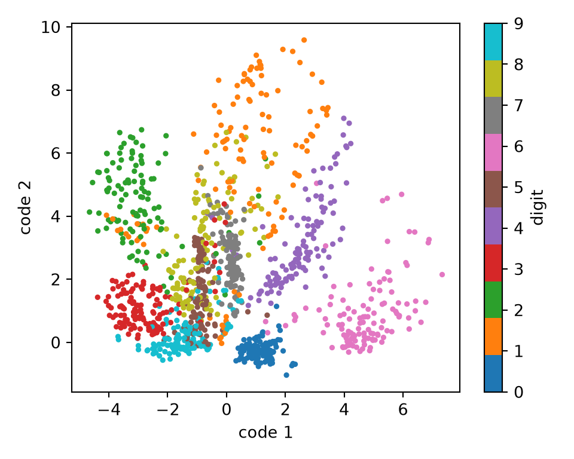
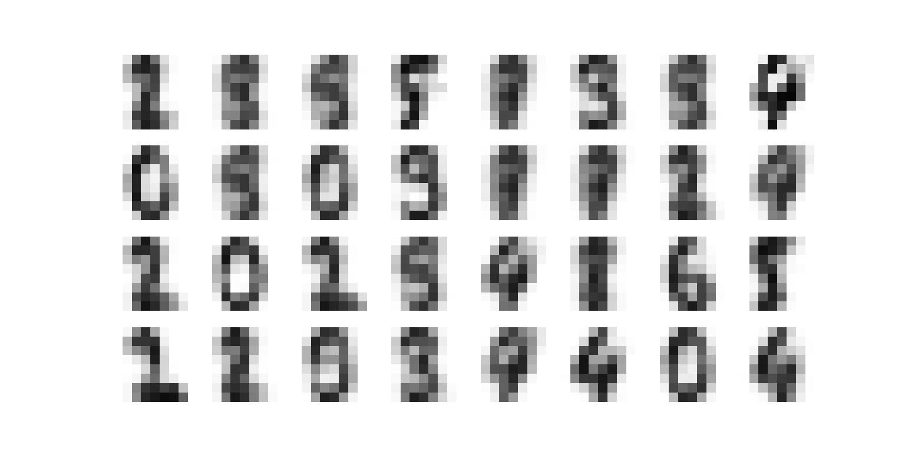
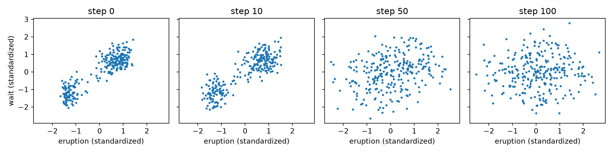
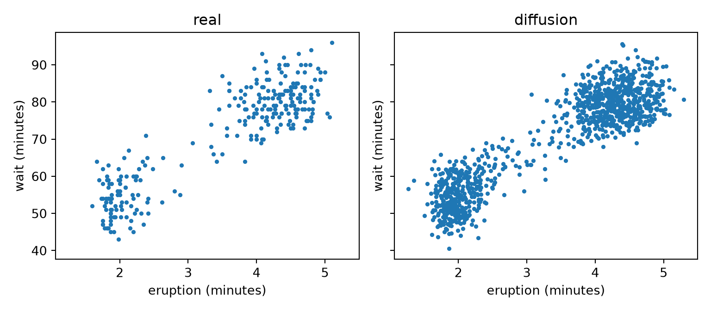

# Generative Models

Code

- [Show All Code](javascript:void(0))
- [Hide All Code](javascript:void(0))

Published

Last modified: 2026-10-31

Show code

``` downlit
# The Python chunks on this page import these; reticulate provisions them.
# Attaching reticulate gives the inline R its `py` object.
library(reticulate)
source("../tools/use-torch.R")
use_torch(c("numpy", "pandas", "matplotlib"))
```

Brian Hutchinson’s CSCI 481/581 sets the order of topics in these notes, which follow it with his permission; this page covers his module on [generative models](https://morrison-lab.github.io/lds/chapters/learning-problems.html#def-generative-model). The exercises are new.

# 1 Welcome

## 1.1 Plan for this lecture

The [language models chapter](../chapters/language-models.llms.md) drew new text one character at a time from a model of the next character. This lecture draws new images and new data points, with [generative models](https://morrison-lab.github.io/lds/chapters/learning-problems.html#def-generative-model) made of neural networks:

1.  an [autoencoder](https://morrison-lab.github.io/lds/chapters/neural-nets.html#def-autoencoder), and why it does not say how to make a new image;
2.  a variant whose codes follow a known distribution, so that a new image is a decoded draw from it;
3.  two networks trained against each other, one making data and one spotting the fakes;
4.  a network that learns to remove noise, and makes data by removing it a step at a time.

## 1.2 The digits

Show code

``` python
import math

import matplotlib.pyplot as plt
import pandas as pd
import torch
import torch.nn.functional as F
from torch import nn

digits = pd.read_csv("data/optdigits-test.csv", header=None)
x = torch.tensor(digits.iloc[:, :64].to_numpy(), dtype=torch.float32) / 16
y = torch.tensor(digits[64].to_numpy())
_ = torch.manual_seed(481)
order = torch.randperm(len(x))
n_train = 1200
x_train, y_train = x[order[:n_train]], y[order[:n_train]]
x_test = x[order[n_train:]]
n_test = len(x_test)


def mlp(*sizes):
    # Linear layers of the given sizes, with a ReLU between each pair.
    layers = []
    for n_in, n_out in zip(sizes[:-1], sizes[1:]):
        layers += [nn.Linear(n_in, n_out), nn.ReLU()]
    return nn.Sequential(*layers[:-1])


def train_model(model, loss_fn, n_epochs=100, lr=0.003, seed=0):
    # Adam on minibatches of 64 training images; loss_fn(model, batch) is the loss.
    optimizer = torch.optim.Adam(model.parameters(), lr=lr)
    generator = torch.Generator().manual_seed(seed)
    for epoch in range(n_epochs):
        shuffled = torch.randperm(n_train, generator=generator)
        for start in range(0, n_train, 64):
            loss = loss_fn(model, x_train[shuffled[start:start + 64]])
            optimizer.zero_grad()
            loss.backward()
            optimizer.step()


def show_digits(images, n_cols=8):
    # Draws each row of `images` as an 8 by 8 grayscale picture.
    n_rows = math.ceil(len(images) / n_cols)
    fig, axes = plt.subplots(n_rows, n_cols, figsize=(n_cols, n_rows))
    for ax, image in zip(axes.flat, images):
        ax.imshow(image.reshape(8, 8), cmap="gray_r", vmin=0, vmax=1);
    for ax in axes.flat:
        ax.axis("off");
    plt.show()


print(x_train.shape, x_test.shape)
```

    torch.Size([1200, 64]) torch.Size([597, 64])

The digits are the handwritten digits of the [feedforward networks chapter](../chapters/feedforward-networks.llms.md) [\[1\]](#ref-alpaydin1998optdigits), 8 by 8 images with pixel values scaled to lie between 0 and 1. 1,200 images are for training and the other 597 for testing. `mlp()` builds an [MLP](../chapters/feedforward-networks.llms.md#def-feedforward-network) from a list of layer sizes, and `train_model()` runs [Adam](https://morrison-lab.github.io/lds/chapters/gradient-descent.html#def-adam) on minibatches of 64 training images.

# 2 Autoencoders

## 2.1 A two-number code

Show code

``` python
class Autoencoder(nn.Module):
    # Encodes 64 pixels as `code_size` numbers,
    # and decodes those numbers back to 64 pixels between 0 and 1.

    def __init__(self, code_size=2):
        super().__init__()
        self.encoder = mlp(64, 128, code_size)
        self.decoder = nn.Sequential(mlp(code_size, 128, 64), nn.Sigmoid())

    def forward(self, x):
        return self.decoder(self.encoder(x))


def ae_loss(model, batch):
    # Binary cross-entropy of each pixel against its reconstruction,
    # summed over the pixels and averaged over the images.
    return F.binary_cross_entropy(model(batch), batch, reduction="sum") / len(batch)


_ = torch.manual_seed(1)
autoencoder = Autoencoder()
print(autoencoder)
```

    Autoencoder(
      (encoder): Sequential(
        (0): Linear(in_features=64, out_features=128, bias=True)
        (1): ReLU()
        (2): Linear(in_features=128, out_features=2, bias=True)
      )
      (decoder): Sequential(
        (0): Sequential(
          (0): Linear(in_features=2, out_features=128, bias=True)
          (1): ReLU()
          (2): Linear(in_features=128, out_features=64, bias=True)
        )
        (1): Sigmoid()
      )
    )

`Autoencoder` is an [autoencoder](https://morrison-lab.github.io/lds/chapters/neural-nets.html#def-autoencoder) whose bottleneck has 2 [units](../chapters/feedforward-networks.llms.md#def-unit), so its encoder turns each image into a code of 2 numbers. Other sources call the code a latent representation or latent variable. `ae_loss()` treats each pixel value as the probability that the pixel is dark.

## 2.2 Reconstruction

> **NOTE:**
>
> **Exercise 1 (Two numbers per image)** Train `autoencoder` with `train_model()` and `ae_loss()`. Is its mean squared error on the test images lower than that of the mean training image, used as the reconstruction of every test image?

> **NOTE:**
>
> *Solution 1*.
>
> Show code
>
> ``` python
> train_model(autoencoder, ae_loss)
> with torch.no_grad():
>     ae_mse = F.mse_loss(autoencoder(x_test), x_test).item()
>     ae_codes = autoencoder.encoder(x_train)
> mean_mse = F.mse_loss(x_train.mean(dim=0).expand_as(x_test), x_test).item()
> error_removed = 1 - ae_mse / mean_mse
> print(ae_mse, mean_mse, error_removed)
> ```
>
>     0.03567703440785408 0.07374946773052216 0.5162401098511429
>
> Show code
>
> ``` python
> # The prose below answers "yes"; stop the render if the autoencoder loses.
> assert ae_mse < mean_mse
> ```
>
> Yes. Its mean squared error per pixel is 0.036, against 0.074 for the mean image. Two numbers per image remove 52% of the mean image’s squared error.

## 2.3 The codes

> **NOTE:**
>
> **Exercise 2 (Where the codes lie)** Do the trained [autoencoder](https://morrison-lab.github.io/lds/chapters/neural-nets.html#def-autoencoder)’s codes of the training images follow a distribution we could draw new codes from?

> **NOTE:**
>
> *Solution 2*. No.
>
> > **NOTE:**
> >
> > Show code
> >
> > ``` python
> > fig, ax = plt.subplots(figsize=(5, 4))
> > points = ax.scatter(ae_codes[:, 0], ae_codes[:, 1], c=y_train, cmap="tab10", s=6);
> > fig.colorbar(points, ax=ax, label="digit");
> > ax.set_xlabel("code 1");
> > ax.set_ylabel("code 2");
> > fig.tight_layout();
> > plt.show()
> > ```
> >
> > [](generative-models_files/figure-html/unnamed-chunk-5-1.png "Figure 1: The autoencoder’s 2-number codes of the training images.")
> >
> > Figure 1: The [autoencoder](https://morrison-lab.github.io/lds/chapters/neural-nets.html#def-autoencoder)’s 2-number codes of the training images.
>
> Show code
>
> ``` python
> ae_code_mean = ae_codes.mean(dim=0).tolist()
> ae_code_sd = ae_codes.std(dim=0).tolist()
> print(ae_code_mean, ae_code_sd)
> ```
>
>     [0.015210718847811222, 2.2400617599487305] [2.4187214374542236, 2.1688451766967773]
>
> The codes have means 0.02 and 2.24, and standard deviations 2.42 and 2.17. Images of the same digit get nearby codes, and some digits, such as 0, 2 and 6, stand apart, while others, such as 3, 5, 7, 8 and 9, overlap. Nothing in `ae_loss()` says where the codes should lie, so these numbers come out of training, and a different seed would move them. To make a new image we would have to pick a code to decode, and the [autoencoder](https://morrison-lab.github.io/lds/chapters/neural-nets.html#def-autoencoder) gives no distribution to draw that code from.

# 3 Drawing new codes

## 3.1 A distribution for the codes

> **NOTE:**
>
> **Exercise 3 (Codes we can draw)** The codes of [Solution 2](#sol-ae-codes) follow no distribution we know. What could the encoder output, and the loss add, so that the codes of the training images follow \\\dNf{\vzero, \idmat}\\?

> **NOTE:**
>
> *Solution 3*. Let the encoder output a normal distribution for each image, with a mean and a standard deviation for each coordinate of the code, and train the decoder on draws from it. Then add to the loss the [KL divergence](https://morrison-lab.github.io/pds/expectation.html#def-kl-divergence) of each of those distributions from \\\dNf{0, 1}\\. The penalty pulls every image’s distribution toward the standard normal, so a draw from \\\dNf{\vzero, \idmat}\\ lands where the decoder has seen codes. This needs two results: the KL divergence between two normal distributions, and a way to differentiate through a random draw.

## 3.2 Distance from a standard normal

> **NOTE:**
>
> **Exercise 4 (How far is a normal distribution from the standard normal?)** Let \\q = \dNf{\mu, \sigma^2}\\ and \\p = \dNf{0, 1}\\. Find the [KL divergence](https://morrison-lab.github.io/pds/expectation.html#def-kl-divergence) \\\kldivf{q}{p}\\ as a formula in \\\mu\\ and \\\sigma\\.

> **NOTE:**
>
> *Solution 4*. Let \\Z \sim q\\, so \\\E{Z} = \mu\\ and \\\Var{Z} = \sigma^2\\. The log densities are \\\logf{q(z)} = -\frac{1}{2} \logf{2 \pi} - \frac{1}{2} \logf{\sigma^2} - \frac{(z - \mu)^2}{2 \sigma^2}\\ and \\\logf{p(z)} = -\frac{1}{2} \logf{2 \pi} - \frac{z^2}{2}\\. Then
>
> \\ \begin{aligned} \kldivf{q}{p} &= \E{\logf{q(Z)} - \logf{p(Z)}} && \text{(definition of KL divergence)} \\ &= \E{-\frac{1}{2} \logf{\sigma^2} - \frac{(Z - \mu)^2}{2 \sigma^2} + \frac{Z^2}{2}} && \text{(the } \logf{2 \pi} \text{ terms cancel)} \\ &= -\frac{1}{2} \logf{\sigma^2} - \frac{\E{(Z - \mu)^2}}{2 \sigma^2} + \frac{\E{Z^2}}{2} && \text{(linearity of expectation)} \\ &= -\frac{1}{2} \logf{\sigma^2} - \frac{\sigma^2}{2 \sigma^2} + \frac{\E{Z^2}}{2} && \text{(} \E{(Z - \mu)^2} = \Var{Z} = \sigma^2 \text{)} \\ &= -\frac{1}{2} \logf{\sigma^2} - \frac{\sigma^2}{2 \sigma^2} + \frac{\sigma^2 + \mu^2}{2} && \text{(} \E{Z^2} = \Var{Z} + \E{Z}^2 \text{)} \\ &= -\frac{1}{2} \logf{\sigma^2} - \frac{1}{2} + \frac{\sigma^2 + \mu^2}{2} && \text{(cancel } \sigma^2 \text{)} \\ &= \frac{1}{2} \paren{\mu^2 + \sigma^2 - 1 - \logf{\sigma^2}}. && \text{(collect terms)} \end{aligned} \\

> **NOTE:**
>
> **Theorem 1 (KL divergence from the standard normal)** For \\\mu \in \reals\\ and \\\sigma \> 0\\,
>
> \\ \kldivf{\dNf{\mu, \sigma^2}}{\dNf{0, 1}} = \frac{1}{2} \paren{\mu^2 + \sigma^2 - 1 - \logf{\sigma^2}} \\
>
> Kingma and Welling [\[2\]](#ref-kingma2014auto) derive it in their appendix B.

> **NOTE:**
>
> *Proof*. By [Solution 4](#sol-kl-normal).

> **NOTE:**
>
> **Example 1 (Checking the formula)**  
>
> Show code
>
> ``` python
> from torch.distributions import Normal, kl_divergence
>
> kl_torch = kl_divergence(Normal(1.0, 0.5), Normal(0.0, 1.0)).item()
> kl_formula = 0.5 * (1.0**2 + 0.5**2 - 1 - math.log(0.5**2))
> print(kl_torch, kl_formula)
> ```
>
>     0.8181471824645996 0.8181471805599453
>
> For \\\mu = 1\\ and \\\sigma = 0.5\\, [Theorem 1](#thm-kl-normal) gives \\\frac{1}{2} \paren{1 + 0.25 - 1 - \logf{0.25}} = 0.8181\\, and `torch.distributions.kl_divergence` [\[3\]](#ref-pytorch_distributions) gives the same value. The divergence is 0 only at \\\mu = 0\\ and \\\sigma = 1\\.

## 3.3 Differentiating through a draw

> **NOTE:**
>
> **Exercise 5 (A gradient through a random draw)** An encoder outputs \\\mu\\ and \\\sigma\\, and the next layer gets a draw \\z\\ from \\\dNf{\mu, \sigma^2}\\. How can we write \\z\\ so that the [gradient](https://morrison-lab.github.io/lds/chapters/linear-regression.html#def-gradient) of the loss reaches \\\mu\\ and \\\sigma\\?

> **NOTE:**
>
> *Solution 5*. Draw \\\noise \sim \dNf{0, 1}\\ first, with no [parameters](https://morrison-lab.github.io/lds/chapters/big-ideas.html#def-parameter) involved, and set \\z = \mu + \sigma \noise\\. Then \\z \sim \dNf{\mu, \sigma^2}\\, and \\z\\ is a differentiable function of \\\mu\\ and \\\sigma\\, with \\\derivf{z}{\mu} = 1\\ and \\\derivf{z}{\sigma} = \noise\\.

> **NOTE:**
>
> **Definition 1 (Reparameterization trick)** The **reparameterization trick** writes a draw \\\vz\\ from a distribution with [parameters](https://morrison-lab.github.io/lds/chapters/big-ideas.html#def-parameter) \\\vth\\ as \\\vz = g\_{\vth}(\vnoise)\\, where \\\vnoise\\ is drawn from a fixed distribution and \\g\_{\vth}\\ is differentiable in \\\vth\\ [\[2, Sec. 2.4\]](#ref-kingma2014auto). For a normal distribution with mean \\\vecf{\mu}\\ and standard deviations \\\vecf{\sigma}\\, \\\vz = \vecf{\mu} + \vecf{\sigma} \odot \vnoise\\ with \\\vnoise \sim \dNf{\vzero, \idmat}\\, where \\\odot\\ multiplies entry by entry.

> **NOTE:**
>
> **Example 2 (Autograd through the draw)**  
>
> Show code
>
> ``` python
> mu = torch.tensor(1.0, requires_grad=True)
> sigma = torch.tensor(0.5, requires_grad=True)
> eps = torch.randn((), generator=torch.Generator().manual_seed(0))
> z = mu + sigma * eps
> z.backward()
> print(eps.item(), mu.grad.item(), sigma.grad.item())
> ```
>
>     1.5409960746765137 1.0 1.5409960746765137
>
> With the [reparameterization trick](#def-reparameterization), autograd finds \\\derivf{z}{\mu} = 1\\ and \\\derivf{z}{\sigma} = 1.541\\, the value of \\\noise\\ drawn.

## 3.4 The model

> **NOTE:**
>
> **Definition 2 (Variational autoencoder)** A **variational autoencoder** has an encoder that maps an input \\\vx\\ to vectors \\\vecf{\mu}(\vx)\\ and \\\vecf{\sigma}(\vx)\\ in \\\reals^k\\, and a decoder that maps a code \\\vz \in \reals^k\\ back to the space of inputs. In training, the code is a draw \\\vz = \vecf{\mu}(\vx) + \vecf{\sigma}(\vx) \odot \vnoise\\ by the [reparameterization trick](#def-reparameterization). The loss for \\\vx\\ is the reconstruction loss of the decoded \\\vz\\ plus \\\sumto{j}{k} \kldivf{\dNf{\mu_j(\vx), \sigma_j(\vx)^2}}{\dNf{0, 1}}\\ [\[2, Secs. 2.3, 3\]](#ref-kingma2014auto). To make a new input, decode a draw from \\\dNf{\vzero, \idmat}\\.

> **NOTE:**
>
> **Example 3 (A variational autoencoder for the digits)**  
>
> Show code
>
> ``` python
> class VAE(nn.Module):
>     # The encoder's 2 * code_size outputs are the means and the log variances.
>
>     def __init__(self, code_size=2):
>         super().__init__()
>         self.encoder = mlp(64, 128, 2 * code_size)
>         self.decoder = nn.Sequential(mlp(code_size, 128, 64), nn.Sigmoid())
>
>     def forward(self, x):
>         mu, log_var = self.encoder(x).chunk(2, dim=1)
>         z = mu + torch.exp(0.5 * log_var) * torch.randn_like(mu)
>         return self.decoder(z), mu, log_var
>
>
> def vae_loss(model, batch):
>     reconstruction, mu, log_var = model(batch)
>     fit = F.binary_cross_entropy(reconstruction, batch, reduction="sum")
>     kl = 0.5 * (mu**2 + log_var.exp() - 1 - log_var).sum()
>     return (fit + kl) / len(batch)
>
>
> _ = torch.manual_seed(1)
> vae = VAE()
> train_model(vae, vae_loss)
> with torch.no_grad():
>     train_mu, train_log_var = vae.encoder(x_train).chunk(2, dim=1)
>     noise = torch.randn(train_mu.shape, generator=torch.Generator().manual_seed(2))
>     vae_codes = train_mu + torch.exp(0.5 * train_log_var) * noise
>     test_mu = vae.encoder(x_test).chunk(2, dim=1)[0]
>     vae_mse = F.mse_loss(vae.decoder(test_mu), x_test).item()
> vae_code_mean = vae_codes.mean(dim=0).tolist()
> vae_code_sd = vae_codes.std(dim=0).tolist()
> print(vae_code_mean, vae_code_sd, vae_mse)
> ```
>
>     [0.025694118812680244, 0.04258835315704346] [1.0070878267288208, 1.0168691873550415] 0.03732502833008766
>
> Show code
>
> ``` python
> # Stop the render if the codes are far from standard normal, as the prose says they are close.
> assert all(abs(m) < 0.2 for m in vae_code_mean)
> assert all(abs(s - 1) < 0.2 for s in vae_code_sd)
> ```
>
> `VAE` is a [variational autoencoder](#def-vae) with codes of 2 numbers, the same layers as `Autoencoder`, and the KL term of [Theorem 1](#thm-kl-normal) added to `ae_loss()`. Its encoder outputs \\\logf{\sigma^2}\\ rather than \\\sigma\\, so that any real output gives a valid \\\sigma\\. After the same training, one draw of the code for each training image gives codes with means 0.03 and 0.04 and standard deviations 1.01 and 1.02, close to the means of 0 and standard deviations of 1 of the standard normal that new codes are drawn from. Decoding \\\vecf{\mu}(\vx)\\ gives a test mean squared error of 0.037, against 0.036 for the [autoencoder](https://morrison-lab.github.io/lds/chapters/neural-nets.html#def-autoencoder) of [Solution 1](#sol-reconstruct).

> **NOTE:**
>
> *Remark 1* (The loss as a bound). When the reconstruction loss is the negative log probability that the decoder gives \\\vx\\, as the binary [cross-entropy](https://morrison-lab.github.io/pds/expectation.html#def-cross-entropy) of `vae_loss()` would be for pixels that are each 0 or 1, the negative of the [variational autoencoder](#def-vae)’s loss is a one-draw estimate [\[2, Sec. 2.3\]](#ref-kingma2014auto) of what Kingma and Welling [\[2, Sec. 2.2\]](#ref-kingma2014auto) call the variational lower bound, a lower bound on the log probability of \\\vx\\. Many sources call it the evidence lower bound (ELBO).

## 3.5 Sampling

> **NOTE:**
>
> **Exercise 6 (New digits)** Decode 32 draws from \\\dNf{\vzero, \idmat}\\ with the trained `vae`.

> **NOTE:**
>
> *Solution 6*.
>
> > **NOTE:**
> >
> > Show code
> >
> > ``` python
> > with torch.no_grad():
> >     new_digits = vae.decoder(torch.randn(32, 2, generator=torch.Generator().manual_seed(4)))
> > show_digits(new_digits)
> > ```
> >
> > [](generative-models_files/figure-html/unnamed-chunk-10-3.png "Figure 2: Images decoded from 32 codes drawn from the standard normal distribution.")
> >
> > Figure 2: Images decoded from 32 codes drawn from the standard normal distribution.
>
> The [variational autoencoder](#def-vae) never saw these images. Each is the decoder’s output for a code drawn from the distribution that the KL term pulled the training codes toward. They are blurrier than real digits: the decoder’s output is a probability for each pixel, and [Figure 2](#fig-vae-samples) shows those probabilities rather than a draw of dark and light pixels.

# 4 Two networks against each other

## 4.1 Old Faithful

Show code

``` python
faithful = pd.read_csv("data/faithful.csv")
eruptions = torch.tensor(faithful.to_numpy(), dtype=torch.float32)
center, scale = eruptions.mean(dim=0), eruptions.std(dim=0)
standardized = (eruptions - center) / scale
long_share = (eruptions[:, 0] > 3).float().mean().item()


def long_wait_sd(points):
    # Standard deviation of the wait, over the eruptions longer than 3 minutes.
    return points[points[:, 0] > 3, 1].std().item()


real_long_sd = long_wait_sd(eruptions)
print(faithful.head())
```

       eruptions  waiting
    0      3.600       79
    1      1.800       54
    2      3.333       74
    3      2.283       62
    4      4.533       85

Show code

``` python
print(len(faithful), long_share, real_long_sd)
```

    272 0.6433823704719543 5.994239330291748

> **NOTE:**
>
> Show code
>
> ``` python
> def plot_eruptions(ax, points, title):
>     ax.scatter(points[:, 0], points[:, 1], s=6);
>     ax.set_xlabel("eruption (minutes)");
>     ax.set_ylabel("wait (minutes)");
>     ax.set_title(title);
>
>
> fig, ax = plt.subplots(figsize=(4, 3.5))
> plot_eruptions(ax, eruptions, "Old Faithful");
> fig.tight_layout();
> plt.show()
> ```
>
> [](generative-models_files/figure-html/unnamed-chunk-12-5.png "Figure 3: The length of each of the 272 eruptions and the wait until the next one.")
>
> Figure 3: The length of each of the 272 eruptions and the wait until the next one.

The rest of the lecture uses smaller data: a local copy, [`data/faithful.csv`](data/faithful.csv), of the 272 eruptions of the Old Faithful geyser in R’s `faithful` data set [\[4\]](#ref-r_faithful). R’s documentation gives its source as Härdle [\[5\]](#ref-hardle1991smoothing); Azzalini and Bowman [\[6\]](#ref-azzalini1990look) analyse a more complete version. `tools/get-faithful.R` writes the copy from R, unchanged. Each row gives an eruption’s length and the wait until the next one, in minutes. The eruptions fall in two clusters, and 64% of them last longer than 3 minutes. `standardized` rescales each column to mean 0 and standard deviation 1.

## 4.2 A forger and a detective

> **NOTE:**
>
> **Exercise 7 (Real or made up?)** A network turns random noise into made-up eruptions. We have the 272 real eruptions but no formula for their density. How could a second network tell the first one how to make its eruptions look more real?

> **NOTE:**
>
> *Solution 7*. Train the second network as a classifier that tells real eruptions from made-up ones. The first network then changes its weights to make the classifier call its eruptions real. As each network improves, the other has a harder task.

> **NOTE:**
>
> **Definition 3 (Generative adversarial network (GAN))** A **generative adversarial network**, or **GAN**, has a generator \\G\\, which maps a draw \\\vz\\ of noise to a data point \\G(\vz)\\, and a discriminator \\D\\, which gives the probability \\D(\vx)\\ that a data point \\\vx\\ is real. They are trained in turn, \\D\\ to maximize and \\G\\ to minimize
>
> \\ V(D, G) = \E{\logf{D(\vecf{X})}} + \E{\logf{1 - D(G(\vecf{Z}))}}, \\
>
> where \\\vecf{X}\\ is a real data point and \\\vecf{Z}\\ is the noise [\[7, Sec. 3\]](#ref-goodfellow2014generative).

> **NOTE:**
>
> **Example 4 (A GAN for Old Faithful)**  
>
> Show code
>
> ``` python
> _ = torch.manual_seed(0)
> generator_net = mlp(2, 64, 64, 2)
> discriminator = mlp(2, 64, 64, 1)
> adam = dict(lr=1e-3, betas=(0.5, 0.999))
> g_optimizer = torch.optim.Adam(generator_net.parameters(), **adam)
> d_optimizer = torch.optim.Adam(discriminator.parameters(), **adam)
> draws = torch.Generator().manual_seed(0)
> real_label, fake_label = torch.ones(64, 1), torch.zeros(64, 1)
> for step in range(3000):
>     real = standardized[torch.randint(0, len(standardized), (64,), generator=draws)]
>     fake = generator_net(torch.randn(64, 2, generator=draws))
>     # The discriminator's step: logits, so the loss is cross-entropy on D.
>     d_loss = (
>         F.binary_cross_entropy_with_logits(discriminator(real), real_label)
>         + F.binary_cross_entropy_with_logits(discriminator(fake.detach()), fake_label)
>     )
>     d_optimizer.zero_grad()
>     d_loss.backward()
>     d_optimizer.step()
>     # The generator's step: make D call the fakes real.
>     g_loss = F.binary_cross_entropy_with_logits(discriminator(fake), real_label)
>     g_optimizer.zero_grad()
>     g_loss.backward()
>     g_optimizer.step()
> with torch.no_grad():
>     gan_points = generator_net(torch.randn(1000, 2, generator=draws)) * scale + center
> gan_long_share = (gan_points[:, 0] > 3).float().mean().item()
> gan_long_sd = long_wait_sd(gan_points)
> print(gan_long_share, gan_long_sd, real_long_sd)
> ```
>
>     0.6340000033378601 3.717714786529541 5.994239330291748
>
> Show code
>
> ``` python
> # Stop the render if the generator's waits spread as much as the real ones,
> # since the prose says they spread less.
> assert gan_long_sd < real_long_sd
> ```
>
> > **NOTE:**
> >
> > Show code
> >
> > ``` python
> > fig, axes = plt.subplots(1, 2, figsize=(8, 3.5), sharex=True, sharey=True)
> > plot_eruptions(axes[0], eruptions, "real");
> > plot_eruptions(axes[1], gan_points, "GAN");
> > fig.tight_layout();
> > plt.show()
> > ```
> >
> > [](generative-models_files/figure-html/unnamed-chunk-14-7.png "Figure 4: The real eruptions and 1,000 made by the GAN’s generator.")
> >
> > Figure 4: The real eruptions and 1,000 made by the [GAN](#def-gan)’s generator.
>
> Both networks are [MLPs](../chapters/feedforward-networks.llms.md#def-feedforward-network) with two [hidden layers](../chapters/feedforward-networks.llms.md#def-hidden-layer) of 64 [units](../chapters/feedforward-networks.llms.md#def-unit), trained for 3,000 steps on the `standardized` eruptions. The discriminator returns a [logit](../chapters/feedforward-networks.llms.md#def-logits), so `binary_cross_entropy_with_logits`, with label 1 for the real points and 0 for the made-up ones, is \\-V(D, G)\\ for a minibatch. The generator’s loss is \\-\logf{D(G(\vz))}\\, rather than \\V(D, G)\\. Of the made-up eruptions, 63% last longer than 3 minutes, against 64% of the real ones. But the made-up points lie along one thin curve. Along the long end of that curve, the generator gives each eruption length nearly one wait; along the short end, it gives nearly one length for a range of waits. Among the eruptions longer than 3 minutes, the waits have standard deviation 3.7 minutes, against 6.0 for the real ones. The generator matches where the data lie better than how they spread.

> **NOTE:**
>
> *Remark 2* (The generator’s loss in practice). [Example 4](#exm-gan) follows Goodfellow et al. [\[7, Sec. 3\]](#ref-goodfellow2014generative), who train \\G\\ to maximize \\\logf{D(G(\vecf{Z}))}\\ instead of minimizing \\V(D, G)\\. This gives larger [gradients](https://morrison-lab.github.io/lds/chapters/linear-regression.html#def-gradient) early in training, when \\D\\ rejects the made-up points easily.

## 4.3 The best detective

> **NOTE:**
>
> **Exercise 8 (The best discriminator)** Fix the generator, and let \\p_g\\ be the density of its made-up points and \\p\\ that of the real ones. Which \\D(\vx)\\ maximizes \\V(D, G)\\ of [Definition 3](#def-gan)?

> **NOTE:**
>
> *Solution 8*. A point \\G(\vecf{Z})\\ made up by the generator has density \\p_g\\, so \\\E{\logf{1 - D(G(\vecf{Z}))}} = \int p_g(\vx) \logf{1 - D(\vx)} \\ d\vx\\. Writing the first expectation the same way puts \\V\\ in one integral over \\\vx\\:
>
> \\ V(D, G) = \int \paren{p(\vx) \logf{D(\vx)} + p_g(\vx) \logf{1 - D(\vx)}} \\ d\vx. \\
>
> The integral is largest when \\D(\vx)\\ maximizes the integrand at each \\\vx\\ separately. With \\a = p(\vx)\\, \\b = p_g(\vx)\\ and \\u = D(\vx)\\, the integrand is \\f(u) = a \logf{u} + b \logf{1 - u}\\ on \\0 \< u \< 1\\. For \\a, b \> 0\\,
>
> \\ \begin{aligned} f'(u) &= \frac{a}{u} - \frac{b}{1 - u} && \text{(differentiate)} \\ 0 &= \frac{a}{u} - \frac{b}{1 - u} && \text{(set } f'(u) = 0 \text{)} \\ 0 &= a (1 - u) - b u && \text{(multiply by } u (1 - u) \text{)} \\ 0 &= a - (a + b) u && \text{(collect the terms in } u \text{)} \\ u &= \frac{a}{a + b}. && \text{(solve for } u \text{)} \end{aligned} \\
>
> \\f''(u) = -a / u^2 - b / (1 - u)^2 \< 0\\, so that \\u\\ is the maximum. Where \\b = 0\\ the integrand increases toward \\u = 1\\, and where \\a = 0\\ it increases toward \\u = 0\\; \\a / (a + b)\\ gives those values too. The best discriminator is \\D(\vx) = p(\vx) / \paren{p(\vx) + p_g(\vx)}\\. Where the generator’s density equals the data’s, the best discriminator is \\\frac{1}{2}\\.

> **NOTE:**
>
> **Theorem 2 (The optimal discriminator)** For a fixed generator whose points have density \\p_g\\, and data with density \\p\\, the discriminator that maximizes \\V(D, G)\\ is
>
> \\ D^\*(\vx) = \frac{p(\vx)}{p(\vx) + p_g(\vx)} \\
>
> Goodfellow et al. [\[7, Sec. 4.1\]](#ref-goodfellow2014generative) prove it as their proposition 1.

> **NOTE:**
>
> *Proof*. By [Solution 8](#sol-best-discriminator).

> **NOTE:**
>
> **Example 5 (Where the GAN’s discriminator ended up)**  
>
> Show code
>
> ``` python
> with torch.no_grad():
>     d_real = torch.sigmoid(discriminator(standardized)).mean().item()
>     made_up = generator_net(torch.randn(1000, 2, generator=draws))
>     d_fake = torch.sigmoid(discriminator(made_up)).mean().item()
> print(d_real, d_fake)
> ```
>
>     0.5009837746620178 0.5033958554267883
>
> If the generator of [Example 4](#exm-gan) matched the data exactly, [Theorem 2](#thm-best-discriminator) says the best discriminator would give \\\frac{1}{2}\\ to every point. The trained discriminator gives the real eruptions an average probability of 0.50 of being real, and the made-up ones 0.50. The generator does not match the data, as [Figure 4](#fig-gan) shows, so this is not the best discriminator: a small network, trained a step at a time against a moving generator, has stopped telling the two apart on average, though the theorem says a better one could.

# 5 Adding and removing noise

## 5.1 Adding noise

> **NOTE:**
>
> **Exercise 9 (Adding noise twice)** Start from a data point \\\vx_0\\, and add noise twice:
>
> \\ \vx_1 = \sqrt{1 - \beta_1} \\ \vx_0 + \sqrt{\beta_1} \\ \vnoise_1, \qquad \vx_2 = \sqrt{1 - \beta_2} \\ \vx_1 + \sqrt{\beta_2} \\ \vnoise_2, \\
>
> with \\\vnoise_1\\ and \\\vnoise_2\\ independent draws from \\\dNf{\vzero, \idmat}\\. What is the distribution of \\\vx_2\\ given \\\vx_0\\?

> **NOTE:**
>
> *Solution 9*. Substitute \\\vx_1\\ into \\\vx_2\\:
>
> \\ \begin{aligned} \vx_2 &= \sqrt{1 - \beta_2} \paren{\sqrt{1 - \beta_1} \\ \vx_0 + \sqrt{\beta_1} \\ \vnoise_1} + \sqrt{\beta_2} \\ \vnoise_2 && \text{(substitute } \vx_1 \text{)} \\ &= \sqrt{1 - \beta_2} \sqrt{1 - \beta_1} \\ \vx_0 + \sqrt{1 - \beta_2} \sqrt{\beta_1} \\ \vnoise_1 + \sqrt{\beta_2} \\ \vnoise_2 && \text{(distribute)} \\ &= \sqrt{(1 - \beta_1)(1 - \beta_2)} \\ \vx_0 + \sqrt{(1 - \beta_2) \beta_1} \\ \vnoise_1 + \sqrt{\beta_2} \\ \vnoise_2. && \text{(} \sqrt{a} \sqrt{b} = \sqrt{a b} \text{)} \end{aligned} \\
>
> The last two terms are independent normal vectors with mean \\\vzero\\, so their sum is normal with mean \\\vzero\\ and covariance
>
> \\ \begin{aligned} \paren{(1 - \beta_2) \beta_1 + \beta_2} \idmat &= \paren{\beta_1 - \beta_1 \beta_2 + \beta_2} \idmat && \text{(expand)} \\ &= \paren{1 - (1 - \beta_1)(1 - \beta_2)} \idmat. && \text{(factor)} \end{aligned} \\
>
> So \\\vx_2\\ given \\\vx_0\\ is \\\dNf{\sqrt{\bar\alpha_2} \\ \vx_0, (1 - \bar\alpha_2) \idmat}\\, where \\\bar\alpha_2 = (1 - \beta_1)(1 - \beta_2)\\.

> **NOTE:**
>
> **Definition 4 (Forward diffusion process)** A **forward diffusion process** with noise levels \\\beta_1, \dots, \beta_T\\ between 0 and 1 turns a data point \\\vx_0\\ into \\\vx_1, \dots, \vx_T\\ by
>
> \\ \vx_t = \sqrt{1 - \beta_t} \\ \vx\_{t - 1} + \sqrt{\beta_t} \\ \vnoise_t, \qquad t = 1, \dots, T, \\
>
> with independent \\\vnoise_t \sim \dNf{\vzero, \idmat}\\ [\[8, Sec. 2\]](#ref-ho2020denoising). We write \\\bar\alpha_t \eqdef \prod\_{s = 1}^{t} (1 - \beta_s)\\; Ho et al. [\[8, Sec. 2\]](#ref-ho2020denoising) also write \\\alpha_t\\ for \\1 - \beta_t\\, which these notes do not use.

> **NOTE:**
>
> **Example 6 (A noise schedule)**  
>
> Show code
>
> ``` python
> n_steps = 100
> betas = torch.linspace(1e-4, 0.1, n_steps)
> alpha_bars = torch.cumprod(1 - betas, dim=0)
> print(alpha_bars[[9, 49, 99]])
> ```
>
>     tensor([0.9545, 0.2830, 0.0056])
>
> With \\T = 100\\ steps and \\\beta_t\\ rising evenly from 0.0001 to 0.1, \\\bar\alpha_t\\ is 0.95 after 10 steps, 0.283 after 50 and 0.0056 after 100. Ho et al. [\[8, Sec. 4\]](#ref-ho2020denoising) use \\T = 1000\\ steps, with \\\beta_t\\ from 0.0001 to 0.02.

> **NOTE:**
>
> **Theorem 3 (Noise added in one step)** In a [forward diffusion process](#def-forward-process), \\\vx_t\\ given \\\vx_0\\ is \\\dNf{\sqrt{\bar\alpha_t} \\ \vx_0, (1 - \bar\alpha_t) \idmat}\\, so \\\vx_t = \sqrt{\bar\alpha_t} \\ \vx_0 + \sqrt{1 - \bar\alpha_t} \\ \vnoise\\ with \\\vnoise \sim \dNf{\vzero, \idmat}\\ [\[8, Sec. 2\]](#ref-ho2020denoising).

> **NOTE:**
>
> *Proof*. By induction on \\t\\. For \\t = 1\\, \\\bar\alpha_1 = 1 - \beta_1\\ and the statement is the definition. If it holds for \\t - 1\\, then \\\vx_t = \sqrt{1 - \beta_t} \paren{\sqrt{\bar\alpha\_{t - 1}} \\ \vx_0 + \sqrt{1 - \bar\alpha\_{t - 1}} \\ \vnoise'} + \sqrt{\beta_t} \\ \vnoise_t\\, where \\\vnoise' \sim \dNf{\vzero, \idmat}\\ depends only on \\\vnoise_1, \dots, \vnoise\_{t - 1}\\ and so is independent of \\\vnoise_t\\. The steps of [Solution 9](#sol-noise-twice), with \\\bar\alpha\_{t - 1}\\ in place of \\1 - \beta_1\\ and \\\beta_t\\ in place of \\\beta_2\\, give mean \\\sqrt{\bar\alpha_t} \\ \vx_0\\ and covariance \\(1 - \bar\alpha_t) \idmat\\.

> **NOTE:**
>
> **Example 7 (Noising the eruptions)**  
>
> > **NOTE:**
> >
> > Show code
> >
> > ``` python
> > fig, axes = plt.subplots(1, 4, figsize=(12, 3), sharex=True, sharey=True)
> > noise = torch.randn(standardized.shape, generator=torch.Generator().manual_seed(5))
> > for ax, t in zip(axes, [0, 10, 50, 100]):
> >     alpha_bar = 1.0 if t == 0 else alpha_bars[t - 1].item()
> >     noised = math.sqrt(alpha_bar) * standardized + math.sqrt(1 - alpha_bar) * noise
> >     ax.scatter(noised[:, 0], noised[:, 1], s=4);
> >     ax.set_title(f"step {t}");
> >     ax.set_xlabel("eruption (standardized)");
> > axes[0].set_ylabel("wait (standardized)");
> > fig.tight_layout();
> > plt.show()
> > ```
> >
> > [](generative-models_files/figure-html/unnamed-chunk-17-9.png "Figure 5: The standardized eruptions after t steps of a forward diffusion process, with the noise schedule of Example 6.")
> >
> > Figure 5: The standardized eruptions after \\t\\ steps of a [forward diffusion process](#def-forward-process), with the noise schedule of [Example 6](#exm-forward-process).
>
> [Figure 5](#fig-forward-process) draws each step at once from [Theorem 3](#thm-forward-marginal), without computing the steps before it. By step 100, \\\vx_T\\ is close to a draw from \\\dNf{\vzero, \idmat}\\.

## 5.2 Removing noise

> **NOTE:**
>
> **Exercise 10 (Undoing the noise)** A network looks at \\\vx_t\\ and guesses the noise \\\est{\vnoise}\\ that [Theorem 3](#thm-forward-marginal) added to \\\vx_0\\. What estimate of \\\vx_0\\ follows from its guess?

> **NOTE:**
>
> *Solution 10*. Solve \\\vx_t = \sqrt{\bar\alpha_t} \\ \vx_0 + \sqrt{1 - \bar\alpha_t} \\ \est{\vnoise}\\ for \\\vx_0\\:
>
> \\ \est{\vx}\_0 = \frac{\vx_t - \sqrt{1 - \bar\alpha_t} \\ \est{\vnoise}}{\sqrt{\bar\alpha_t}}. \\
>
> A network that predicts the noise well can remove it, so predicting the noise is a way to predict the data.

> **NOTE:**
>
> **Definition 5 (Denoising diffusion model (denoising diffusion probabilistic model, DDPM))** A **denoising diffusion model**, which Ho et al. [\[8\]](#ref-ho2020denoising) call a **denoising diffusion probabilistic model** (**DDPM**), is defined for a [forward diffusion process](#def-forward-process). It trains a network \\\vnoise\_{\vth}(\vx_t, t)\\ to predict the noise in \\\vx_t\\, by minimizing \\\normsq{\vnoise - \vnoise\_{\vth}\paren{\sqrt{\bar\alpha_t} \\ \vx_0 + \sqrt{1 - \bar\alpha_t} \\ \vnoise, t}}\\ over data points \\\vx_0\\, steps \\t\\ drawn uniformly from \\1, \dots, T\\, and \\\vnoise \sim \dNf{\vzero, \idmat}\\. To make a new point, it draws \\\vx_T \sim \dNf{\vzero, \idmat}\\ and steps back, for \\t = T, \dots, 1\\:
>
> \\ \vx\_{t - 1} = \frac{1}{\sqrt{1 - \beta_t}} \paren{\vx_t - \frac{\beta_t}{\sqrt{1 - \bar\alpha_t}} \\ \vnoise\_{\vth}(\vx_t, t)} + \sqrt{\beta_t} \\ \vz_t, \\
>
> with \\\vz_t \sim \dNf{\vzero, \idmat}\\ for \\t \> 1\\ and \\\vz_1 = \vzero\\ [\[8, Secs. 3.2, 3.4\]](#ref-ho2020denoising).

> **NOTE:**
>
> **Example 8 (A diffusion model for Old Faithful)**  
>
> Show code
>
> ``` python
> class NoisePredictor(nn.Module):
>     # Predicts the noise in a 2-number point x_t, given t / T as a third input.
>
>     def __init__(self):
>         super().__init__()
>         self.net = mlp(3, 128, 128, 2)
>
>     def forward(self, x, t):
>         return self.net(torch.cat([x, (t / n_steps).unsqueeze(1)], dim=1))
>
>
> _ = torch.manual_seed(0)
> predictor = NoisePredictor()
> optimizer = torch.optim.Adam(predictor.parameters(), lr=1e-3)
> for step in range(4000):
>     x0 = standardized[torch.randint(0, len(standardized), (128,), generator=draws)]
>     t = torch.randint(1, n_steps + 1, (128,), generator=draws)
>     noise = torch.randn(128, 2, generator=draws)
>     alpha_bar = alpha_bars[t - 1].unsqueeze(1)
>     noised = alpha_bar.sqrt() * x0 + (1 - alpha_bar).sqrt() * noise
>     loss = F.mse_loss(predictor(noised, t.float()), noise)
>     optimizer.zero_grad()
>     loss.backward()
>     optimizer.step()
>
> with torch.no_grad():
>     points = torch.randn(1000, 2, generator=draws)
>     for t in range(n_steps, 0, -1):
>         beta, alpha_bar = betas[t - 1], alpha_bars[t - 1]
>         guess = predictor(points, torch.full((1000,), float(t)))
>         points = (points - beta / (1 - alpha_bar).sqrt() * guess) / (1 - beta).sqrt()
>         if t > 1:
>             points = points + beta.sqrt() * torch.randn(1000, 2, generator=draws)
> diffusion_points = points * scale + center
> diffusion_long_share = (diffusion_points[:, 0] > 3).float().mean().item()
> diffusion_long_sd = long_wait_sd(diffusion_points)
> print(diffusion_long_share, diffusion_long_sd)
> ```
>
>     0.6230000257492065 5.48890495300293
>
> > **NOTE:**
> >
> > Show code
> >
> > ``` python
> > fig, axes = plt.subplots(1, 2, figsize=(8, 3.5), sharex=True, sharey=True)
> > plot_eruptions(axes[0], eruptions, "real");
> > plot_eruptions(axes[1], diffusion_points, "diffusion");
> > fig.tight_layout();
> > plt.show()
> > ```
> >
> > [](generative-models_files/figure-html/unnamed-chunk-19-11.png "Figure 6: The real eruptions and 1,000 made by the denoising diffusion model.")
> >
> > Figure 6: The real eruptions and 1,000 made by the [denoising diffusion model](#def-diffusion-model).
>
> `NoisePredictor` is an [MLP](../chapters/feedforward-networks.llms.md#def-feedforward-network) that takes the noised point and \\t / T\\, trained for 4,000 steps of the [denoising diffusion model](#def-diffusion-model)’s loss on the noise schedule of [Example 6](#exm-forward-process). Sampling starts from 1,000 draws of pure noise and takes all 100 steps back. Of the points it makes, 62% last longer than 3 minutes, against 64% of the real eruptions. Unlike the [GAN](#def-gan)’s points, they spread around each cluster: among the eruptions longer than 3 minutes, the waits have standard deviation 5.5 minutes, against 6.0 for the real ones.

## 5.3 Further reading

> **NOTE:**
>
> *Deep Learning*’s [chapter 20](https://www.deeplearningbook.org/contents/generative_models.html) covers variational autoencoders and GANs [\[9, Secs. 20.10.3, 20.10.4\]](#ref-goodfellow2016deep). Kingma and Welling [\[2\]](#ref-kingma2014auto) introduced the variational autoencoder, Goodfellow et al. [\[7\]](#ref-goodfellow2014generative) the GAN, and Ho et al. [\[8\]](#ref-ho2020denoising) the denoising diffusion model.

# 6 References

\[1\]

E. Alpaydin and C. Kaynak, “Optical recognition of handwritten digits.” UCI Machine Learning Repository, 1998. doi: [10.24432/C50P49](https://doi.org/10.24432/C50P49).

\[2\]

D. P. Kingma and M. Welling, “Auto-encoding variational Bayes,” in *2nd international conference on learning representations*, 2014. doi: [10.48550/arXiv.1312.6114](https://doi.org/10.48550/arXiv.1312.6114).

\[3\]

PyTorch Contributors, “Probability distributions: torch.distributions.” PyTorch documentation, 2026. Available: <https://docs.pytorch.org/docs/stable/distributions.html>

\[4\]

R Core Team, “Faithful: Old Faithful geyser data.” R package datasets documentation, 2026. Available: <https://stat.ethz.ch/R-manual/R-devel/library/datasets/html/faithful.html>

\[5\]

W. Härdle, *Smoothing techniques: With implementation in S*. in Springer series in statistics. New York: Springer, 1991. doi: [10.1007/978-1-4612-4432-5](https://doi.org/10.1007/978-1-4612-4432-5).

\[6\]

A. Azzalini and A. W. Bowman, “A look at some data on the Old Faithful geyser,” *Applied Statistics*, vol. 39, no. 3, pp. 357–365, 1990, doi: [10.2307/2347385](https://doi.org/10.2307/2347385).

\[7\]

I. Goodfellow *et al.*, “Generative adversarial nets,” in *Advances in neural information processing systems*, 2014. Available: <https://papers.nips.cc/paper/5423-generative-adversarial-nets>

\[8\]

J. Ho, A. Jain, and P. Abbeel, “Denoising diffusion probabilistic models,” in *Advances in neural information processing systems*, 2020, pp. 6840–6851. Available: <https://arxiv.org/abs/2006.11239>

\[9\]

I. Goodfellow, Y. Bengio, and A. Courville, *Deep learning*. MIT Press, 2016. Available: <https://www.deeplearningbook.org/>

Back to top
