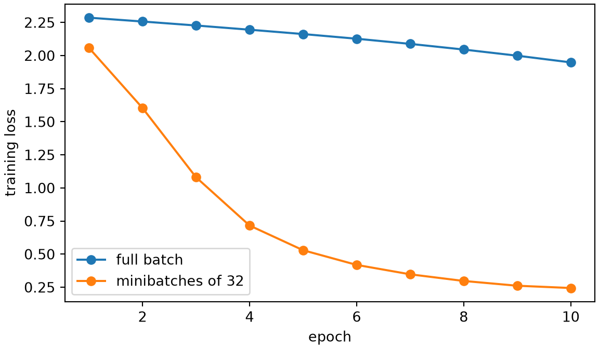
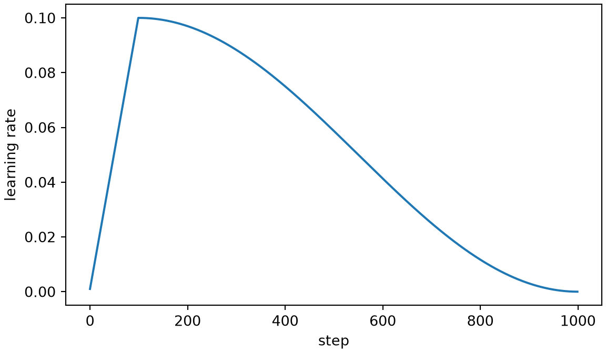

# Optimization

Code

- [Show All Code](javascript:void(0))
- [Hide All Code](javascript:void(0))

Published

Last modified: 2026-10-29

Show code

``` downlit
# The Python chunks on this page import these; reticulate provisions them.
# Attaching reticulate gives the inline R its `py` object.
library(reticulate)
source("../tools/use-torch.R")
use_torch(c("numpy", "pandas", "matplotlib"))
```

Brian Hutchinson’s CSCI 481/581 sets the order of topics in these notes, which follow it with his permission; this page covers the training algorithms and starting weights of his module on optimization and [regularization](https://morrison-lab.github.io/lds/chapters/big-ideas.html#def-regularization). The exercises are new. Minibatches, momentum, Adam and starting weights follow *Deep Learning*, Chapter 8 [\[1\]](#ref-goodfellow2016deep).

# 1 Welcome

## 1.1 Plan for this lecture

The [feedforward networks chapter](../chapters/feedforward-networks.llms.md) trained its [MLP](../chapters/feedforward-networks.llms.md#def-feedforward-network) with full-batch [gradient descent](https://morrison-lab.github.io/mds/optimization.html#def-gradient-descent), and [lds’s chapter on gradient descent](https://morrison-lab.github.io/lds/chapters/gradient-descent.html) covers the algorithms that do better. This lecture runs them in PyTorch on the digits:

1.  training on small random subsets of the training images instead of all of them at each step;
2.  [momentum](https://morrison-lab.github.io/lds/chapters/gradient-descent.html#def-momentum) and [Adam](https://morrison-lab.github.io/lds/chapters/gradient-descent.html#def-adam) as PyTorch optimizers;
3.  changing the [learning rate](https://morrison-lab.github.io/lds/chapters/gradient-descent.html#def-learning-rate) during training, starting with a short ramp up;
4.  choosing the scale of the starting weights.

## 1.2 The digits and the network

Show code

``` python
import math

import numpy as np
import pandas as pd
import torch
from torch import nn
import matplotlib.pyplot as plt

_ = torch.manual_seed(481)
digits = pd.read_csv("data/optdigits-test.csv", header=None)
x = torch.tensor(digits.iloc[:, :64].to_numpy(), dtype=torch.float32) / 16
y = torch.tensor(digits[64].to_numpy())
n_train = 1200
order = torch.randperm(len(x))
x_train, y_train = x[order[:n_train]], y[order[:n_train]]
x_test, y_test = x[order[n_train:]], y[order[n_train:]]
loss_fn = nn.CrossEntropyLoss()


def make_mlp(seed=1):
    # A fresh copy of the digits MLP, with the same starting weights for a given seed.
    torch.manual_seed(seed)
    return nn.Sequential(nn.Linear(64, 32), nn.ReLU(), nn.Linear(32, 10))


print(make_mlp())
```

    Sequential(
      (0): Linear(in_features=64, out_features=32, bias=True)
      (1): ReLU()
      (2): Linear(in_features=32, out_features=10, bias=True)
    )

The exercises use the 1,797 digits of [`data/optdigits-test.csv`](data/optdigits-test.csv) [\[2\]](#ref-alpaydin1998optdigits), split as in the [feedforward networks chapter](../chapters/feedforward-networks.llms.md), with 1,200 images in the [training set](https://morrison-lab.github.io/lds/chapters/big-ideas.html#def-training-set). `make_mlp()` builds that chapter’s [MLP](../chapters/feedforward-networks.llms.md#def-feedforward-network), with the same starting weights each time, so that every method below starts from the same place.

# 2 Minibatches

## 2.1 Ten passes over the data

> **NOTE:**
>
> **Exercise 1 (Ten passes over the data)** Suppose one fresh [MLP](../chapters/feedforward-networks.llms.md#def-feedforward-network) from `make_mlp()` is trained for 10 [epochs](https://morrison-lab.github.io/lds/chapters/gradient-descent.html#def-epoch) of full-batch [gradient descent](https://morrison-lab.github.io/mds/optimization.html#def-gradient-descent) with [learning rate](https://morrison-lab.github.io/lds/chapters/gradient-descent.html#def-learning-rate) 0.5. Another is trained for 10 epochs of [minibatch gradient descent](https://morrison-lab.github.io/lds/chapters/gradient-descent.html#def-minibatch) with batch size 32 and learning rate 0.1. The minibatches of each pass come from a fresh shuffle of the training images, rather than being drawn with replacement. Which has the lower training loss after 10 epochs?

> **NOTE:**
>
> *Solution 1*.
>
> Show code
>
> ``` python
> def train(mlp, optimizer, n_epochs, batch_size, scheduler=None, seed=0):
>     # Minibatch training; returns the training loss after each epoch.
>     shuffler = torch.Generator().manual_seed(seed)
>     losses = []
>     for epoch in range(n_epochs):
>         shuffled = torch.randperm(n_train, generator=shuffler)
>         for start in range(0, n_train, batch_size):
>             batch = shuffled[start:start + batch_size]
>             optimizer.zero_grad()
>             loss_fn(mlp(x_train[batch]), y_train[batch]).backward()
>             optimizer.step()
>             if scheduler is not None:
>                 scheduler.step()
>         with torch.no_grad():
>             losses.append(loss_fn(mlp(x_train), y_train).item())
>     return losses
>
>
> full_mlp = make_mlp()
> full_losses = train(full_mlp, torch.optim.SGD(full_mlp.parameters(), lr=0.5), 10, n_train)
> mini_mlp = make_mlp()
> mini_losses = train(mini_mlp, torch.optim.SGD(mini_mlp.parameters(), lr=0.1), 10, 32)
>
> fig, ax = plt.subplots(figsize=(6, 3.5), layout="constrained")
> ax.plot(range(1, 11), full_losses, marker="o", label="full batch");
> ax.plot(range(1, 11), mini_losses, marker="o", label="minibatches of 32");
> ax.set_xlabel("epoch");
> ax.set_ylabel("training loss");
> ax.legend();
> plt.show()
> ```
>
> [](optimization_files/figure-html/unnamed-chunk-3-1.png)
>
> Minibatches win by far: after 10 [epoch](https://morrison-lab.github.io/lds/chapters/gradient-descent.html#def-epoch)s the training loss is 0.24 for minibatches of 32 and 1.95 for the full batch. An epoch costs about the same either way, since it computes the loss and its [gradient](https://morrison-lab.github.io/lds/chapters/linear-regression.html#def-gradient) once for each training image. Full-batch descent spends that cost on one step per epoch, while the minibatch version spends it on many smaller, noisier steps, each of which already points roughly downhill. `batch_size=n_train` makes `train()` take full-batch steps.

## 2.2 How noisy is a minibatch gradient?

> **NOTE:**
>
> **Exercise 2 (How noisy is a minibatch gradient?)** [lds’s exercise on minibatches](https://morrison-lab.github.io/lds/chapters/gradient-descent.html#exr-minibatch) shows that, for minibatches drawn with replacement, the minibatch [gradient](https://morrison-lab.github.io/lds/chapters/linear-regression.html#def-gradient)’s variance is \\1/b\\ times that of one image’s gradient, for batch size \\b\\. For a fresh [MLP](../chapters/feedforward-networks.llms.md#def-feedforward-network) at its starting [parameters](https://morrison-lab.github.io/lds/chapters/big-ideas.html#def-parameter), and 200 minibatches each of sizes 8, 32 and 128, does \\b\\ times the mean squared distance between the minibatch gradient and the full-batch gradient stay about the same?

> **NOTE:**
>
> *Solution 2*.
>
> Show code
>
> ``` python
> noise_mlp = make_mlp()
>
>
> def flat_gradient(rows):
>     # The loss gradient on the given training images, as one long vector.
>     noise_mlp.zero_grad()
>     loss_fn(noise_mlp(x_train[rows]), y_train[rows]).backward()
>     return torch.cat([p.grad.flatten() for p in noise_mlp.parameters()])
>
>
> full_gradient = flat_gradient(torch.arange(n_train))
> sampler = torch.Generator().manual_seed(0)
> noise = {}
> for b in [8, 32, 128]:
>     distances = []
>     for draw in range(200):
>         rows = torch.randint(n_train, (b,), generator=sampler)
>         distances.append(((flat_gradient(rows) - full_gradient) ** 2).sum().item())
>     noise[b] = np.mean(distances)
> print({b: round(float(b * d), 2) for b, d in noise.items()})
> ```
>
>     {8: 4.55, 32: 4.6, 128: 4.44}
>
> Yes. The mean squared distance falls from 0.569 at \\b = 8\\ to 0.035 at \\b = 128\\, and \\b\\ times it stays between 4.4 and 4.6. The mean squared distance is the sum of the variances of the [gradient](https://morrison-lab.github.io/lds/chapters/linear-regression.html#def-gradient)’s entries, so it falls as \\1/b\\, as each variance does. Quadrupling the batch size only halves the typical distance, which is one reason small batches are a good use of each gradient computation.

# 3 Momentum and Adam

## 3.1 Momentum in PyTorch

> **NOTE:**
>
> *Remark 1* (Momentum in PyTorch). `torch.optim.SGD(params, lr=alpha, momentum=beta)` takes the steps of [lds’s momentum](https://morrison-lab.github.io/lds/chapters/gradient-descent.html#def-momentum), \\\vv_t = \beta \vv\_{t - 1} + \vg_t\\ and \\\vcoef_t = \vcoef\_{t - 1} - \learnrate \vv_t\\, where \\\vg_t\\ is the [gradient](https://morrison-lab.github.io/lds/chapters/linear-regression.html#def-gradient) at step \\t\\ and \\\vcoef_t\\ the [parameters](https://morrison-lab.github.io/lds/chapters/big-ideas.html#def-parameter) after it. Its first step sets \\\vv_1 = \vg_1\\, as \\\vv_0 = \vzero\\ would [\[3\]](#ref-pytorch_sgd). Some sources scale the gradient term by \\1 - \beta\\ or fold \\\learnrate\\ into \\\vv_t\\; the steps are the same up to a rescaled [learning rate](https://morrison-lab.github.io/lds/chapters/gradient-descent.html#def-learning-rate).

## 3.2 Momentum on a steady slope

> **NOTE:**
>
> **Exercise 3 (Momentum on a steady slope)** Suppose the [gradient](https://morrison-lab.github.io/lds/chapters/linear-regression.html#def-gradient) is the same vector \\\vg\\ at every step, and [momentum](https://morrison-lab.github.io/lds/chapters/gradient-descent.html#def-momentum), updated as in [Remark 1](#rem-pytorch-momentum), starts from \\\vv_0 = \vzero\\. What does the step \\\learnrate \vv_t\\ approach as \\t\\ grows?

> **NOTE:**
>
> *Solution 3*. Unrolling \\\vv_t = \beta \vv\_{t - 1} + \vg\\ from \\\vv_0 = \vzero\\:
>
> \\ \begin{aligned} \vv_t &= \vg + \beta \vg + \dots + \beta^{t - 1} \vg && \text{(apply the update \$t\$ times)} \\ &= \frac{1 - \beta^t}{1 - \beta} \vg && \text{(sum of a geometric series, for \$0 \le \beta \< 1\$)} \\ &\to \frac{1}{1 - \beta} \vg && \text{(since \$\beta^t \to 0\$)} \end{aligned} \\
>
> So the step approaches \\\frac{\learnrate}{1 - \beta} \vg\\: on a steady slope, [momentum](https://morrison-lab.github.io/lds/chapters/gradient-descent.html#def-momentum) moves like plain [gradient descent](https://morrison-lab.github.io/mds/optimization.html#def-gradient-descent) with [learning rate](https://morrison-lab.github.io/lds/chapters/gradient-descent.html#def-learning-rate) \\\learnrate / (1 - \beta)\\. With \\\beta = 0.9\\, that learning rate is 10 times \\\learnrate\\.

## 3.3 Three optimizers on the digits

> **NOTE:**
>
> **Exercise 4 (Plain steps, momentum and Adam)** Suppose three fresh [MLP](../chapters/feedforward-networks.llms.md#def-feedforward-network)s are trained for 5 [epoch](https://morrison-lab.github.io/lds/chapters/gradient-descent.html#def-epoch)s on minibatches of 32, using `train()` from [Solution 1](#sol-minibatch-epochs):
>
> - one with `torch.optim.SGD` at [learning rate](https://morrison-lab.github.io/lds/chapters/gradient-descent.html#def-learning-rate) 0.1;
> - one with `torch.optim.SGD` at learning rate 0.01 and [momentum](https://morrison-lab.github.io/lds/chapters/gradient-descent.html#def-momentum) 0.9;
> - one with `torch.optim.Adam`, PyTorch’s [Adam](https://morrison-lab.github.io/lds/chapters/gradient-descent.html#def-adam), at learning rate 0.01.
>
> Which reaches the lowest training loss?

> **NOTE:**
>
> *Solution 4*.
>
> Show code
>
> ``` python
> optimizers = {
>     "SGD": lambda p: torch.optim.SGD(p, lr=0.1),
>     "momentum": lambda p: torch.optim.SGD(p, lr=0.01, momentum=0.9),
>     "Adam": lambda p: torch.optim.Adam(p, lr=0.01),
> }
> final_loss, test_acc = {}, {}
> for name, make_optimizer in optimizers.items():
>     mlp = make_mlp()
>     final_loss[name] = train(mlp, make_optimizer(mlp.parameters()), 5, 32)[-1]
>     with torch.no_grad():
>         test_acc[name] = (mlp(x_test).argmax(dim=1) == y_test).float().mean().item()
> print(final_loss)
> ```
>
>     {'SGD': 0.5297544598579407, 'momentum': 0.5874408483505249, 'Adam': 0.10584728419780731}
>
> Show code
>
> ``` python
> print(test_acc)
> ```
>
>     {'SGD': 0.8860971331596375, 'momentum': 0.8844221234321594, 'Adam': 0.94807368516922}
>
> [Adam](https://morrison-lab.github.io/lds/chapters/gradient-descent.html#def-adam) reaches the lowest training loss, 0.11, against 0.53 for plain SGD and 0.59 with [momentum](https://morrison-lab.github.io/lds/chapters/gradient-descent.html#def-momentum). It also classifies the most images of the [test set](https://morrison-lab.github.io/lds/chapters/big-ideas.html#def-test-set) correctly, 94.8%. Momentum and plain SGD end close together, as [Solution 3](#sol-momentum-long-run) predicts: [learning rate](https://morrison-lab.github.io/lds/chapters/gradient-descent.html#def-learning-rate) 0.01 with \\\beta = 0.9\\ moves like learning rate 0.1 on a steady slope. A comparison like this depends on the learning rates chosen for each method, so a fair one tunes each method’s learning rate separately.

## 3.4 Adam’s first step

> **NOTE:**
>
> **Exercise 5 (Adam’s first step)** At [Adam](https://morrison-lab.github.io/lds/chapters/gradient-descent.html#def-adam)’s first step, one [parameter](https://morrison-lab.github.io/lds/chapters/big-ideas.html#def-parameter) has [gradient](https://morrison-lab.github.io/lds/chapters/linear-regression.html#def-gradient) \\g \neq 0\\. Ignoring \\\smallconst\\, how far does that step move the parameter?

> **NOTE:**
>
> *Solution 5*. With \\m_0 = u_0 = 0\\, the first averages are \\m_1 = (1 - \beta_1) g\\ and \\u_1 = (1 - \beta_2) g^2\\.
>
> \\ \begin{aligned} \frac{\est{m}\_1}{\sqrt{\est{u}\_1}} &= \frac{m_1 / (1 - \beta_1)}{\sqrt{u_1 / (1 - \beta_2)}} && \text{(bias corrections at \$t = 1\$)} \\ &= \frac{g}{\sqrt{g^2}} && \text{(substitute \$m_1\$ and \$u_1\$)} \\ &= \frac{g}{\abs{g}} && \text{(\$\sqrt{g^2} = \abs{g}\$)} \end{aligned} \\
>
> So the first step moves the [parameter](https://morrison-lab.github.io/lds/chapters/big-ideas.html#def-parameter) by exactly \\\learnrate\\, against the sign of \\g\\, whatever the size of \\g\\.
>
> Show code
>
> ``` python
> w = torch.ones(2, requires_grad=True)
> adam = torch.optim.Adam([w], lr=0.01)
> w.grad = torch.tensor([1000.0, 0.001])
> adam.step()
> step = (1 - w.detach()).tolist()
> print(step)
> ```
>
>     [0.009999990463256836, 0.009999871253967285]
>
> [Gradients](https://morrison-lab.github.io/lds/chapters/linear-regression.html#def-gradient) of 1,000 and 0.001 move their [parameters](https://morrison-lab.github.io/lds/chapters/big-ideas.html#def-parameter) by 0.0100000 and 0.0099999, both close to the [learning rate](https://morrison-lab.github.io/lds/chapters/gradient-descent.html#def-learning-rate), 0.01. The small difference is the effect of \\\smallconst\\. So the learning rate of [Adam](https://morrison-lab.github.io/lds/chapters/gradient-descent.html#def-adam) sets the size of each step on the [parameters](https://morrison-lab.github.io/lds/chapters/big-ideas.html#def-parameter)’ own scale. Later steps are also bounded by about the learning rate [\[4, Sec. 2.1\]](#ref-kingma2015adam). A step of plain [gradient descent](https://morrison-lab.github.io/mds/optimization.html#def-gradient-descent) is instead the learning rate times the [gradient](https://morrison-lab.github.io/lds/chapters/linear-regression.html#def-gradient).

# 4 Changing the learning rate

## 4.1 Starting slowly

> **NOTE:**
>
> **Definition 1 (Learning-rate warmup)** **Learning-rate warmup** raises the [learning rate](https://morrison-lab.github.io/lds/chapters/gradient-descent.html#def-learning-rate) from a small value to its target over the first steps of training, usually linearly, before the rest of the schedule takes over [\[5, Sec. 2.2\]](#ref-goyal2017accurate). With linear warmup over \\T_w\\ steps to a target learning rate \\\learnrate\\, step \\t = 0, 1, \dots, T_w - 1\\ uses learning rate \\\learnrate (t + 1) / T_w\\.

> **NOTE:**
>
> **Example 1 (Warmup to 0.1 over 100 steps)**  
>
> Show code
>
> ``` python
> target_rate, n_warmup_steps = 0.1, 100
> warmup_rates = {t: target_rate * (t + 1) / n_warmup_steps for t in [0, 49, 99]}
> print(warmup_rates)
> ```
>
>     {0: 0.001, 49: 0.05, 99: 0.1}
>
> With \\T_w = 100\\ and \\\learnrate = 0.1\\, [learning-rate warmup](#def-warmup) uses [learning rate](https://morrison-lab.github.io/lds/chapters/gradient-descent.html#def-learning-rate) 0.001 at step 0, 0.05 at step 49, and 0.1 at step 99, the last step of the [warmup](#def-warmup).

## 4.2 A schedule in PyTorch

> **NOTE:**
>
> **Exercise 6 (Warmup, then cosine decay)** A schedule for `torch.optim.SGD` at [learning rate](https://morrison-lab.github.io/lds/chapters/gradient-descent.html#def-learning-rate) 0.1 uses [learning-rate warmup](#def-warmup) over 100 steps, and then [cosine decay](https://morrison-lab.github.io/lds/chapters/gradient-descent.html#def-cosine-decay) to 0 at step 1,000. What learning rate does it give at step 550?

> **NOTE:**
>
> *Solution 6*.
>
> Show code
>
> ``` python
> n_warmup, n_steps = 100, 1000
>
>
> def warmup_cosine(step):
>     # The factor that multiplies the base learning rate at this step.
>     if step < n_warmup:
>         return (step + 1) / n_warmup
>     progress = (step - n_warmup) / (n_steps - n_warmup)
>     return 0.5 * (1 + math.cos(math.pi * progress))
>
>
> schedule_mlp = make_mlp()
> sgd = torch.optim.SGD(schedule_mlp.parameters(), lr=0.1)
> scheduler = torch.optim.lr_scheduler.LambdaLR(sgd, warmup_cosine)
> rates = []
> for step in range(n_steps):
>     rates.append(sgd.param_groups[0]["lr"])
>     sgd.step()
>     scheduler.step()
>
> fig, ax = plt.subplots(figsize=(6, 3.5), layout="constrained")
> ax.plot(rates);
> ax.set_xlabel("step");
> ax.set_ylabel("learning rate");
> plt.show()
> ```
>
> [](optimization_files/figure-html/unnamed-chunk-8-3.png)
>
> Show code
>
> ``` python
> rate_550 = rates[550]
> ```
>
> 0.050. Step 550 is halfway through the cosine part, from step 100 to step 1,000, and halfway there [cosine decay](https://morrison-lab.github.io/lds/chapters/gradient-descent.html#def-cosine-decay) gives half the base [learning rate](https://morrison-lab.github.io/lds/chapters/gradient-descent.html#def-learning-rate), since \\\frac{1}{2}\paren{1 + \cosf{\frac{\pi}{2}}} = \frac{1}{2}\\. The loop calls `scheduler.step()` after `sgd.step()`, the order PyTorch expects, and `train()` in [Solution 1](#sol-minibatch-epochs) does the same at every minibatch. Here `sgd.step()` changes nothing, since no [gradients](https://morrison-lab.github.io/lds/chapters/linear-regression.html#def-gradient) have been computed; it is there only to show the order.

> **NOTE:**
>
> *Remark 2* (Why warm up). At the start of training the [parameters](https://morrison-lab.github.io/lds/chapters/big-ideas.html#def-parameter) are far from good ones, and the [gradients](https://morrison-lab.github.io/lds/chapters/linear-regression.html#def-gradient) can be large, so a [learning rate](https://morrison-lab.github.io/lds/chapters/gradient-descent.html#def-learning-rate) that works later can throw the network into a bad region in the first few steps. Goyal et al. [\[5\]](#ref-goyal2017accurate) proposed gradual [warmup](#def-warmup) for training with very large minibatches. For [Adam](https://morrison-lab.github.io/lds/chapters/gradient-descent.html#def-adam), its running average of squared gradients rests on only a few gradients at first, so its step sizes vary widely, and warmup keeps those early steps small [\[6\]](#ref-liu2020variance).

# 5 Starting weights

## 5.1 The scale of the starting weights

> **NOTE:**
>
> **Exercise 7 (How the starting scale grows or shrinks)** Suppose the training images are pushed through 10 layers, each computing \\\operatorname{ReLU}\paren{\matr{W} \vhidval}\\ with [width](https://morrison-lab.github.io/lds/chapters/neural-nets.html#def-width) 256 and no bias. Every weight is drawn independently from a normal distribution with mean 0 and standard deviation \\\sigma\\. How does the standard deviation of the last layer’s values depend on \\\sigma\\, for \\\sigma = 0.01\\, for \\\sigma = \sqrt{2 / n\_{\text{in}}}\\, where \\n\_{\text{in}}\\ is the layer’s number of inputs, and for \\\sigma = 0.2\\?

> **NOTE:**
>
> *Solution 7*.
>
> Show code
>
> ``` python
> def last_layer_sd(scale, depth=10, width=256):
>     # scale(n_in) gives the standard deviation of the weights of a layer with n_in inputs.
>     torch.manual_seed(0)
>     h = x_train
>     for layer in range(depth):
>         n_in = h.shape[1]
>         weight = scale(n_in) * torch.randn(width, n_in)
>         h = torch.relu(h @ weight.T)
>     return h.std().item()
>
>
> init_sd = {
>     "small": last_layer_sd(lambda n_in: 0.01),
>     "he": last_layer_sd(lambda n_in: math.sqrt(2 / n_in)),
>     "large": last_layer_sd(lambda n_in: 0.2),
>     "pixels": x_train.std().item(),
> }
> print(init_sd)
> ```
>
>     {'small': 5.173762460120024e-11, 'he': 0.30115261673927307, 'large': 529.7935180664062, 'pixels': 0.37631645798683167}
>
> The pixels have standard deviation 0.38. After 10 layers, \\\sigma = 0.01\\ leaves values with standard deviation about \\10^{-10}\\, \\\sigma = 0.2\\ gives about \\10^{3}\\, and \\\sigma = \sqrt{2 / n\_{\text{in}}}\\ gives 0.30, close to where it started. Each layer multiplies the typical size of the values by about \\\sigma \sqrt{n\_{\text{in}} / 2}\\: the weighted sum of \\n\_{\text{in}}\\ values has variance proportional to \\n\_{\text{in}} \sigma^2\\, and the [ReLU](../chapters/feedforward-networks.llms.md#def-relu) zeroes about half of the results. That factor is 1 for \\\sigma^2 = 2 / n\_{\text{in}}\\, which is [He initialization](https://morrison-lab.github.io/lds/chapters/backpropagation.html#def-he-initialization) [\[7\]](#ref-he2015delving). Since [backpropagation](../chapters/backpropagation.llms.md#def-backpropagation) multiplies by the same weight matrices on the way back, the [gradients](https://morrison-lab.github.io/lds/chapters/linear-regression.html#def-gradient) shrink or grow layer by layer in the same way.

## 5.2 PyTorch’s default

> **NOTE:**
>
> **Exercise 8 (PyTorch’s starting weights)** `nn.Linear(n_in, n_out)` draws each weight independently and uniformly from the interval \\\paren{-1 / \sqrt{n\_{\text{in}}}, 1 / \sqrt{n\_{\text{in}}}}\\ [\[8\]](#ref-pytorch_linear). What is the variance of each weight?

> **NOTE:**
>
> *Solution 8*. A weight \\w\\ drawn uniformly from \\(-a, a)\\ has mean 0, so its variance is
>
> \\ \begin{aligned} \Var{w} &= \E{w^2} && \text{(the mean is 0)} \\ &= \int\_{-a}^{a} w^2 \frac{1}{2a} \\ dw && \text{(the density is \$\frac{1}{2a}\$ on \$(-a, a)\$)} \\ &= \frac{1}{2a} \cdot \frac{2 a^3}{3} && \text{(integrate \$w^2\$ from \$-a\$ to \$a\$)} \\ &= \frac{a^2}{3}, \end{aligned} \\
>
> so with \\a = 1 / \sqrt{n\_{\text{in}}}\\ each weight has variance \\1 / (3 n\_{\text{in}})\\.
>
> Show code
>
> ``` python
> _ = torch.manual_seed(0)
> layer = nn.Linear(256, 256)
> default_var_times_n = layer.weight.var().item() * 256
> print(default_var_times_n)
> ```
>
>     0.33143436908721924
>
> For `nn.Linear(256, 256)` the sample variance of the weights times 256 is 0.331, close to \\\frac{1}{3}\\. This variance is \\\frac{1}{6}\\ of [He initialization](https://morrison-lab.github.io/lds/chapters/backpropagation.html#def-he-initialization)’s \\2 / n\_{\text{in}}\\, so by [Solution 7](#sol-init-scale) each [ReLU](../chapters/feedforward-networks.llms.md#def-relu) layer with PyTorch’s starting weights shrinks the values by a factor of about \\1 / \sqrt{6}\\. `nn.init.kaiming_normal_` gives a layer He initialization instead.

## 5.3 Starting every weight at the same value

> **NOTE:**
>
> **Exercise 9 (Starting every weight at the same value)** Suppose every weight and bias of a fresh [MLP](../chapters/feedforward-networks.llms.md#def-feedforward-network) is set to 0.1. It is then trained for 5 [epoch](https://morrison-lab.github.io/lds/chapters/gradient-descent.html#def-epoch)s on minibatches of 32, with `torch.optim.SGD` at [learning rate](https://morrison-lab.github.io/lds/chapters/gradient-descent.html#def-learning-rate) 0.1. What happens to the 32 [units](../chapters/feedforward-networks.llms.md#def-unit) of its [hidden layer](../chapters/feedforward-networks.llms.md#def-hidden-layer)?

> **NOTE:**
>
> *Solution 9*.
>
> Show code
>
> ``` python
> constant_mlp = make_mlp()
> with torch.no_grad():
>     for p in constant_mlp.parameters():
>         _ = p.fill_(0.1)
> _ = train(constant_mlp, torch.optim.SGD(constant_mlp.parameters(), lr=0.1), 5, 32)
> first_weights = constant_mlp[0].weight
> largest_row_gap = (first_weights - first_weights[0]).abs().max().item()
> with torch.no_grad():
>     constant_acc = (constant_mlp(x_test).argmax(dim=1) == y_test).float().mean().item()
> print(largest_row_gap, constant_acc)
> ```
>
>     0.0 0.09380234777927399
>
> They stay identical: after training, the largest difference between any row of the first layer’s weight matrix and the first row is 0, so all 32 [unit](../chapters/feedforward-networks.llms.md#def-unit)s compute the same function of the pixels, and the network classifies only 9.4% of the test images correctly. [Unit](../chapters/feedforward-networks.llms.md#def-unit)s that start equal receive equal [gradients](https://morrison-lab.github.io/lds/chapters/linear-regression.html#def-gradient), since each enters the output in the same way, so every step changes them equally. The network has, in effect, one hidden [unit](../chapters/feedforward-networks.llms.md#def-unit).

> **NOTE:**
>
> *Remark 3* (Random starting weights break the symmetry). Drawing the starting weights at random makes each [unit](../chapters/feedforward-networks.llms.md#def-unit) start as a different function, so the [unit](../chapters/feedforward-networks.llms.md#def-unit)s receive different [gradients](https://morrison-lab.github.io/lds/chapters/linear-regression.html#def-gradient) and can come to compute different functions [\[1, Sec. 8.4\]](#ref-goodfellow2016deep). The biases can start at 0, since the random weights already tell the [unit](../chapters/feedforward-networks.llms.md#def-unit)s apart. [Solution 7](#sol-init-scale) and [Solution 8](#sol-default-init) show how to choose the scale of the random weights.

## 5.4 Further reading

> **NOTE:**
>
> *Deep Learning*’s [Chapter 8](https://www.deeplearningbook.org/contents/optimization.html) covers minibatches, [momentum](https://morrison-lab.github.io/lds/chapters/gradient-descent.html#def-momentum), [Adam](https://morrison-lab.github.io/lds/chapters/gradient-descent.html#def-adam) and starting weights for deep networks [\[1, Ch. 8\]](#ref-goodfellow2016deep).

# 6 References

\[1\]

I. Goodfellow, Y. Bengio, and A. Courville, *Deep learning*. MIT Press, 2016. Available: <https://www.deeplearningbook.org/>

\[2\]

E. Alpaydin and C. Kaynak, “Optical recognition of handwritten digits.” UCI Machine Learning Repository, 1998. doi: [10.24432/C50P49](https://doi.org/10.24432/C50P49).

\[3\]

PyTorch Contributors, “Torch.optim.SGD.” PyTorch documentation, 2026. Available: <https://docs.pytorch.org/docs/stable/generated/torch.optim.SGD.html>

\[4\]

D. P. Kingma and J. Ba, “Adam: A method for stochastic optimization,” in *3rd international conference on learning representations*, 2015. doi: [10.48550/arXiv.1412.6980](https://doi.org/10.48550/arXiv.1412.6980).

\[5\]

P. Goyal *et al.*, “Accurate, large minibatch SGD: Training ImageNet in 1 hour.” 2017. doi: [10.48550/arXiv.1706.02677](https://doi.org/10.48550/arXiv.1706.02677).

\[6\]

L. Liu *et al.*, “On the variance of the adaptive learning rate and beyond,” in *International conference on learning representations*, 2020. Available: <https://arxiv.org/abs/1908.03265>

\[7\]

K. He, X. Zhang, S. Ren, and J. Sun, “Delving deep into rectifiers: Surpassing human-level performance on ImageNet classification,” in *Proceedings of the IEEE international conference on computer vision*, 2015, pp. 1026–1034. Available: <https://arxiv.org/abs/1502.01852>

\[8\]

PyTorch Contributors, “Torch.nn.Linear.” PyTorch documentation, 2026. Available: <https://docs.pytorch.org/docs/stable/generated/torch.nn.Linear.html>

Back to top
