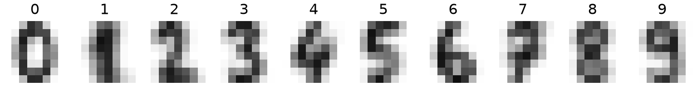

# Tensors, Automatic Differentiation and Training

Code

- [Show All Code](javascript:void(0))
- [Hide All Code](javascript:void(0))

Published

Last modified: 2026-10-28

Show code

``` downlit
# The Python chunks on this page import these; reticulate provisions them.
# Attaching reticulate gives the inline R its `py` object.
library(reticulate)
source("../tools/use-torch.R")
use_torch(c("numpy", "pandas", "matplotlib"))
```

Brian Hutchinson’s CSCI 481/581 sets the order of topics in these notes, which follow it with his permission; his module on the course’s tools is the starting point for this page. The exercises are new, except that the three exercises of the section on training a model adapt questions L.4 to L.8 of his Lab 2 (Winter 2025).

# 1 Welcome

## 1.1 Plan for this lecture

All code in these notes, and in the homework, uses PyTorch [\[1\]](#ref-paszke2019pytorch). This lecture covers the three parts of PyTorch that everything else is built on, on the handwritten digits from the [course overview](../chapters/course-overview.llms.md):

1.  how PyTorch stores the arrays that hold a network’s inputs, [parameters](https://morrison-lab.github.io/lds/chapters/big-ideas.html#def-parameter) and outputs;
2.  how PyTorch computes the derivative of a loss from the code that computes the loss;
3.  how PyTorch packages a model and the loop that fits it.

# 2 Tensors

## 2.1 The digits in PyTorch

> **NOTE:**
>
> **Exercise 1 (The digits in PyTorch)** Load the digits from [`data/optdigits-test.csv`](data/optdigits-test.csv), the local copy of the [UCI data](https://archive.ics.uci.edu/dataset/80) [\[2\]](#ref-alpaydin1998optdigits) that the course overview uses. Put their pixels into one PyTorch array that holds each image as an 8 by 8 grid, and their labels into another.

> **NOTE:**
>
> *Solution 1*.
>
> Show code
>
> ``` python
> import numpy as np
> import pandas as pd
> import torch
> import matplotlib.pyplot as plt
>
> digits = pd.read_csv("data/optdigits-test.csv", header=None)
> pixels = digits.iloc[:, :64].to_numpy()
> images = torch.tensor(pixels.reshape(-1, 8, 8))
> labels = torch.tensor(digits[64].to_numpy())
> n_images = len(images)
> print(images[0])
> ```
>
>     tensor([[ 0,  0,  5, 13,  9,  1,  0,  0],
>             [ 0,  0, 13, 15, 10, 15,  5,  0],
>             [ 0,  3, 15,  2,  0, 11,  8,  0],
>             [ 0,  4, 12,  0,  0,  8,  8,  0],
>             [ 0,  5,  8,  0,  0,  9,  8,  0],
>             [ 0,  4, 11,  0,  1, 12,  7,  0],
>             [ 0,  2, 14,  5, 10, 12,  0,  0],
>             [ 0,  0,  6, 13, 10,  0,  0,  0]])
>
> Show code
>
> ``` python
> print(labels[:10])
> ```
>
>     tensor([0, 1, 2, 3, 4, 5, 6, 7, 8, 9])
>
> `torch.tensor` copies a NumPy array into a PyTorch array. `images` stacks 1797 grids, each with 8 rows and 8 columns, and `labels` holds one number per image.

> **NOTE:**
>
> **Definition 1 (Tensor)** A **tensor** is an array of numbers arranged on a regular grid with any number of dimensions [\[3, Sec. 2.1\]](#ref-goodfellow2016deep). Every entry is picked out by one index per dimension.
>
> A tensor with no dimensions is a scalar, one with one dimension is a vector, and one with two is a matrix. PyTorch says “dimensions” (`ndim`, and `dim=` in its functions), where NumPy, which also says `ndim`, calls them “axes” (`axis=`); other sources say “modes”, or call the number of dimensions the tensor’s “order” or “rank”. That “rank” is not the rank of a matrix. Physics and mathematics use “tensor” for a multilinear map, which an array of numbers represents once a basis is chosen; [deep learning](../chapters/course-overview.llms.md#def-deep-learning) means only the array.

> **NOTE:**
>
> **Example 1 (The digits at three sizes)**  
>
> Show code
>
> ``` python
> print(images.ndim, images[0].ndim, images[0, 3].ndim, images[0, 3, 4].ndim)
> ```
>
>     3 2 1 0
>
> Show code
>
> ``` python
> print(images[0, 3])
> ```
>
>     tensor([ 0,  4, 12,  0,  0,  8,  8,  0])
>
> Show code
>
> ``` python
> print(images[0, 3, 4])
> ```
>
>     tensor(0)
>
> `images` from [Solution 1](#sol-load-tensor) has three dimensions: image, row and column. Indexing it once, as `images[0]`, gives the first image, a matrix; indexing twice, as `images[0, 3]`, gives that image’s row 3, a vector of 8 pixels; and indexing three times, as `images[0, 3, 4]`, gives one pixel, a scalar, with rows and columns counted from 0.

> **NOTE:**
>
> **Definition 2 (Shape)** A [tensor](#def-tensor)’s **shape** lists the size of each of its dimensions, in order. PyTorch reports it as `.shape`, or `.size()`; NumPy also calls it `.shape`.

> **NOTE:**
>
> **Example 2 (The shapes of the digits)**  
>
> Show code
>
> ``` python
> print(images.shape, images[0].shape, images[0, 3].shape, images[0, 3, 4].shape)
> ```
>
>     torch.Size([1797, 8, 8]) torch.Size([8, 8]) torch.Size([8]) torch.Size([])
>
> `images` has [shape](#def-shape) (1797, 8, 8): 1797 images, each with 8 rows and 8 columns. Indexing it drops the dimensions that the index fixes: one image has shape (8, 8), one of its rows has shape (8,), and one pixel has the empty shape ().

## 2.2 The average pixel

> **NOTE:**
>
> **Exercise 2 (The average pixel)** Find the average of the 64 pixels of the first image with the [tensor](#def-tensor) method `.mean()`.

> **NOTE:**
>
> *Solution 2*.
>
> Show code
>
> ``` python
> import textwrap
>
> print(images.dtype)
> ```
>
>     torch.int64
>
> Show code
>
> ``` python
> try:
>     images[0].mean()
> except RuntimeError as err:
>     print(textwrap.fill(str(err), 60))
> ```
>
>     mean(): could not infer output dtype. Input dtype must be
>     either a floating point or complex dtype. Got: Long
>
> Show code
>
> ``` python
> first_mean = images[0].float().mean().item()
> print(images[0].float().dtype, first_mean)
> ```
>
>     torch.float32 4.59375
>
> The pixels were read as whole numbers, so the [tensor](#def-tensor) stores 64-bit integers, `torch.int64`, which PyTorch also calls `Long`. `.mean()` refuses them, since an average of integers is not in general an integer. Converting the tensor with `.float()` to 32-bit floating-point numbers fixes it: the first image’s average pixel is 4.59, on the file’s scale of 0 to 16.

> **NOTE:**
>
> **Definition 3 (Data type)** A [tensor](#def-tensor)’s **data type** (in PyTorch, its `dtype`) is the kind of number that every one of its entries stores, such as 64-bit integers (`torch.int64`) or 32-bit floating-point numbers (`torch.float32`, PyTorch’s default for real numbers). All the entries of one tensor share one data type. PyTorch’s [tensor attributes](https://docs.pytorch.org/docs/stable/tensor_attributes.html) page lists them all.

> **NOTE:**
>
> **Example 3 (Two data types for one image)**  
>
> Show code
>
> ``` python
> pixel_int = images[0, 3, 4]
> pixel_float = pixel_int.float()
> print(pixel_int, pixel_int.dtype)
> ```
>
>     tensor(0) torch.int64
>
> Show code
>
> ``` python
> print(pixel_float, pixel_float.dtype)
> ```
>
>     tensor(0.) torch.float32
>
> Show code
>
> ``` python
> print(pixel_int == pixel_float)
> ```
>
>     tensor(True)
>
> In [Solution 2](#sol-mean-pixel), the first image is `torch.int64` as loaded and `torch.float32` after `.float()`. One of its pixels, printed both ways, shows the difference: the float prints with a decimal point, the two compare as equal, and only the [data type](#def-dtype) that stores the value differs.

## 2.3 Reshaping and averaging

> **NOTE:**
>
> **Exercise 3 (Back to rows of 64)** Turn `images` into a [tensor](#def-tensor) with one row of 64 pixels per image, the arrangement the file stores.

> **NOTE:**
>
> *Solution 3*.
>
> Show code
>
> ``` python
> rows = images.reshape(-1, 64)
> print(rows.shape, torch.equal(rows, torch.tensor(pixels)))
> ```
>
>     torch.Size([1797, 64]) True
>
> `reshape(-1, 64)` asks for rows of 64 and lets PyTorch work out the number of rows, the `-1`. It reads the entries in order, last dimension fastest, so each image’s row 0 comes first, then its row 1, and so on, which undoes the `reshape(-1, 8, 8)` of [Solution 1](#sol-load-tensor). `torch.equal` confirms that the [shapes](#def-shape) and every entry match. The course overview’s [remark on the two arrangements](../chapters/course-overview.llms.md#rem-grid-or-vector) says which models take which.

> **NOTE:**
>
> **Exercise 4 (The average image of each digit)** Compute the average image of each digit, 0 to 9, as one [tensor](#def-tensor) of [shape](#def-shape) (10, 8, 8).

> **NOTE:**
>
> *Solution 4*.
>
> Show code
>
> ``` python
> averages = torch.stack(
>     [images[labels == k].float().mean(dim=0) for k in range(10)]
> )
> print(averages.shape)
> ```
>
>     torch.Size([10, 8, 8])
>
> `labels == k` is a [tensor](#def-tensor) of `True` and `False`, one per image, and indexing `images` with it keeps the images of digit `k`. `.mean(dim=0)` averages over dimension 0, the images, and leaves one average for each row and column. `torch.stack` puts the ten 8 by 8 averages along a new first dimension.

> **NOTE:**
>
> **Exercise 5 (Drawing the averages)** Draw the ten averages from [Exercise 4](#exr-average-digit) side by side.

> **NOTE:**
>
> *Solution 5*.
>
> > **NOTE:**
> >
> > Show code
> >
> > ``` python
> > def draw_digits(grids):
> >     """Draw each 8 by 8 grid in `grids` side by side, titled by its index."""
> >     fig, axes = plt.subplots(1, len(grids), figsize=(8, 1.2), layout="constrained")
> >     for k, ax in enumerate(axes):
> >         ax.imshow(grids[k], cmap="gray_r", vmin=0, vmax=16)
> >         ax.set_title(str(k))
> >         ax.set_axis_off()
> >     plt.show()
> >
> > draw_digits(averages)
> > ```
> >
> > [](pytorch-basics_files/figure-html/unnamed-chunk-9-1.png "Figure 1: The average image of each digit among the 1797 images.")
> >
> > Figure 1: The average image of each digit among the 1797 images.
>
> `imshow` draws each 8 by 8 average as a grid of gray squares, on the file’s scale of 0 (white) to 16 (black).

## 2.4 Tensors of different shapes

> **NOTE:**
>
> **Exercise 6 (Centering the images)** Subtract the average of all the images from each image, without a loop.

> **NOTE:**
>
> *Solution 6*.
>
> Show code
>
> ``` python
> mean_image = images.float().mean(dim=0)
> centered = images.float() - mean_image
> largest_mean = centered.mean(dim=0).abs().max().item()
> print(images.shape, mean_image.shape, centered.shape)
> ```
>
>     torch.Size([1797, 8, 8]) torch.Size([8, 8]) torch.Size([1797, 8, 8])
>
> Show code
>
> ``` python
> print(largest_mean)
> ```
>
>     5.816511361445009e-07
>
> `mean_image` has [shape](#def-shape) (8, 8), and `images` has shape (1797, 8, 8), yet PyTorch subtracts one from the other. It uses the one average image for every image, as if `mean_image` had been copied 1797 times along a new first dimension, without making the copies. Each pixel of `centered` now averages to 0 over the images, to within 5.8e-07, a floating-point rounding error.

> **NOTE:**
>
> **Definition 4 (Broadcasting)** **Broadcasting** is how an elementwise operation such as `+`, `-`, `*` or `/` combines two [tensors](#def-tensor) of different [shapes](#def-shape) [\[3, Sec. 2.1\]](#ref-goodfellow2016deep). Line the two shapes up from their last dimension backwards, and treat a dimension that one [tensor](#def-tensor) lacks at the front as having size 1. The shapes are compatible when, in every dimension, the two sizes are equal or one of them is 1. In each dimension, the result takes the size that is not 1, or the common size when the two are equal. A tensor with size 1 in a dimension uses its one entry along the whole of it. When the shapes are not compatible, PyTorch raises an error. PyTorch’s [broadcasting semantics](https://docs.pytorch.org/docs/stable/notes/broadcasting.html) page states the same rule, which PyTorch takes from NumPy.

> **NOTE:**
>
> **Example 4 (Broadcasting the average image)**  
>
> Show code
>
> ``` python
> print(torch.broadcast_shapes(images.shape, mean_image.shape))
> ```
>
>     torch.Size([1797, 8, 8])
>
> Show code
>
> ``` python
> print(torch.broadcast_shapes(images.shape, mean_image[0].shape))
> ```
>
>     torch.Size([1797, 8, 8])
>
> Show code
>
> ``` python
> print(torch.broadcast_shapes(images.shape, (len(images), 1, 1)))
> ```
>
>     torch.Size([1797, 8, 8])
>
> In [Solution 6](#sol-center-images), the [shapes](#def-shape) (1797, 8, 8) and (8, 8) line up as 8 with 8, 8 with 8, and 1797 with a missing dimension, which counts as 1. So the result has [shape](#def-shape) (1797, 8, 8). A single row of the average image, of shape (8,), is also compatible: it is used for every row of every image. So is a shape of (1797, 1, 1), one number per image, which is used for every pixel of its image. `torch.broadcast_shapes` applies the rule to shapes alone, without any data.

> **NOTE:**
>
> **Exercise 7 (Scaling each image)** Divide each image by its own largest pixel, so that the largest pixel of every image is 1.

> **NOTE:**
>
> *Solution 7*.
>
> Show code
>
> ``` python
> largest = images.float().amax(dim=(1, 2))
> try:
>     images.float() / largest
> except RuntimeError as err:
>     print(textwrap.fill(str(err), 60))
> ```
>
>     The size of tensor a (8) must match the size of tensor b
>     (1797) at non-singleton dimension 2
>
> Show code
>
> ``` python
> largest = images.float().amax(dim=(1, 2), keepdim=True)
> scaled = images.float() / largest
> all_ones = bool((scaled.amax(dim=(1, 2)) == 1).all())
> print(largest.shape, scaled.shape, all_ones)
> ```
>
>     torch.Size([1797, 1, 1]) torch.Size([1797, 8, 8]) True
>
> `.amax(dim=(1, 2))` takes the largest pixel over each image’s rows and columns, giving one number per image, a [tensor](#def-tensor) of [shape](#def-shape) (1797,). Dividing by it fails. By [Definition 4](#def-broadcasting), the last dimensions line up first, and they are 8 and 1797. These sizes differ, and neither is 1. `keepdim=True` makes `.amax` keep the two dimensions it reduced, with size 1. So the largest pixels have shape (1797, 1, 1), and that shape broadcasts against (1797, 8, 8) as in [Example 4](#exm-broadcasting). Every scaled image has 1 as its largest pixel.

## 2.5 Tensors and NumPy arrays

> **NOTE:**
>
> **Exercise 8 (A tensor that shares its array)** [`torch.from_numpy`](https://docs.pytorch.org/docs/stable/generated/torch.from_numpy.html) also makes a [tensor](#def-tensor) from a NumPy array. Make one this way from a copy of `pixels`, change an entry of the tensor, and look at the same entry of the array.

> **NOTE:**
>
> *Solution 8*.
>
> Show code
>
> ``` python
> shared_array = pixels.copy()
> shared = torch.from_numpy(shared_array)
> shared[0, 0] = 99
> print(pixels[0, 0], shared_array[0, 0])
> ```
>
>     0 99
>
> The [tensor](#def-tensor) from `torch.from_numpy` uses the array’s own memory, so changing the tensor changed the array, from 0 to 99. The tensor method `.numpy()` shares memory the same way, in the other direction.

> **NOTE:**
>
> **Exercise 9 (A tensor that copies its array)** Repeat [Exercise 8](#exr-shared-memory) with `torch.tensor` in place of `torch.from_numpy`.

> **NOTE:**
>
> *Solution 9*.
>
> Show code
>
> ``` python
> copied_array = pixels.copy()
> copied = torch.tensor(copied_array)
> copied[0, 0] = 99
> copied_entry = copied[0, 0].item()
> print(copied_array[0, 0], copied_entry)
> ```
>
>     0 99
>
> `torch.tensor` copies the numbers, so the array kept 0 while the [tensor](#def-tensor) changed to 99. Sharing, as in [Solution 8](#sol-shared-memory), saves time and memory on large data, at the cost of a change in one place showing up in the other.

## 2.6 Devices

> **NOTE:**
>
> **Definition 5 (Device)** A [tensor](#def-tensor)’s **device** is the processor whose memory holds its entries, and on which operations on the tensor run: the CPU, or a GPU (in PyTorch, `"cuda"` for an NVIDIA GPU). PyTorch makes a tensor on the CPU unless told otherwise, `.to()` copies a tensor to another device, and an operation on two [tensors](#def-tensor) needs both on the same device.

> **NOTE:**
>
> **Example 5 (Where the digits live)**  
>
> Show code
>
> ``` python
> has_gpu = torch.cuda.is_available()
> print(images.device, has_gpu)
> ```
>
>     cpu False
>
> `images` was made without naming a [device](#def-device), so it lives on the CPU. `torch.cuda.is_available()` says whether this computer has an NVIDIA GPU that PyTorch can use; it returned `False` on the computer that built this page. Where it returns `True`, `images.to("cuda")` makes a copy of `images` on the GPU.

> **NOTE:**
>
> PyTorch’s [tensors tutorial](https://docs.pytorch.org/tutorials/beginner/basics/tensorqs_tutorial.html) shows more ways to make, index and combine tensors. Its notes on [broadcasting](https://docs.pytorch.org/docs/stable/notes/broadcasting.html) give the rules for an operation on two tensors of different [shapes](#def-shape).

# 3 Automatic differentiation

## 3.1 The soft 0-or-1 rule

The rest of this page differentiates the [soft 0-or-1 rule](../chapters/ml-review.llms.md#exr-log-loss-curve) of the [machine learning review](../chapters/ml-review.llms.md). Among the images of 0s and 1s, it gives each image the probability \\\hprob = \sigmoidf{\predvar - \param}\\ of being a 1, where \\\predvar\\ is the image’s [center ink](../chapters/course-overview.llms.md#sol-zero-or-one), its average pixel over rows 2 to 5 and columns 3 and 4, and \\\param\\ is the rule’s cutoff. Its mean [log loss](https://morrison-lab.github.io/lds/chapters/logistic-regression.html#def-log-loss) over those \\\nobs\\ images, its [empirical risk](https://morrison-lab.github.io/lds/chapters/big-ideas.html#def-empirical-risk) under that loss, is

\\ \empriskf{\param} = -\avgin \sb{\outvar_i \log \hprob_i + (1 - \outvar_i) \log (1 - \hprob_i)}, \\

where \\\outvar_i\\ is 1 if image \\i\\ is a 1 and 0 if it is a 0.

> **NOTE:**
>
> **Exercise 10 (The data for the soft rule)** From `images` and `labels`, make a [tensor](#def-tensor) of the center ink \\\predvar_i\\ of each image of a 0 or a 1, stored as 64-bit floating-point numbers, and a tensor of the matching \\\outvar_i\\.

> **NOTE:**
>
> *Solution 10*.
>
> Show code
>
> ``` python
> center_ink = images[:, 2:6, 3:5].double().mean(dim=(1, 2))
> is_01 = (labels == 0) | (labels == 1)
> ink_01 = center_ink[is_01]
> is_one = (labels[is_01] == 1).double()
> n_01 = len(ink_01)
> print(n_01)
> ```
>
>     360
>
> Show code
>
> ``` python
> print(ink_01[:5])
> ```
>
>     tensor([ 0.3750, 15.8750,  3.0000, 14.1250,  2.5000], dtype=torch.float64)
>
> Show code
>
> ``` python
> print(is_one[:5])
> ```
>
>     tensor([0., 1., 0., 1., 0.], dtype=torch.float64)
>
> `images[:, 2:6, 3:5]` keeps rows 2 to 5 and columns 3 and 4 of every image, and `.mean(dim=(1, 2))` averages over those rows and columns, leaving one number per image. `.double()` converts to 64-bit floats, `torch.float64`, so that later comparisons of derivatives are not limited by 32-bit rounding. There are \\\nobs\\ = 360 images of 0s and 1s.

## 3.2 The slope by hand

> **NOTE:**
>
> **Exercise 11 (The slope of the log loss)** Find the derivative \\\dif{\emprisk}{\param}\\ of the mean [log loss](https://morrison-lab.github.io/lds/chapters/logistic-regression.html#def-log-loss) with respect to the cutoff.
>
> > **TIP:**
> >
> > The [logistic function](https://morrison-lab.github.io/lds/chapters/logistic-regression.html#exm-logistic-function) has derivative \\\sigmoid'(z) = \sigmoidf{z}\paren{1 - \sigmoidf{z}}\\ ([lds](https://morrison-lab.github.io/lds/chapters/logistic-regression.html#thm-logistic-derivative)).

> **NOTE:**
>
> *Solution 11*. Write \\\obsloss{i}\\ for image \\i\\’s [log loss](https://morrison-lab.github.io/lds/chapters/logistic-regression.html#def-log-loss), \\\obsloss{i} = -\outvar_i \log \hprob_i - (1 - \outvar_i) \log (1 - \hprob_i)\\. Its derivative with respect to \\\hprob_i\\ is
>
> \\ \dif{\obsloss{i}}{\hprob_i} = -\frac{\outvar_i}{\hprob_i} + \frac{1 - \outvar_i}{1 - \hprob_i}. \\
>
> Since \\\hprob_i = \sigmoidf{\predvar_i - \param}\\, the chain rule and the derivative of the logistic function give
>
> \\ \begin{aligned} \dif{\hprob_i}{\param} &= \sigmoid'(\predvar_i - \param) \cdot \dif{}{\param} (\predvar_i - \param) \\ &= \hprob_i (1 - \hprob_i) \cdot (-1) \\ &= -\hprob_i (1 - \hprob_i). \end{aligned} \\
>
> Multiplying the two,
>
> \\ \begin{aligned} \dif{\obsloss{i}}{\param} &= \dif{\obsloss{i}}{\hprob_i} \cdot \dif{\hprob_i}{\param} \\ &= \paren{-\frac{\outvar_i}{\hprob_i} + \frac{1 - \outvar_i}{1 - \hprob_i}} \cdot \paren{-\hprob_i (1 - \hprob_i)} \\ &= \outvar_i (1 - \hprob_i) - (1 - \outvar_i) \hprob_i \\ &= \outvar_i - \outvar_i \hprob_i - \hprob_i + \outvar_i \hprob_i \\ &= \outvar_i - \hprob_i. \end{aligned} \\
>
> \\\emprisk\\ is the mean of the \\\obsloss{i}\\, so its derivative is the mean of theirs:
>
> \\ \dif{\emprisk}{\param} = \avgin (\outvar_i - \hprob_i). \\

> **NOTE:**
>
> **Theorem 1 (The slope of the soft rule’s log loss)** The mean [log loss](https://morrison-lab.github.io/lds/chapters/logistic-regression.html#def-log-loss) \\\emprisk\\ of the [soft 0-or-1 rule](../chapters/ml-review.llms.md#exr-log-loss-curve) has derivative
>
> \\ \dif{\emprisk}{\param} = \avgin (\outvar_i - \hprob_i) \\
>
> with respect to its cutoff \\\param\\.

> **NOTE:**
>
> *Proof*. By [Solution 11](#sol-log-loss-slope). The rule is a [logistic regression](https://morrison-lab.github.io/lds/chapters/logistic-regression.html#def-logistic-regression) whose coefficient on \\\predvar\\ is fixed at 1 and whose intercept is \\-\param\\, so the formula is also the negative of the intercept component of [lds’s gradient of the log loss](https://morrison-lab.github.io/lds/chapters/logistic-regression.html#thm-logistic-gradient), divided by \\\nobs\\ to give the mean.

> **NOTE:**
>
> **Example 6 (The slope at a cutoff of 5)**  
>
> Show code
>
> ``` python
> x_np, y_np = ink_01.numpy(), is_one.numpy()
> p_np = 1 / (1 + np.exp(-(x_np - 5)))
> share_of_ones = np.mean(y_np)
> mean_prob_at_5 = np.mean(p_np)
> slope_by_hand = share_of_ones - mean_prob_at_5
> print(share_of_ones, mean_prob_at_5, slope_by_hand)
> ```
>
>     0.5055555555555555 0.5473628863066621 -0.04180733075110654
>
> By [Theorem 1](#thm-log-loss-slope), the slope is the share of 1s among the images minus the average probability the rule gives them. The 1s make up a share of 0.506 of the 360 images, and at \\\param = 5\\ the rule’s average probability of a 1 is 0.547. So the slope at \\\param = 5\\ is -0.0418. It is negative, so raising the cutoff from 5 lowers the [log loss](https://morrison-lab.github.io/lds/chapters/logistic-regression.html#def-log-loss). The slope is 0 at the cutoff where the average probability equals the share of 1s.

## 3.3 The slope by autograd

> **NOTE:**
>
> **Exercise 12 (Asking PyTorch for the slope)** Write a function that computes \\\empriskf{\param}\\ with PyTorch operations. Make \\\param = 5\\ a [tensor](#def-tensor) created with `requires_grad=True`, compute \\\empriskf{5}\\, and pass both to [`torch.autograd.grad`](https://docs.pytorch.org/docs/stable/generated/torch.autograd.grad.html).

> **NOTE:**
>
> *Solution 12*.
>
> Show code
>
> ``` python
> def mean_log_loss(theta):
>     """Mean log loss of the soft 0-or-1 rule with cutoff `theta`."""
>     p = torch.sigmoid(ink_01 - theta)
>     return -torch.mean(is_one * torch.log(p) + (1 - is_one) * torch.log(1 - p))
>
> theta = torch.tensor(5.0, dtype=torch.float64, requires_grad=True)
> loss = mean_log_loss(theta)
> (slope_by_autograd,) = torch.autograd.grad(loss, theta)
> print(loss)
> ```
>
>     tensor(0.0853, dtype=torch.float64, grad_fn=<NegBackward0>)
>
> Show code
>
> ``` python
> print(slope_by_autograd)
> ```
>
>     tensor(-0.0418, dtype=torch.float64)
>
> `torch.autograd.grad` returns -0.0418. The code for \\\emprisk\\ says nothing about its derivative. Because `theta` was made with `requires_grad=True`, PyTorch recorded each operation that turned it into `loss` (the subtraction `ink_01 - theta`, the logistic function, and each operation after them, down to the mean and its change of sign), and `torch.autograd.grad` applied the chain rule to those operations, one at a time. The `grad_fn` that `loss` prints is the record of its last operation.

> **NOTE:**
>
> **Exercise 13 (Checking PyTorch’s slope)** How far is the slope from [Exercise 12](#exr-autograd-slope) from the slope computed by hand in [Example 6](#exm-log-loss-slope)?

> **NOTE:**
>
> *Solution 13*.
>
> Show code
>
> ``` python
> slope_gap = abs(slope_by_autograd.item() - slope_by_hand)
> print(slope_by_autograd.item(), slope_by_hand, slope_gap)
> ```
>
>     -0.04180733075110652 -0.04180733075110654 2.0816681711721685e-17
>
> The two slopes differ by 2.1e-17, a floating-point rounding error: both are -0.0418 to four decimal places.

> **NOTE:**
>
> **Definition 6 (Automatic differentiation (autodiff))** **Automatic differentiation**, also called **autodiff**, computes the derivatives of a function that is given as code, by applying the chain rule to the elementary operations the code performs as it runs [\[1\]](#ref-paszke2019pytorch), [\[3, Sec. 6.5\]](#ref-goodfellow2016deep).
>
> PyTorch implements it in its `torch.autograd` module. The result is the exact derivative of the operations the code performs, up to floating-point rounding. Automatic differentiation is neither symbolic differentiation, which manipulates a formula for the function, nor numerical differentiation, which approximates a derivative from the function’s values at nearby points. lds’s [backpropagation](https://morrison-lab.github.io/lds/chapters/backpropagation.html) chapter derives by hand the derivatives that autodiff computes for a neural network.

> **NOTE:**
>
> **Example 7 (The cutoff’s slope by autodiff)** [Solution 12](#sol-autograd-slope) is [automatic differentiation](#def-automatic-differentiation): PyTorch was given only the code for \\\emprisk\\, and returned its derivative at \\\param = 5\\, which matches the formula of [Theorem 1](#thm-log-loss-slope) to within 2.1e-17, as [Solution 13](#sol-autograd-vs-hand) found.

## 3.4 Gradient descent with autograd

> **NOTE:**
>
> **Exercise 14 (Finding the cutoff by gradient descent)** Run 100 steps of [gradient descent](https://morrison-lab.github.io/lds/chapters/gradient-descent.html#the-algorithm) on \\\emprisk\\, starting from \\\param = 0\\ with learning rate \\\learnrate = 4\\, with each step’s derivative from `torch.autograd.grad`. Where does \\\param\\ end up?

> **NOTE:**
>
> *Solution 14*.
>
> Show code
>
> ``` python
> learning_rate = 4.0
> theta = torch.tensor(0.0, dtype=torch.float64, requires_grad=True)
> for step in range(100):
>     (slope,) = torch.autograd.grad(mean_log_loss(theta), theta)
>     with torch.no_grad():
>         theta -= learning_rate * slope
> theta_descent = theta.item()
> (final_slope,) = torch.autograd.grad(mean_log_loss(theta), theta)
> print(theta_descent, final_slope.item())
> ```
>
>     6.59960743783184 -6.833215346312323e-06
>
> [Gradient descent](https://morrison-lab.github.io/lds/chapters/gradient-descent.html#the-algorithm) ends at \\\param\\ = 6.5996, where the slope is -6.8e-06.
>
> The update runs inside `torch.no_grad()`, which tells PyTorch not to record it: the step is a change to \\\param\\, not part of the loss. Without it, PyTorch would record the in-place subtraction on `theta`, and it raises an error for a recorded in-place change to a [tensor](#def-tensor) that was created with `requires_grad=True`.

> **NOTE:**
>
> **Exercise 15 (Gradient descent and the grid)** How far is the cutoff from [Exercise 14](#exr-autograd-descent) from the lowest point on the grid of cutoffs in the [machine learning review](../chapters/ml-review.llms.md#sol-smooth-loss)?

> **NOTE:**
>
> *Solution 15*.
>
> Show code
>
> ``` python
> cutoffs = np.arange(0, 16.005, 0.01)
> grid_step = cutoffs[1] - cutoffs[0]
> with torch.no_grad():
>     grid_loss = [mean_log_loss(torch.tensor(c)).item() for c in cutoffs]
> theta_grid = cutoffs[np.argmin(grid_loss)]
> gap = abs(theta_descent - theta_grid)
> print(theta_grid, gap)
> ```
>
>     6.6000000000000005 0.00039256216816063727
>
> The grid’s lowest point is at 6.60, the cutoff found in [the review’s solution](../chapters/ml-review.llms.md#sol-smooth-loss). It differs from the cutoff found by [gradient descent](https://morrison-lab.github.io/lds/chapters/gradient-descent.html#the-algorithm) by 0.0004, less than the grid’s spacing of 0.01.

# 4 Training a model

## 4.1 The soft rule as a PyTorch model

> **NOTE:**
>
> **Exercise 16 (The soft rule as a PyTorch model)** Write the [soft 0-or-1 rule](../chapters/ml-review.llms.md#exr-log-loss-curve) as a subclass of PyTorch’s `nn.Module` whose cutoff is an `nn.Parameter` that starts at 0.

> **NOTE:**
>
> *Solution 16*.
>
> Show code
>
> ``` python
> from torch import nn
>
>
> class SoftRule(nn.Module):
>     """The soft 0-or-1 rule, with its cutoff as a parameter."""
>
>     def __init__(self):
>         super().__init__()
>         self.cutoff = nn.Parameter(torch.tensor(0.0, dtype=torch.float64))
>
>     def forward(self, ink):
>         return torch.sigmoid(ink - self.cutoff)
>
>
> rule = SoftRule()
> print(list(rule.parameters()))
> ```
>
>     [Parameter containing:
>     tensor(0., dtype=torch.float64, requires_grad=True)]
>
> - `__init__` runs `nn.Module`’s own setup, then creates the cutoff. Assigning an `nn.Parameter`, a wrapped [tensor](#def-tensor), to an attribute of the module registers it, so `rule.parameters()` returns it, as the printout shows. An `nn.Parameter` is created with `requires_grad=True`.
> - `forward` computes the probability of a 1 for each image’s center ink. Calling the module, as `rule(ink_01)`, runs `forward`.

> **NOTE:**
>
> **Exercise 17 (Training the soft rule with an optimizer)** Train a `SoftRule` from [Solution 16](#sol-soft-rule-module) with `torch.optim.SGD`, using the start, learning rate and number of steps of [Exercise 14](#exr-autograd-descent).

> **NOTE:**
>
> *Solution 17*.
>
> Show code
>
> ``` python
> rule = SoftRule()
> optimizer = torch.optim.SGD(rule.parameters(), lr=learning_rate)
> for step in range(100):
>     optimizer.zero_grad()
>     loss = nn.functional.binary_cross_entropy(rule(ink_01), is_one)
>     loss.backward()
>     optimizer.step()
> theta_module = rule.cutoff.item()
> module_gap = abs(theta_module - theta_descent)
> print(theta_module, module_gap)
> ```
>
>     6.59960743783184 0.0
>
> The trained `SoftRule` has its cutoff at 6.5996, where the loop of [Solution 14](#sol-autograd-descent) ended, exactly. The code splits that loop into the parts that `torch.optim` expects:
>
> - [`nn.functional.binary_cross_entropy`](https://docs.pytorch.org/docs/stable/generated/torch.nn.functional.binary_cross_entropy.html) computes the mean [log loss](https://morrison-lab.github.io/lds/chapters/logistic-regression.html#def-log-loss), \\\emprisk\\, from the probabilities and the 0-or-1 labels.
> - `optimizer.zero_grad()` clears the gradient stored from the previous step.
> - `loss.backward()` computes the derivative of the loss with respect to the cutoff, as `torch.autograd.grad` did, but stores it in the cutoff’s `.grad` instead of returning it.
> - `optimizer.step()` moves the cutoff by minus the learning rate times its `.grad`, the update that [Solution 14](#sol-autograd-descent) ran inside `torch.no_grad()`.

> **NOTE:**
>
> **Definition 7 (Training step)** A **training step** in PyTorch updates a model’s [parameters](https://morrison-lab.github.io/lds/chapters/big-ideas.html#def-parameter) once, in four stages:
>
> 1.  `optimizer.zero_grad()` clears the gradient stored in each [parameter](https://morrison-lab.github.io/lds/chapters/big-ideas.html#def-parameter)’s `.grad`;
> 2.  calling the model, and then the [loss function](https://morrison-lab.github.io/lds/chapters/big-ideas.html#def-loss-function), computes the loss on a batch of data;
> 3.  `loss.backward()` computes the gradient of the loss with respect to each parameter, by [automatic differentiation](#def-automatic-differentiation), and adds it to that parameter’s `.grad`;
> 4.  `optimizer.step()` updates each parameter using its `.grad`, by the rule of the optimizer, such as [gradient descent](https://morrison-lab.github.io/lds/chapters/gradient-descent.html#the-algorithm) for `torch.optim.SGD`.
>
> Training repeats the step, over the whole [training set](https://morrison-lab.github.io/lds/chapters/big-ideas.html#def-training-set) or over one batch of it at a time.

> **NOTE:**
>
> **Example 8 (One step of the soft rule)**  
>
> Show code
>
> ``` python
> one_rule = SoftRule()
> one_optimizer = torch.optim.SGD(one_rule.parameters(), lr=learning_rate)
> grad_at_start = one_rule.cutoff.grad
> one_optimizer.zero_grad()
> one_loss = nn.functional.binary_cross_entropy(one_rule(ink_01), is_one)
> one_loss.backward()
> grad_after_backward = one_rule.cutoff.grad.item()
> one_optimizer.step()
> cutoff_after_step = one_rule.cutoff.item()
> print(grad_at_start, grad_after_backward, cutoff_after_step)
> ```
>
>     None -0.3759104821764343 1.5036419287057372
>
> The code runs the first [training step](#def-training-step) of [Solution 17](#sol-train-soft-rule) one call at a time. A new [parameter](https://morrison-lab.github.io/lds/chapters/big-ideas.html#def-parameter) has no stored gradient, so its `.grad` is `None`. After `loss.backward()`, the cutoff’s `.grad` holds the slope of \\\emprisk\\ at \\\param = 0\\, -0.3759. Then `optimizer.step()` moves the cutoff from 0 to \\0 - 4 \times (-0.3759) = 1.5036\\.

## 4.2 Leaving out `zero_grad`

> **NOTE:**
>
> **Exercise 18 (Leaving out `zero_grad`)** What happens to the cutoff of a new `SoftRule` trained as in [Solution 17](#sol-train-soft-rule), but without the call to `optimizer.zero_grad()`?

> **NOTE:**
>
> *Solution 18*.
>
> Show code
>
> ``` python
> stale_rule = SoftRule()
> stale_optimizer = torch.optim.SGD(stale_rule.parameters(), lr=learning_rate)
> stale_grads, stale_cutoffs = [], []
> for step in range(100):
>     loss = nn.functional.binary_cross_entropy(stale_rule(ink_01), is_one)
>     loss.backward()
>     stale_grads.append(stale_rule.cutoff.grad.item())
>     stale_optimizer.step()
>     stale_cutoffs.append(stale_rule.cutoff.item())
> theta_stale = stale_cutoffs[-1]
> sides = np.sign(np.array(stale_cutoffs) - theta_module)
> n_crossings = int(np.sum(sides[1:] != sides[:-1]))
> # Steps taken from a cutoff already past theta_module with a summed gradient
> # that is still negative, so the step moves the cutoff further past it.
> cutoffs_before = np.array([0.0] + stale_cutoffs[:-1])
> n_overshoot = int(np.sum((cutoffs_before > theta_module) & (np.array(stale_grads) < 0)))
> print(theta_stale, stale_grads[:2], min(stale_cutoffs), max(stale_cutoffs))
> ```
>
>     13.715047620391509 [-0.3759104821764343, -0.619865330559432] -0.20192185662741569 14.864360430182934
>
> Show code
>
> ``` python
> print(n_crossings, n_overshoot)
> ```
>
>     13 26
>
> The cutoff ends at 13.7150, not at 6.5996. `loss.backward()` adds each new gradient to the one already in `.grad`. So without `optimizer.zero_grad()`, the gradient used at each step is the sum of the gradients of every step so far. The first step is the same as in [Example 8](#exm-training-step), with `.grad` at -0.3759. At the second step, `.grad` is -0.6199, the first step’s gradient plus the second’s. At 26 of the 100 steps, the cutoff was already past 6.5996, the lowest point of \\\emprisk\\, and the summed gradient was still negative, so the step moved the cutoff further past it. The cutoff overshoots and swings back. Over the 100 steps, it ranges from -0.20 to 14.86 and crosses 6.5996 13 times. PyTorch adds rather than replaces so that a gradient can be built up over several backward passes, for example over pieces of a batch too large to fit in memory at once.

# References

\[1\]

A. Paszke *et al.*, “PyTorch: An imperative style, high-performance deep learning library,” in *Advances in neural information processing systems*, 2019. Available: <https://arxiv.org/abs/1912.01703>

\[2\]

E. Alpaydin and C. Kaynak, “Optical recognition of handwritten digits.” UCI Machine Learning Repository, 1998. doi: [10.24432/C50P49](https://doi.org/10.24432/C50P49).

\[3\]

I. Goodfellow, Y. Bengio, and A. Courville, *Deep learning*. MIT Press, 2016. Available: <https://www.deeplearningbook.org/>

Back to top
