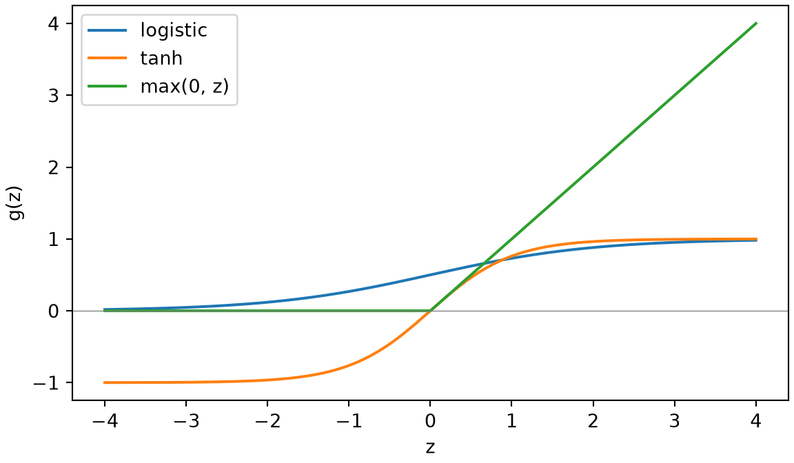
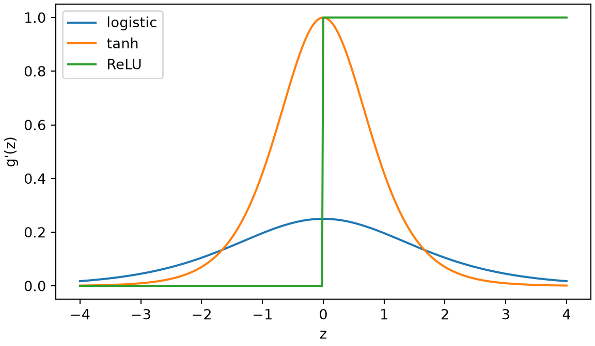
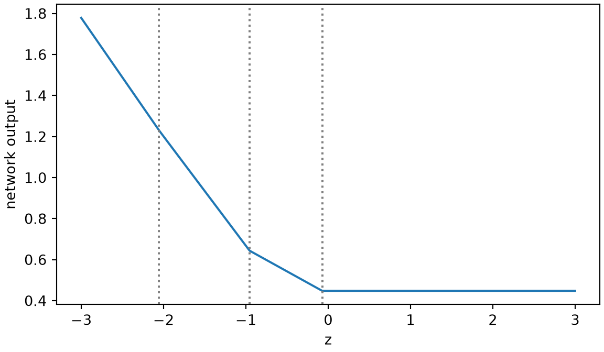
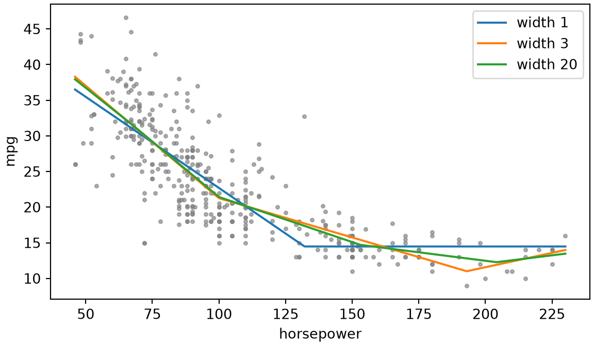

# Feedforward Networks

Code

- [Show All Code](javascript:void(0))
- [Hide All Code](javascript:void(0))

Published

Last modified: 2026-10-29

Show code

``` downlit
# The Python chunks on this page import these; reticulate provisions them.
# Attaching reticulate gives the inline R its `py` object.
library(reticulate)
source("../tools/use-torch.R")
use_torch(c("numpy", "pandas", "matplotlib"))
```

Brian Hutchinson’s CSCI 481/581 sets the order of topics in these notes, which follow it with his permission; this page covers the layered networks of his module on [machine learning](https://morrison-lab.github.io/lds/chapters/course-overview.html#def-machine-learning) fundamentals. The exercises are new. The output units and universal approximation follow *Deep Learning*, Chapter 6 [\[1\]](#ref-goodfellow2016deep).

# 1 Welcome

## 1.1 Plan for this lecture

[The PyTorch chapter](../chapters/pytorch-basics.llms.md) fit the [soft 0-or-1 rule](../chapters/pytorch-basics.llms.md#sol-soft-rule-module), a model with one [parameter](https://morrison-lab.github.io/lds/chapters/big-ideas.html#def-parameter). This lecture builds models that learn their own [features](https://morrison-lab.github.io/lds/chapters/anatomy.html#def-feature) of the digits:

1.  what a stack of linear layers can and cannot compute, and what a function applied between the layers changes;
2.  how a network turns its last layer’s numbers into class probabilities and a loss, and how PyTorch computes that loss without overflowing;
3.  how much a network with one layer of learned [features](https://morrison-lab.github.io/lds/chapters/anatomy.html#def-feature) can represent.

## 1.2 The digits as tensors

Show code

``` python
import numpy as np
import pandas as pd
import torch
from torch import nn
import matplotlib.pyplot as plt

_ = torch.manual_seed(481)
digits = pd.read_csv("data/optdigits-test.csv", header=None)
x = torch.tensor(digits.iloc[:, :64].to_numpy(), dtype=torch.float32) / 16
y = torch.tensor(digits[64].to_numpy())
n_train = 1200
order = torch.randperm(len(x))
x_train, y_train = x[order[:n_train]], y[order[:n_train]]
x_test, y_test = x[order[n_train:]], y[order[n_train:]]
n_test = len(x_test)
print(x_train.shape, x_test.shape)
```

    torch.Size([1200, 64]) torch.Size([597, 64])

The exercises use the 1,797 handwritten digits from the [course overview](../chapters/course-overview.llms.md), from the same local copy, [`data/optdigits-test.csv`](data/optdigits-test.csv), of the UCI Machine Learning Repository’s data [\[2\]](#ref-alpaydin1998optdigits). Each image’s 64 pixels, from 0 to 16, are divided by 16 so that they run from 0 to 1, and a random 1,200 images form a [training set](https://morrison-lab.github.io/lds/chapters/big-ideas.html#def-training-set), with the other images as a [test set](https://morrison-lab.github.io/lds/chapters/big-ideas.html#def-test-set).

# 2 Layers

## 2.1 Two layers with nothing between them

> **NOTE:**
>
> **Exercise 1 (Two layers with nothing between them)** A layer `first = nn.Linear(64, 32)` maps a digit’s 64 pixels \\\vx\\ to 32 numbers \\\matr{W}\_1 \vx + \vecf{b}\_1\\, and a layer `second = nn.Linear(32, 10)` maps 32 numbers \\\vecf{u}\\ to 10 numbers \\\matr{W}\_2 \vecf{u} + \vecf{b}\_2\\. What kind of function of \\\vx\\ does the stack `second(first(x))` compute?

> **NOTE:**
>
> *Solution 1*. Substituting the first layer into the second,
>
> \\ \begin{aligned} \matr{W}\_2 \paren{\matr{W}\_1 \vx + \vecf{b}\_1} + \vecf{b}\_2 &= \matr{W}\_2 \matr{W}\_1 \vx + \matr{W}\_2 \vecf{b}\_1 + \vecf{b}\_2 && \text{(distribute \$\matr{W}\_2\$)} \\ &= \underbrace{\paren{\matr{W}\_2 \matr{W}\_1}}\_{10 \times 64} \vx + \underbrace{\paren{\matr{W}\_2 \vecf{b}\_1 + \vecf{b}\_2}}\_{10 \times 1} && \text{(group the terms that do not involve \$\vx\$)} \end{aligned} \\
>
> So the stack is an [affine function](https://morrison-lab.github.io/lds/chapters/linear-regression.html#def-affine-function) of \\\vx\\, the same kind of function as one `nn.Linear(64, 10)`, with weight matrix \\\matr{W}\_2 \matr{W}\_1\\ and bias \\\matr{W}\_2 \vecf{b}\_1 + \vecf{b}\_2\\. The 32 numbers in the middle add nothing that one layer could not compute.
>
> Show code
>
> ``` python
> first = nn.Linear(64, 32)
> second = nn.Linear(32, 10)
> weight = second.weight @ first.weight
> bias = second.weight @ first.bias + second.bias
> stacked = second(first(x_test))
> one_layer = x_test @ weight.T + bias
> stack_gap = (stacked - one_layer).abs().max().item()
> print(weight.shape, bias.shape, stack_gap)
> ```
>
>     torch.Size([10, 64]) torch.Size([10]) 1.4901161193847656e-07
>
> On the 597 test images, the stack and the single layer agree to within 1.5e-07, a rounding error. `nn.Linear` stores \\\matr{W}\\ with one row per output, and computes `x @ weight.T + bias` for a [tensor](../chapters/pytorch-basics.llms.md#def-tensor) `x` with one row per image.

## 2.2 A function between the layers

> **NOTE:**
>
> **Exercise 2 (A function between the layers)** Suppose the [logistic function](https://morrison-lab.github.io/mds/functions.html#def-logistic-function), \\\sigmoidf{z} = 1 / \paren{1 + \e{-z}}\\, is applied to each of the 32 numbers between the two layers of [Exercise 1](#exr-two-linear), giving `second(torch.sigmoid(first(x)))`. Is that stack still an [affine function](https://morrison-lab.github.io/lds/chapters/linear-regression.html#def-affine-function) of \\\vx\\?
>
> > **TIP:**
> >
> > An [affine function](https://morrison-lab.github.io/lds/chapters/linear-regression.html#def-affine-function) \\f\\ maps the midpoint of two inputs to the midpoint of their outputs: \\f\paren{\frac{1}{2}(\vx + \vx')} = \frac{1}{2}\paren{f(\vx) + f(\vx')}\\. Try two digits.

> **NOTE:**
>
> *Solution 2*.
>
> Show code
>
> ``` python
> def midpoint_gap(f, a, b):
>     # Largest gap between f at the midpoint and the midpoint of f.
>     return (f((a + b) / 2) - (f(a) + f(b)) / 2).abs().max().item()
>
> a, b = x_test[0], x_test[1]
> gap_linear = midpoint_gap(lambda v: second(first(v)), a, b)
> gap_logistic = midpoint_gap(lambda v: second(torch.sigmoid(first(v))), a, b)
> mean_abs_pre = first(torch.stack([a, b])).abs().mean().item()
> print(gap_linear, gap_logistic, mean_abs_pre)
> ```
>
>     5.960464477539063e-08 0.0003224015235900879 0.2633136212825775
>
> No. Take the first two test images, which show the digits 2 and 8. For them, the stack with nothing between its layers maps their midpoint to the midpoint of their outputs, to within 6e-08, a rounding error. With \\\sigmoid\\ between the layers it misses by up to 0.00032, far more than a rounding error, so it is not an [affine function](https://morrison-lab.github.io/lds/chapters/linear-regression.html#def-affine-function). Even so, \\\sigmoid\\ bends the untrained stack only a little. The untrained first layer’s numbers for these two images have a mean absolute value of 0.26, and near 0, \\\sigmoid\\ is close to its tangent line, \\\frac{1}{2} + \frac{z}{4}\\. Training can move the numbers to where \\\sigmoid\\ bends.
>
> The [logistic function](https://morrison-lab.github.io/mds/functions.html#def-logistic-function) bends each of the 32 numbers, so each of the 10 outputs is an affine function of 32 bent [features](https://morrison-lab.github.io/lds/chapters/anatomy.html#def-feature), not of the pixels. Training moves \\\matr{W}\_1\\ and \\\vecf{b}\_1\\ as well as \\\matr{W}\_2\\ and \\\vecf{b}\_2\\, so it chooses those features.

> **NOTE:**
>
> **Definition 1 (Hidden layer)** A **hidden layer** of a network is a vector that the network computes from its input on the way to its output, and that is neither the input nor the output [\[1, Ch. 6\]](#ref-goodfellow2016deep).
>
> The [training data](https://morrison-lab.github.io/lds/chapters/anatomy.html#def-training-data) give an input and a target output for each example, but no target for a hidden layer: training chooses the [parameters](https://morrison-lab.github.io/lds/chapters/big-ideas.html#def-parameter) that compute it. These notes write a hidden layer as \\\vhidval\\.

> **NOTE:**
>
> **Example 1 (The 32 hidden values of one digit)**  
>
> Show code
>
> ``` python
> hidden = torch.sigmoid(first(x_test[0]))
> print(hidden.shape)
> ```
>
>     torch.Size([32])
>
> Show code
>
> ``` python
> print(hidden.detach().numpy().round(2))
> ```
>
>     [0.39 0.42 0.48 0.41 0.57 0.49 0.51 0.51 0.54 0.6  0.44 0.53 0.64 0.41
>      0.44 0.63 0.61 0.41 0.43 0.56 0.49 0.54 0.56 0.56 0.46 0.42 0.59 0.46
>      0.55 0.54 0.6  0.46]
>
> In [Solution 2](#sol-function-between), `torch.sigmoid(first(x))` is a [hidden layer](#def-hidden-layer) of [width](https://morrison-lab.github.io/lds/chapters/neural-nets.html#def-width) 32. For the first test image it holds the 32 numbers printed, each between 0 and 1. [`.detach()`](https://rdrr.io/r/base/base-internal.html) drops the record that [automatic differentiation](../chapters/pytorch-basics.llms.md#def-automatic-differentiation) keeps, so that NumPy can print the values.

> **NOTE:**
>
> **Definition 2 (Unit (neuron))** A **unit**, or **neuron**, is one entry of a [hidden layer](#def-hidden-layer) [\[1, Ch. 6\]](#ref-goodfellow2016deep). The number of units in a hidden layer is its [width](https://morrison-lab.github.io/lds/chapters/neural-nets.html#def-width).

> **NOTE:**
>
> **Example 2 (One unit of the digits network)** The [hidden layer](#def-hidden-layer) of [Example 1](#exm-hidden-layer) has 32 [units](#def-unit). For the first test image, [unit](#def-unit) 1 holds 0.39, the first number printed there.

> **NOTE:**
>
> **Definition 3 (Activation function (nonlinearity))** An **activation function**, or **nonlinearity**, is a fixed function \\g: \reals \to \reals\\, not an [affine function](https://morrison-lab.github.io/lds/chapters/linear-regression.html#def-affine-function), that a network applies to each entry of an affine function of the layer before, so that a [hidden layer](#def-hidden-layer) is
>
> \\ \vhidval = g\paren{\matr{W} \vx + \vecf{b}}, \\
>
> with \\g\\ applied entry by entry [\[1, Sec. 6.3\]](#ref-goodfellow2016deep).

> **NOTE:**
>
> **Example 3 (The logistic function as an activation function)**  
>
> Show code
>
> ``` python
> pre = first(x_test[0])
> print(pre[:4].detach().numpy().round(3))
> ```
>
>     [-0.458 -0.31  -0.068 -0.356]
>
> Show code
>
> ``` python
> print(torch.sigmoid(pre[:4]).detach().numpy().round(3))
> ```
>
>     [0.387 0.423 0.483 0.412]
>
> In [Example 1](#exm-hidden-layer) the [activation function](#def-activation-function) is the [logistic function](https://morrison-lab.github.io/mds/functions.html#def-logistic-function), \\g(z) = \sigmoidf{z} = 1 / \paren{1 + \e{-z}}\\. The first line printed holds the first 4 entries of \\\matr{W}\_1 \vx + \vecf{b}\_1\\ for the first test image, and the second holds the logistic function of each. The logistic function maps each entry separately: entry 1 of the output depends only on entry 1 of the input.

> **NOTE:**
>
> **Definition 4 (Pre-activation)** The **pre-activation** of a [hidden layer](#def-hidden-layer) \\\vhidval = g\paren{\matr{W} \vx + \vecf{b}}\\ is the vector \\\matr{W} \vx + \vecf{b}\\ that goes into its [activation function](#def-activation-function) \\g\\.

> **NOTE:**
>
> **Example 4 (The pre-activation of one digit)** In [Example 3](#exm-activation-function), the first line printed holds the first 4 entries of the [pre-activation](#def-pre-activation) of the [hidden layer](#def-hidden-layer) of [Example 1](#exm-hidden-layer), for the first test image, and the second line holds the same entries of the hidden layer itself.

## 2.3 Three activation functions

> **NOTE:**
>
> **Exercise 3 (Three activation functions)** How do the [logistic function](https://morrison-lab.github.io/mds/functions.html#def-logistic-function) \\\sigmoidf{z}\\, the hyperbolic tangent \\\tanhf{z}\\, and the function \\\maxf{0, z}\\ behave as \\\abs{z}\\ grows large?

> **NOTE:**
>
> *Solution 3*.
>
> Show code
>
> ``` python
> z = torch.linspace(-4, 4, 401)
> activations = {
>     "logistic": torch.sigmoid(z),
>     "tanh": torch.tanh(z),
>     "max(0, z)": torch.relu(z),
> }
> fig, ax = plt.subplots(figsize=(6, 3.5), layout="constrained")
> for name, value in activations.items():
>     ax.plot(z, value, label=name);
> ax.axhline(0, color="gray", linewidth=0.5);
> ax.set_xlabel("z");
> ax.set_ylabel("g(z)");
> ax.legend();
> plt.show()
> ```
>
> [](feedforward-networks_files/figure-html/unnamed-chunk-7-1.png)
>
> - **Large positive \\z\\.** \\\sigmoidf{z}\\ levels off at 1, and \\\tanhf{z}\\ levels off at 1, while \\\maxf{0, z} = z\\ keeps growing.
> - **Large negative \\z\\.** \\\sigmoidf{z}\\ levels off at 0, and \\\tanhf{z}\\ levels off at \\-1\\, while \\\maxf{0, z}\\ is exactly 0 for every negative \\z\\.
>
> \\\tanh\\ is a rescaled [logistic function](https://morrison-lab.github.io/mds/functions.html#def-logistic-function), \\\tanhf{z} = 2 \sigmoidf{2z} - 1\\, so its graph is the same S curve, centred on 0 instead of \\\frac{1}{2}\\.

> **NOTE:**
>
> **Definition 5 (Rectified linear unit (ReLU))** The **rectified linear unit**, or **ReLU**, is the [activation function](#def-activation-function)
>
> \\ \operatorname{ReLU}(z) = \maxf{0, z} \\
>
> [\[1, Sec. 6.3.1\]](#ref-goodfellow2016deep), [\[3\]](#ref-nair2010rectified). PyTorch provides it as `torch.relu` and as the layer `nn.ReLU()`. In mathematics \\\maxf{0, z}\\ is also called the positive part of \\z\\, written \\z^+\\. *Deep Learning* recommends ReLU as the default activation function for [hidden layers](#def-hidden-layer) [\[1, Sec. 6.1\]](#ref-goodfellow2016deep).

> **NOTE:**
>
> **Example 5 (ReLU on the digits)**  
>
> Show code
>
> ``` python
> hidden_relu = torch.relu(first(x_test))
> zero_share = (hidden_relu == 0).float().mean().item()
> print(hidden_relu.shape, zero_share)
> ```
>
>     torch.Size([597, 32]) 0.4586997628211975
>
> Applying the [ReLU](#def-relu) to the [pre-activation](#def-pre-activation)s of the first layer of [Exercise 1](#exr-two-linear), for all 597 test images, gives a [hidden layer](#def-hidden-layer) of [width](https://morrison-lab.github.io/lds/chapters/neural-nets.html#def-width) 32 for each image. 46% of its entries are exactly 0, one for each negative pre-activation.

> **NOTE:**
>
> **Exercise 4 (Where the slopes vanish)** Using [automatic differentiation](../chapters/pytorch-basics.llms.md#def-automatic-differentiation), find the values of \\z\\ at which the derivative of each [activation function](#def-activation-function) of [Exercise 3](#exr-three-activations) is close to 0.

> **NOTE:**
>
> *Solution 4*.
>
> Show code
>
> ``` python
> z = torch.linspace(-4, 4, 401, requires_grad=True)
> fig, ax = plt.subplots(figsize=(6, 3.5), layout="constrained")
> slopes = {}
> for name, g in [("logistic", torch.sigmoid), ("tanh", torch.tanh), ("ReLU", torch.relu)]:
>     (slope,) = torch.autograd.grad(g(z).sum(), z)
>     slopes[name] = slope
>     ax.plot(z.detach(), slope, label=name);
> ax.set_xlabel("z");
> ax.set_ylabel("g'(z)");
> ax.legend();
> plt.show()
> ```
>
> [](feedforward-networks_files/figure-html/unnamed-chunk-9-3.png)
>
> Show code
>
> ``` python
> largest_logistic_slope = slopes["logistic"].max().item()
> logistic_slope_at_4 = slopes["logistic"][-1].item()
> ```
>
> Each output of `g(z)` depends only on the matching entry of `z`, so the [gradient](https://morrison-lab.github.io/lds/chapters/linear-regression.html#def-gradient) of `g(z).sum()` holds the derivative \\g'(z)\\ at each point.
>
> - **Logistic.** Its derivative peaks at 0.25 at \\z = 0\\, and is close to 0 once \\\abs{z}\\ is large: 0.018 at \\z = 4\\.
> - **tanh.** Its derivative peaks at 1 at \\z = 0\\ and is also close to 0 for large \\\abs{z}\\.
> - **[ReLU](#def-relu).** Its derivative is 1 for every positive \\z\\ and exactly 0 for every negative \\z\\. At \\z = 0\\ it has no derivative; PyTorch uses 0 there.
>
> A [unit](#def-unit) whose [pre-activation](#def-pre-activation) sits where the derivative is near 0 is [saturated](https://morrison-lab.github.io/lds/chapters/backpropagation.html#def-saturation): a small change in its weights barely changes its output, so the gradient that training follows is small too. The [logistic function](https://morrison-lab.github.io/mds/functions.html#def-logistic-function) and \\\tanh\\ [saturate](https://morrison-lab.github.io/lds/chapters/backpropagation.html#def-saturation) on both sides, and ReLU only on its negative side.

## 2.4 Feedforward networks

> **NOTE:**
>
> **Definition 6 (Feedforward network (multilayer perceptron, MLP))** A **feedforward network**, or **multilayer perceptron** (**MLP**), computes its output \\\vecf{\hy}\\ from its input \\\vx\\ through a sequence of \\K\\ [hidden layers](#def-hidden-layer),
>
> \\ \begin{aligned} \vhidval^{(1)} &= g\paren{\matr{W}^{(1)} \vx + \vecf{b}^{(1)}}, \\ \vhidval^{(\layeridx)} &= g\paren{\matr{W}^{(\layeridx)} \vhidval^{(\layeridx - 1)} + \vecf{b}^{(\layeridx)}}, \qquad \layeridx = 2, \dots, K, \\ \vecf{\hy} &= \matr{W}^{(K + 1)} \vhidval^{(K)} + \vecf{b}^{(K + 1)}, \end{aligned} \\
>
> where \\g\\ is an [activation function](#def-activation-function) and the weight matrices \\\matr{W}^{(\layeridx)}\\ and bias vectors \\\vecf{b}^{(\layeridx)}\\ are the network’s [parameters](https://morrison-lab.github.io/lds/chapters/big-ideas.html#def-parameter) [\[1, Ch. 6\]](#ref-goodfellow2016deep). Information flows from the input to the output, with no path from a later layer back to an earlier one; “feedforward” names that.
>
> Every layer of an MLP is [fully connected](https://morrison-lab.github.io/lds/chapters/neural-nets.html#def-fully-connected), so it is also called a fully connected network, and *Deep Learning* calls it a deep feedforward network. It contains no perceptron in Rosenblatt’s sense, a threshold function of a weighted sum [\[4\]](#ref-rosenblatt1958perceptron), so the name is historical. Its [depth](https://morrison-lab.github.io/lds/chapters/neural-nets.html#def-depth) is \\K + 1\\. The last layer has no activation function; how its numbers become predictions depends on the task.

> **NOTE:**
>
> **Example 6 (An MLP for the digits)**  
>
> Show code
>
> ``` python
> _ = torch.manual_seed(1)
> mlp = nn.Sequential(
>     nn.Linear(64, 32),
>     nn.ReLU(),
>     nn.Linear(32, 10),
> )
> print(mlp)
> ```
>
>     Sequential(
>       (0): Linear(in_features=64, out_features=32, bias=True)
>       (1): ReLU()
>       (2): Linear(in_features=32, out_features=10, bias=True)
>     )
>
> Show code
>
> ``` python
> scores = mlp(x_test[:5])
> print(scores.shape)
> ```
>
>     torch.Size([5, 10])
>
> `nn.Sequential` applies its layers in order, so `mlp` is a [feedforward network](#def-feedforward-network) with one [hidden layer](#def-hidden-layer) of [width](https://morrison-lab.github.io/lds/chapters/neural-nets.html#def-width) 32, the [ReLU](#def-relu) as its [activation function](#def-activation-function), and 10 outputs, one per digit. For 5 test images it returns a [tensor](../chapters/pytorch-basics.llms.md#def-tensor) of [shape](../chapters/pytorch-basics.llms.md#def-shape) (5, 10): 10 numbers for each image.

> **NOTE:**
>
> *Remark 1* (Writing a layer). One layer is written here as \\g\paren{\matr{W} \vx + \vecf{b}}\\, with \\\vx\\ a column vector and \\\matr{W}\\ having one row per output. Other sources write it differently:
>
> - PyTorch’s `nn.Linear` stores \\\matr{W}\\ in the same orientation, but takes a batch of inputs with one row per example, and computes `x @ weight.T + bias`.
> - *Deep Learning* writes \\g\paren{\tp{\matr{W}} \vx + \vecf{c}}\\, with one column of \\\matr{W}\\ per output [\[1, Sec. 6.1\]](#ref-goodfellow2016deep).
> - [lds](https://morrison-lab.github.io/lds/chapters/neural-nets.html#sec-learning-the-features) puts a 1 at the start of \\\vx\\ and folds the bias into \\\matr{W}\\.

> **NOTE:**
>
> *Deep Learning*’s [Chapter 6](https://www.deeplearningbook.org/contents/mlp.html) covers [feedforward networks](#def-feedforward-network), their output units and their [activation functions](#def-activation-function) [\[1, Ch. 6\]](#ref-goodfellow2016deep).

# 3 Output units and losses

## 3.1 From scores to probabilities

> **NOTE:**
>
> **Exercise 5 (From scores to probabilities)** The [MLP](#def-feedforward-network) of [Example 6](#exm-feedforward-network) gives each image 10 real numbers, positive or negative. How can they become 10 probabilities, one per digit, each positive and adding up to 1?

> **NOTE:**
>
> *Solution 5*. Apply the [softmax function](https://morrison-lab.github.io/lds/chapters/multiclass-logistic-regression.html#def-softmax): exponentiate each number, which makes it positive, then divide by the sum of the exponentials, which makes them add up to 1.
>
> Show code
>
> ``` python
> probabilities = torch.softmax(scores, dim=1)
> print(probabilities.detach().numpy().round(3))
> ```
>
>     [[0.094 0.092 0.106 0.102 0.141 0.098 0.083 0.104 0.099 0.081]
>      [0.084 0.091 0.121 0.093 0.153 0.085 0.073 0.109 0.109 0.082]
>      [0.094 0.084 0.121 0.097 0.142 0.089 0.082 0.098 0.113 0.08 ]
>      [0.09  0.088 0.119 0.1   0.143 0.087 0.076 0.106 0.103 0.087]
>      [0.09  0.088 0.129 0.1   0.144 0.084 0.075 0.108 0.105 0.075]]
>
> Show code
>
> ``` python
> print(probabilities.sum(dim=1))
> ```
>
>     tensor([1.0000, 1.0000, 1.0000, 1.0000, 1.0000], grad_fn=<SumBackward1>)
>
> `dim=1` applies softmax across the 10 numbers in each row, one row per image. Each row of probabilities adds up to 1, and each is near \\\frac{1}{10}\\, since the network is untrained.

> **NOTE:**
>
> **Definition 7 (Logits)** The **logits** of a classification network are the numbers its output layer computes for each class, before the [softmax function](https://morrison-lab.github.io/lds/chapters/multiclass-logistic-regression.html#def-softmax) turns them into probabilities. PyTorch’s documentation uses this name.
>
> The name comes from the logit function, the [log odds](https://morrison-lab.github.io/pds/probability-basics.html#def-log-odds), but most logits are not log odds. Adding one number to every logit leaves the softmax unchanged, so only their differences matter: with two classes, the difference \\z_2 - z_1\\ is the log odds of class 2. Other names for logits are scores and unnormalized log probabilities.

> **NOTE:**
>
> **Example 7 (Shifting the logits)**  
>
> Show code
>
> ``` python
> logits = mlp(x_test[:1])
> shifted = logits + 5
> softmax_gap = (torch.softmax(shifted, dim=1) - torch.softmax(logits, dim=1)).abs().max().item()
> print(logits.detach().numpy().round(3))
> ```
>
>     [[ 0.    -0.024  0.112  0.08   0.404  0.04  -0.133  0.095  0.045 -0.158]]
>
> Show code
>
> ``` python
> print(softmax_gap)
> ```
>
>     2.9802322387695312e-08
>
> The [logits](#def-logits) of the first test image are the 10 numbers printed. Adding 5 to each changes the softmax probabilities by at most 3e-08, a rounding error.

> **NOTE:**
>
> **Exercise 6 (The loss before training)** The untrained [MLP](#def-feedforward-network) of [Example 6](#exm-feedforward-network) gives each test image probabilities near \\\frac{1}{10}\\. About what mean [cross-entropy](https://morrison-lab.github.io/pds/expectation.html#def-cross-entropy) loss should it have on the [test set](https://morrison-lab.github.io/lds/chapters/big-ideas.html#def-test-set)?

> **NOTE:**
>
> *Solution 6*. The [cross-entropy](https://morrison-lab.github.io/pds/expectation.html#def-cross-entropy) loss of one image is \\-\log\\ of the probability the network gives its true class. If every probability is \\\frac{1}{10}\\, every image’s loss is \\-\log \frac{1}{10} = \log 10\\, and so is their mean.
>
> Show code
>
> ``` python
> start_loss = nn.functional.cross_entropy(mlp(x_test), y_test).item()
> print(start_loss, np.log(10))
> ```
>
>     2.3070168495178223 2.302585092994046
>
> `nn.functional.cross_entropy` takes the [logits](#def-logits) and the true digits, and returns the mean loss over the [test set](https://morrison-lab.github.io/lds/chapters/big-ideas.html#def-test-set), 2.307, close to \\\log 10 \approx 2.303\\. A training run whose first loss is far from \\\log C\\, for \\C\\ classes, is worth checking for a bug before it runs further.

## 3.2 Computing the loss from logits

> **NOTE:**
>
> **Exercise 7 (Softmax straight from its formula)** A trained network can be confident, with [logits](#def-logits) in the hundreds. Take `z` to be the first test image’s logits from [Example 7](#exm-logits) times 1,000. What goes wrong when the softmax of `z` is computed with its formula, `torch.exp(z) / torch.exp(z).sum()`?

> **NOTE:**
>
> *Solution 7*.
>
> Show code
>
> ``` python
> z = (1000 * logits[0]).detach()
> naive = torch.exp(z) / torch.exp(z).sum()
> largest_float = torch.finfo(torch.float32).max
> print(z.numpy().round(1))
> ```
>
>     [ 4.000e-01 -2.380e+01  1.118e+02  7.990e+01  4.042e+02  3.990e+01
>      -1.331e+02  9.520e+01  4.500e+01 -1.576e+02]
>
> Show code
>
> ``` python
> print(naive)
> ```
>
>     tensor([0., 0., nan, 0., nan, 0., 0., nan, 0., 0.])
>
> Show code
>
> ``` python
> print(np.log(largest_float))
> ```
>
>     88.72283905206835
>
> Show code
>
> ``` python
> n_nan = torch.isnan(naive).sum().item()
> n_zero = (naive == 0).sum().item()
> print(n_nan, n_zero)
> ```
>
>     3 7
>
> The result holds 3 `nan`s and 7 zeros. A `float32` number cannot be larger than about \\3.4 \times 10^{38}\\, so `torch.exp(z)` is infinite for every \\z\\ above the log of that number, about 88.7, and infinity divided by infinity is `nan`. Every other entry has a finite exponential divided by that infinite sum, so its probability is 0, and the log of 0 is \\-\infty\\.

> **NOTE:**
>
> **Exercise 8 (The log of a softmax probability)** The [cross-entropy](https://morrison-lab.github.io/pds/expectation.html#def-cross-entropy) loss needs \\\log \operatorname{softmax}(\vz)\_m\\, not the probability itself. Write \\\log \operatorname{softmax}(\vz)\_m\\ without a fraction.

> **NOTE:**
>
> *Solution 8*. \\ \begin{aligned} \log \operatorname{softmax}(\vz)\_m &= \log \frac{\e{z_m}}{\sumto{k}{C} \e{z_k}} && \text{(the softmax function)} \\ &= \log \e{z_m} - \log \sumto{k}{C} \e{z_k} && \text{(log of a quotient)} \\ &= z_m - \log \sumto{k}{C} \e{z_k} && \text{(\$\log\$ undoes \$\expt\$)} \end{aligned} \\
>
> The first term needs no exponential at all. Only the second, the log of a sum of exponentials, can still overflow.

> **NOTE:**
>
> **Definition 8 (Log-sum-exp)** The **log-sum-exp** function maps a vector \\\vz \in \reals^C\\ to
>
> \\ \operatorname{LSE}(\vz) = \log \sumto{k}{C} \e{z_k} \\
>
> [\[1, Sec. 6.2.2.3\]](#ref-goodfellow2016deep). It is the log of the denominator of the [softmax function](https://morrison-lab.github.io/lds/chapters/multiclass-logistic-regression.html#def-softmax). PyTorch provides it as `torch.logsumexp`. \\\operatorname{LSE}\\ is differentiable. \\\operatorname{LSE}(\vz)\\ is at least the largest entry of \\\vz\\ and at most that entry plus \\\log C\\. So it is called a smooth maximum.

> **NOTE:**
>
> **Example 8 (Log-sum-exp of the logits)**  
>
> Show code
>
> ``` python
> lse = torch.logsumexp(logits[0], dim=0).item()
> largest_logit = logits[0].max().item()
> print(lse, largest_logit, largest_logit + np.log(10))
> ```
>
>     2.360166072845459 0.4042101502418518 2.7067952432358977
>
> For the first test image’s [logits](#def-logits), \\\operatorname{LSE}\\ is 2.360, between the largest [logit](#def-logits), 0.404, and that logit plus \\\log 10\\.

> **NOTE:**
>
> **Theorem 1 (Log softmax)** For \\\vz \in \reals^C\\ and \\m = 1, \dots, C\\,
>
> \\ \log \operatorname{softmax}(\vz)\_m = z_m - \operatorname{LSE}(\vz). \\

> **NOTE:**
>
> *Proof*. By [Solution 8](#sol-log-softmax) and [Definition 8](#def-log-sum-exp).

> **NOTE:**
>
> **Example 9 (Log softmax of the logits)**  
>
> Show code
>
> ``` python
> by_theorem = logits[0] - torch.logsumexp(logits[0], dim=0)
> by_torch = torch.log_softmax(logits[0], dim=0)
> log_softmax_gap = (by_theorem - by_torch).abs().max().item()
> print(by_theorem.detach().numpy().round(3))
> ```
>
>     [-2.36  -2.384 -2.248 -2.28  -1.956 -2.32  -2.493 -2.265 -2.315 -2.518]
>
> Show code
>
> ``` python
> print(log_softmax_gap)
> ```
>
>     2.384185791015625e-07
>
> For the first test image, the [logits](#def-logits) minus their [log-sum-exp](#def-log-sum-exp) agree with PyTorch’s `torch.log_softmax` to within 2.4e-07. Each is near \\\log \frac{1}{10} \approx -2.30\\.

> **NOTE:**
>
> **Exercise 9 (Computing log-sum-exp without overflow)** Let \\c\\ be any number. Write \\\operatorname{LSE}(\vz)\\ in terms of \\c\\ and \\\operatorname{LSE}\\ of the shifted vector \\\vz - c\\, whose entries are \\z_k - c\\.

> **NOTE:**
>
> *Solution 9*. \\ \begin{aligned} \operatorname{LSE}(\vz) &= \log \sumto{k}{C} \e{z_k} && \text{(definition of \$\operatorname{LSE}\$)} \\ &= \log \sumto{k}{C} \e{c} \e{z_k - c} && \text{(add and subtract \$c\$ in each exponent)} \\ &= \log \paren{\e{c} \sumto{k}{C} \e{z_k - c}} && \text{(take \$\e{c}\$ out of the sum)} \\ &= c + \log \sumto{k}{C} \e{z_k - c} && \text{(log of a product)} \\ &= c + \operatorname{LSE}(\vz - c) && \text{(definition of \$\operatorname{LSE}\$)} \end{aligned} \\

> **NOTE:**
>
> **Theorem 2 (Shifting log-sum-exp)** For \\\vz \in \reals^C\\ and any \\c \in \reals\\,
>
> \\ \operatorname{LSE}(\vz) = c + \operatorname{LSE}(\vz - c). \\

> **NOTE:**
>
> *Proof*. By [Solution 9](#sol-shift-lse).

> **NOTE:**
>
> **Exercise 10 (Choosing the shift)** Which \\c\\ in [Theorem 2](#thm-shift-lse) keeps every exponential in \\\operatorname{LSE}(\vz - c)\\ from overflowing?

> **NOTE:**
>
> *Solution 10*. Take \\c = \max_k z_k\\. Then every exponent \\z_k - c\\ is at most 0, so no exponential exceeds 1. One exponent is exactly 0, so the sum is at least 1, and its log is not \\-\infty\\.

> **NOTE:**
>
> **Example 10 (The confident logits again)**  
>
> Show code
>
> ``` python
> c = z.max()
> shifted_lse = (c + torch.log(torch.exp(z - c).sum())).item()
> print(shifted_lse, torch.logsumexp(z, dim=0).item())
> ```
>
>     404.21014404296875 404.21014404296875
>
> Show code
>
> ``` python
> print(torch.log_softmax(z, dim=0))
> ```
>
>     tensor([-403.7620, -428.0196, -292.4266, -324.3521,    0.0000, -364.2654,
>             -537.2988, -308.9668, -359.2179, -561.8227])
>
> For the [logits](#def-logits) times 1,000 of [Solution 7](#sol-naive-softmax), shifting by their largest entry gives \\\operatorname{LSE} = 404.2\\, the same value `torch.logsumexp` returns, and `torch.log_softmax` gives finite log probabilities where the formula gave `nan`.

> **NOTE:**
>
> *Remark 2* (Why PyTorch’s cross-entropy takes logits). `nn.CrossEntropyLoss` and `nn.functional.cross_entropy` take [logits](#def-logits), not probabilities. They compute the log probabilities by [Theorem 1](#thm-log-softmax), with the shift of [Theorem 2](#thm-shift-lse), so the loss stays finite for any logits. A classification network built for them ends with a linear layer and no softmax: softmax is applied only when probabilities are wanted for their own sake, as in [Solution 5](#sol-scores-to-probabilities). Putting `nn.Softmax` at the end of the network and then calling `nn.CrossEntropyLoss` applies softmax twice.

## 3.3 Other kinds of output

> **NOTE:**
>
> **Exercise 11 (An output layer for two classes)** An [MLP](#def-feedforward-network) is to tell 0s from 1s, predicting the probability that a digit is a 1. What should its output layer compute?

> **NOTE:**
>
> *Solution 11*. One number \\z\\, the [logit](#def-logits) of a 1, turned into a probability by the [logistic function](https://morrison-lab.github.io/mds/functions.html#def-logistic-function), \\\sigmoidf{z}\\. That is the [soft 0-or-1 rule](../chapters/pytorch-basics.llms.md#sol-soft-rule-module) of the PyTorch chapter, with \\z\\ computed by a network instead of from one [feature](https://morrison-lab.github.io/lds/chapters/anatomy.html#def-feature).
>
> Two outputs with softmax would also work, but they carry one number too many: \\\operatorname{softmax}(z_1, z_2)\_2 = \sigmoidf{z_2 - z_1}\\, so only the difference of the two [logits](#def-logits) matters.

> **NOTE:**
>
> **Exercise 12 (A loss for two classes)** What loss should training minimize for the output layer of [Solution 11](#sol-two-class-output)?

> **NOTE:**
>
> *Solution 12*. Use the [log loss](https://morrison-lab.github.io/lds/chapters/logistic-regression.html#def-log-loss), which is the [cross-entropy](https://morrison-lab.github.io/pds/expectation.html#def-cross-entropy) loss for two classes. PyTorch’s `nn.BCEWithLogitsLoss` takes the [logit](#def-logits) \\z\\ itself, for the reason of [Remark 2](#rem-cross-entropy-takes-logits).

> **NOTE:**
>
> **Exercise 13 (An output layer for a number)** An [MLP](#def-feedforward-network) is to predict a car’s fuel economy in miles per gallon. What should its output layer compute?

> **NOTE:**
>
> *Solution 13*. One number, with no [activation function](#def-activation-function): any real number can be a prediction, and squashing it with the [logistic function](https://morrison-lab.github.io/mds/functions.html#def-logistic-function) or the [ReLU](#def-relu) would rule some out.

> **NOTE:**
>
> **Exercise 14 (A loss for a number)** What loss should training minimize for the output layer of [Solution 13](#sol-real-output)?

> **NOTE:**
>
> *Solution 14*. Use the mean squared error, PyTorch’s `nn.MSELoss`. Minimizing the mean squared error is maximum likelihood when the output is the mean of a normal distribution with a fixed variance [\[1, Sec. 6.2.2.1\]](#ref-goodfellow2016deep), just as the [cross-entropy](https://morrison-lab.github.io/pds/expectation.html#def-cross-entropy) loss is maximum likelihood for the probabilities of the classes.

> **NOTE:**
>
> *Remark 3* (Output layers and their losses). [Solution 5](#sol-scores-to-probabilities), [Solution 11](#sol-two-class-output) and [Solution 13](#sol-real-output) pair each kind of target with an output layer and a loss, each the negative log-likelihood of a distribution for the target [\[1, Sec. 6.2.2\]](#ref-goodfellow2016deep):
>
> | Target | Output layer | Distribution | PyTorch loss |
> |:---|:---|:---|:---|
> | A real number | One number, no activation | Normal with fixed variance | `nn.MSELoss` |
> | One of 2 classes | One [logit](#def-logits), [logistic function](https://morrison-lab.github.io/mds/functions.html#def-logistic-function) | Bernoulli | `nn.BCEWithLogitsLoss` |
> | One of \\C\\ classes | \\C\\ [logits](#def-logits), softmax | Categorical | `nn.CrossEntropyLoss` |

# 4 Representational power

## 4.1 Training the MLP

> **NOTE:**
>
> **Exercise 15 (Training the MLP on the digits)** Train the [MLP](#def-feedforward-network) of [Example 6](#exm-feedforward-network) on the 1,200 training images, with `nn.CrossEntropyLoss`, taking 500 steps of `torch.optim.SGD` with a [learning rate](https://morrison-lab.github.io/lds/chapters/gradient-descent.html#def-learning-rate) of 0.5, each on the whole [training set](https://morrison-lab.github.io/lds/chapters/big-ideas.html#def-training-set). What fraction of the test images does it classify correctly?

> **NOTE:**
>
> *Solution 15*.
>
> Show code
>
> ``` python
> loss_fn = nn.CrossEntropyLoss()
> optimizer = torch.optim.SGD(mlp.parameters(), lr=0.5)
> for step in range(500):
>     optimizer.zero_grad()
>     loss = loss_fn(mlp(x_train), y_train)
>     loss.backward()
>     optimizer.step()
>
> with torch.no_grad():
>     predicted = mlp(x_test).argmax(dim=1)
> test_accuracy = (predicted == y_test).float().mean().item()
> print(loss.item(), test_accuracy)
> ```
>
>     0.044963546097278595 0.9698492288589478
>
> The trained network classifies 97.0% of the 597 test images correctly, against 10% for guessing. The loop is the [training step](../chapters/pytorch-basics.llms.md#def-training-step) of the PyTorch chapter, and the predicted digit is the one with the largest [logit](#def-logits), which is also the one with the largest softmax probability.

## 4.2 Bends in a ReLU network

> **NOTE:**
>
> **Exercise 16 (The shape of a small ReLU network)** An [MLP](#def-feedforward-network) has one input \\z \in \reals\\, one [hidden layer](#def-hidden-layer) of \\L\\ [ReLU](#def-relu) [unit](#def-unit)s, and one output with no [activation function](#def-activation-function):
>
> \\ \hy = c + \sumto{i}{L} v_i \maxf{0, w_i z + b_i}. \\
>
> What does the graph of \\\hy\\ against \\z\\ look like?

> **NOTE:**
>
> *Solution 16*. For \\w_i \neq 0\\, [unit](#def-unit) \\i\\ is 0 on one side of \\z = -b_i / w_i\\ and the line \\w_i z + b_i\\ on the other, so its graph is two straight pieces that meet at that point. A weighted sum of such graphs, plus a constant, is still made of straight pieces. It can change slope only where some unit does. So the graph of \\\hy\\ is a connected chain of straight pieces, with at most \\L\\ bends.
>
> Show code
>
> ``` python
> _ = torch.manual_seed(3)
> tiny = nn.Sequential(nn.Linear(1, 3), nn.ReLU(), nn.Linear(3, 1))
> z = torch.linspace(-3, 3, 601).unsqueeze(1)
> with torch.no_grad():
>     y_hat = tiny(z)
>     bends = (-tiny[0].bias / tiny[0].weight.squeeze()).numpy()
> fig, ax = plt.subplots(figsize=(6, 3.5), layout="constrained")
> ax.plot(z, y_hat);
> for bend in bends:
>     ax.axvline(bend, color="gray", linestyle=":");
> ax.set_xlabel("z");
> ax.set_ylabel("network output");
> plt.show()
> ```
>
> [](feedforward-networks_files/figure-html/unnamed-chunk-19-5.png)
>
> For a random network with \\L = 3\\, the dotted lines mark the three points \\-b_i / w_i\\, and the graph bends at each one that lies in the plotted range.

> **NOTE:**
>
> **Exercise 17 (Following any curve)** Let \\f\\ be a continuous function on an interval \\\[a, b\]\\. Could a network like the one in [Exercise 16](#exr-relu-bends) follow \\f\\ as closely as you like?

> **NOTE:**
>
> *Solution 17*. Yes, with enough [unit](#def-unit)s. Mark points on the graph of \\f\\ at closely spaced values of \\z\\, and join neighbouring points with straight lines. Because \\f\\ is continuous on a closed interval, it changes little between nearby points, so the joined-up graph stays as close to \\f\\ as you like once the points are close enough together. Call the inner points \\t_1 \< \dots \< t\_{n - 1}\\, and the slopes of the \\n\\ pieces \\s_1, \dots, s_n\\. A network like the one in [Exercise 16](#exr-relu-bends) draws the joined-up graph on \\\[a, b\]\\ with \\n\\ [unit](#def-unit)s, one per piece, each with \\w_i = 1\\:
>
> - \\c = f(a)\\ starts the graph at the first point;
> - the unit \\s_1 \maxf{0, z - a}\\ gives the first piece its slope;
> - for each inner point \\t_j\\, the unit \\\paren{s\_{j + 1} - s_j} \maxf{0, z - t_j}\\ is 0 to the left of \\t_j\\, and changes the slope from \\s_j\\ to \\s\_{j + 1}\\ at \\t_j\\.

> **NOTE:**
>
> **Theorem 3 (Universal approximation)** Let \\g\\ be a continuous [activation function](#def-activation-function) that is not a polynomial, such as the [logistic function](https://morrison-lab.github.io/mds/functions.html#def-logistic-function) or the [ReLU](#def-relu). For every continuous function \\f\\ on a closed and bounded set \\\mathcal{X} \subset \reals^{\inputdim}\\ and every \\\epsilon \> 0\\, there is a [width](https://morrison-lab.github.io/lds/chapters/neural-nets.html#def-width) \\L\\ and [parameters](https://morrison-lab.github.io/lds/chapters/big-ideas.html#def-parameter) \\\vw_i \in \reals^{\inputdim}\\ and \\b_i, v_i, c \in \reals\\ such that
>
> \\ \abs{f(\vx) - \paren{c + \sumto{i}{L} v_i \\ g\paren{\tp{\vw_i} \vx + b_i}}} \< \epsilon \quad \text{for every } \vx \in \mathcal{X}. \\
>
> [\[1, Sec. 6.4.1\]](#ref-goodfellow2016deep), [\[5\]](#ref-leshno1993multilayer).

> **NOTE:**
>
> *Proof*. For one input and the [ReLU](#def-relu), [Solution 17](#sol-any-curve) gives the idea. Cybenko [\[6\]](#ref-cybenko1989approximation) proved the theorem for logistic-shaped [activation functions](#def-activation-function), Hornik [\[7\]](#ref-hornik1991approximation) for bounded nonconstant ones, and Leshno et al. [\[5\]](#ref-leshno1993multilayer) for every [activation function](#def-activation-function) that is not a polynomial; those proofs need more analysis than these notes assume.

> **NOTE:**
>
> **Example 11 (Universal approximation for one input)** For one input, the [ReLU](#def-relu) and a closed interval \\\[a, b\]\\, [Solution 17](#sol-any-curve) builds the network that [Theorem 3](#thm-universal-approximation) promises: it joins points on the graph of \\f\\ with straight pieces, and gives the network one [unit](#def-unit) for each piece. Making the pieces shorter brings the network closer to \\f\\, at the cost of more [unit](#def-unit)s.

> **NOTE:**
>
> **Exercise 18 (Wider networks on the Auto data)** Fit networks with one [hidden layer](#def-hidden-layer) of [ReLU](#def-relu) [unit](#def-unit)s, of [width](https://morrison-lab.github.io/lds/chapters/neural-nets.html#def-width) 1, 3 and 20, to miles per gallon on horsepower in the [Auto data](https://morrison-lab.github.io/lds/chapters/course-overview.html#def-auto-data). How does the training mean squared error change as the width grows?

> **NOTE:**
>
> *Solution 18*.
>
> Show code
>
> ``` python
> auto = pd.read_csv("data/auto.csv")
> hp = torch.tensor(auto["horsepower"].to_numpy(), dtype=torch.float32).unsqueeze(1)
> mpg = torch.tensor(auto["mpg"].to_numpy(), dtype=torch.float32).unsqueeze(1)
> hp_scaled = (hp - hp.mean()) / hp.std()
> print(auto[["horsepower", "mpg"]].head(3))
> ```
>
>        horsepower   mpg
>     0         130  18.0
>     1         165  15.0
>     2         150  18.0
>
> Show code
>
> ``` python
> n_steps = 3000
>
>
> def fit_width(width, steps=n_steps):
>     # Fit a one-hidden-layer ReLU network of `width` units to mpg on horsepower.
>     torch.manual_seed(2)
>     net = nn.Sequential(nn.Linear(1, width), nn.ReLU(), nn.Linear(width, 1))
>     optimizer = torch.optim.SGD(net.parameters(), lr=0.01)
>     for step in range(steps):
>         optimizer.zero_grad()
>         loss = nn.functional.mse_loss(net(hp_scaled), mpg)
>         loss.backward()
>         optimizer.step()
>     return net, loss.item()
>
>
> grid = torch.linspace(hp.min().item(), hp.max().item(), 300).unsqueeze(1)
> fig, ax = plt.subplots(figsize=(6, 3.5), layout="constrained")
> ax.scatter(hp, mpg, s=6, color="gray", alpha=0.6);
> auto_mse = {}
> for width in [1, 3, 20]:
>     net, auto_mse[width] = fit_width(width)
>     with torch.no_grad():
>         ax.plot(grid, net((grid - hp.mean()) / hp.std()), label=f"width {width}");
> ax.set_xlabel("horsepower");
> ax.set_ylabel("mpg");
> ax.legend();
> plt.show()
> ```
>
> [](feedforward-networks_files/figure-html/unnamed-chunk-20-7.png)
>
> Show code
>
> ``` python
> print(auto_mse)
> ```
>
>     {1: 19.619924545288086, 3: 18.540300369262695, 20: 18.385217666625977}
>
> The [Auto data](https://morrison-lab.github.io/lds/chapters/course-overview.html#def-auto-data) hold 392 cars from the UCI Auto MPG dataset [\[8\]](#ref-quinlan1993auto), from a local copy, [`data/auto.csv`](data/auto.csv), of the version in lds. Each network fits miles per gallon on horsepower, rescaled to mean 0 and standard deviation 1, by 3,000 steps of [gradient descent](https://morrison-lab.github.io/mds/optimization.html#def-gradient-descent) on the mean squared error. With 1 [unit](#def-unit) the fit can bend only once, and its training mean squared error is 19.6. With 3 [unit](#def-unit)s it is 18.5, and with 20 it is 18.4. So the error falls as the network gets wider. [Theorem 3](#thm-universal-approximation) says that a wide enough network can follow any continuous curve; it does not say that following the [training data](https://morrison-lab.github.io/lds/chapters/anatomy.html#def-training-data) more closely predicts new cars better.

> **NOTE:**
>
> *Remark 4* (What universal approximation leaves out). [Theorem 3](#thm-universal-approximation) says that some network of one [hidden layer](#def-hidden-layer) comes within \\\epsilon\\ of \\f\\. It does not say how wide that network must be, a [width](https://morrison-lab.github.io/lds/chapters/neural-nets.html#def-width) that can grow very fast with the number of inputs \\\inputdim\\, nor that training finds its [parameters](https://morrison-lab.github.io/lds/chapters/big-ideas.html#def-parameter), nor that it predicts new data well [\[1, Sec. 6.4.1\]](#ref-goodfellow2016deep).
>
> [Depth](https://morrison-lab.github.io/lds/chapters/neural-nets.html#def-depth) helps with the first of these. A [ReLU](#def-relu) network’s graph is made of straight pieces, as [Solution 16](#sol-relu-bends) showed for one input. For networks with the same total number of [unit](#def-unit)s, the number of pieces a deep network can make grows exponentially with its number of layers, while a network with one hidden layer makes far fewer [\[9\]](#ref-montufar2014linear). Some functions with many pieces therefore need far fewer [unit](#def-unit)s in a network with several layers.

# References

\[1\]

I. Goodfellow, Y. Bengio, and A. Courville, *Deep learning*. MIT Press, 2016. Available: <https://www.deeplearningbook.org/>

\[2\]

E. Alpaydin and C. Kaynak, “Optical recognition of handwritten digits.” UCI Machine Learning Repository, 1998. doi: [10.24432/C50P49](https://doi.org/10.24432/C50P49).

\[3\]

V. Nair and G. E. Hinton, “Rectified linear units improve restricted Boltzmann machines,” in *Proceedings of the 27th international conference on machine learning*, 2010, pp. 807–814. Available: <https://icml.cc/Conferences/2010/papers/432.pdf>

\[4\]

F. Rosenblatt, “The perceptron: A probabilistic model for information storage and organization in the brain,” *Psychological Review*, vol. 65, no. 6, pp. 386–408, 1958, doi: [10.1037/h0042519](https://doi.org/10.1037/h0042519).

\[5\]

M. Leshno, V. Ya. Lin, A. Pinkus, and S. Schocken, “Multilayer feedforward networks with a nonpolynomial activation function can approximate any function,” *Neural Networks*, vol. 6, no. 6, pp. 861–867, 1993, doi: [10.1016/S0893-6080(05)80131-5](https://doi.org/10.1016/S0893-6080(05)80131-5).

\[6\]

G. Cybenko, “Approximation by superpositions of a sigmoidal function,” *Mathematics of Control, Signals and Systems*, vol. 2, no. 4, pp. 303–314, 1989, doi: [10.1007/BF02551274](https://doi.org/10.1007/BF02551274).

\[7\]

K. Hornik, “Approximation capabilities of multilayer feedforward networks,” *Neural Networks*, vol. 4, no. 2, pp. 251–257, 1991, doi: [10.1016/0893-6080(91)90009-T](https://doi.org/10.1016/0893-6080(91)90009-T).

\[8\]

R. Quinlan, “Auto MPG.” UCI Machine Learning Repository, 1993. doi: [10.24432/C5859H](https://doi.org/10.24432/C5859H).

\[9\]

G. Montúfar, R. Pascanu, K. Cho, and Y. Bengio, “On the number of linear regions of deep neural networks,” in *Advances in neural information processing systems*, 2014. Available: <https://arxiv.org/abs/1402.1869>

Back to top
