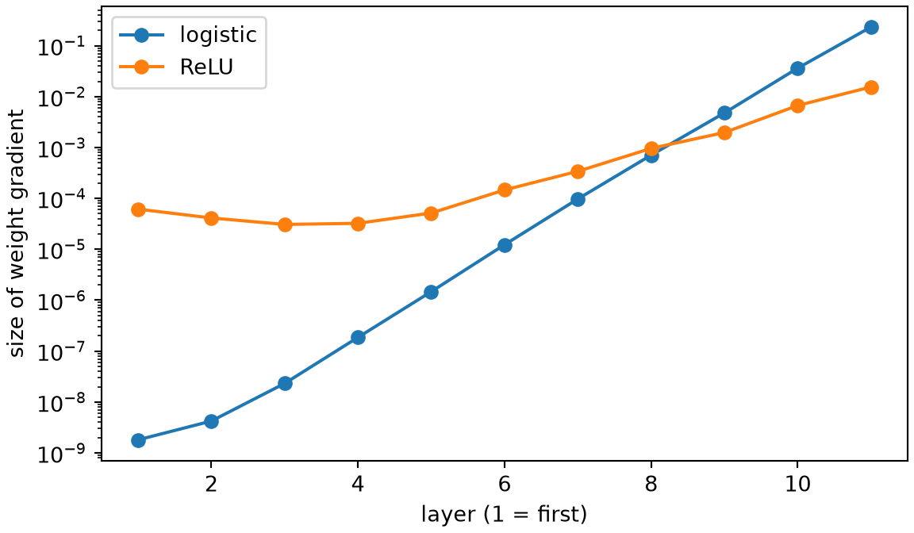

# Backpropagation

Code

- [Show All Code](javascript:void(0))
- [Hide All Code](javascript:void(0))

Published

Last modified: 2026-10-29

Show code

``` downlit
# The Python chunks on this page import these; reticulate provisions them.
# Attaching reticulate gives the inline R its `py` object.
library(reticulate)
source("../tools/use-torch.R")
use_torch(c("numpy", "pandas", "matplotlib"))
```

Brian Hutchinson’s CSCI 481/581 sets the order of topics in these notes, which follow it with his permission; this page covers the lecture on computing [gradients](https://morrison-lab.github.io/lds/chapters/linear-regression.html#def-gradient) in his module on [machine learning](https://morrison-lab.github.io/lds/chapters/course-overview.html#def-machine-learning) fundamentals. The exercises are new. Recording a computation and running it backward follow *Deep Learning*, Section 6.5 [\[1\]](#ref-goodfellow2016deep).

# 1 Welcome

## 1.1 Plan for this lecture

[Automatic differentiation](../chapters/pytorch-basics.llms.md#def-automatic-differentiation) gave the derivative of a loss without anyone writing it down. This lecture opens it up for the [MLP](../chapters/feedforward-networks.llms.md#def-feedforward-network) on the digits:

1.  how PyTorch records the operations that compute a loss;
2.  how the chain rule, applied to those operations from the loss back to the input, gives the [gradient](https://morrison-lab.github.io/lds/chapters/linear-regression.html#def-gradient) with respect to every [parameter](https://morrison-lab.github.io/lds/chapters/big-ideas.html#def-parameter) at once, and how to compute it by hand and match PyTorch;
3.  why that costs only a few times as much as computing the loss once;
4.  why the gradient can shrink layer by layer in a deep network.

[lds’s chapter on the same algorithm](https://morrison-lab.github.io/lds/chapters/backpropagation.html) derives it for a general network with one hidden layer, and runs more experiments on [depth](https://morrison-lab.github.io/lds/chapters/neural-nets.html#def-depth).

## 1.2 The digits and the network

Show code

``` python
import time

import numpy as np
import pandas as pd
import torch
from torch import nn
import matplotlib.pyplot as plt

_ = torch.manual_seed(481)
digits = pd.read_csv("data/optdigits-test.csv", header=None)
x = torch.tensor(digits.iloc[:, :64].to_numpy(), dtype=torch.float32) / 16
y = torch.tensor(digits[64].to_numpy())
n_train = 1200
order = torch.randperm(len(x))
x_train, y_train = x[order[:n_train]], y[order[:n_train]]

_ = torch.manual_seed(1)
mlp = nn.Sequential(nn.Linear(64, 32), nn.ReLU(), nn.Linear(32, 10))
loss_fn = nn.CrossEntropyLoss()
print(mlp)
```

    Sequential(
      (0): Linear(in_features=64, out_features=32, bias=True)
      (1): ReLU()
      (2): Linear(in_features=32, out_features=10, bias=True)
    )

The exercises use the same digits, split and network as the [feedforward networks chapter](../chapters/feedforward-networks.llms.md#exm-feedforward-network): the 1,797 images of [`data/optdigits-test.csv`](data/optdigits-test.csv) [\[2\]](#ref-alpaydin1998optdigits), with pixels divided by 16, a random 1,200 of them as the [training set](https://morrison-lab.github.io/lds/chapters/big-ideas.html#def-training-set), and an untrained [MLP](../chapters/feedforward-networks.llms.md#def-feedforward-network) with one [hidden layer](../chapters/feedforward-networks.llms.md#def-hidden-layer) of 32 [ReLU](../chapters/feedforward-networks.llms.md#def-relu) [units](../chapters/feedforward-networks.llms.md#def-unit).

# 2 Recording a computation

## 2.1 What the loss is made of

> **NOTE:**
>
> **Exercise 1 (From an image to its loss)** List, in order, the operations that take one image \\\vx\\ with true digit \\y\\ to the [MLP](../chapters/feedforward-networks.llms.md#def-feedforward-network)’s [cross-entropy](https://morrison-lab.github.io/pds/expectation.html#def-cross-entropy) loss.

> **NOTE:**
>
> *Solution 1*. Write \\\matr{W}\_1, \vecf{b}\_1\\ for the first layer’s [parameters](https://morrison-lab.github.io/lds/chapters/big-ideas.html#def-parameter) and \\\matr{W}\_2, \vecf{b}\_2\\ for the second’s.
>
> 1.  \\\vz_1 = \matr{W}\_1 \vx + \vecf{b}\_1\\, an [affine function](https://morrison-lab.github.io/lds/chapters/linear-regression.html#def-affine-function) of the pixels;
> 2.  \\\vhidval = \operatorname{ReLU}(\vz_1)\\, entry by entry;
> 3.  \\\vz_2 = \matr{W}\_2 \vhidval + \vecf{b}\_2\\, the [logits](../chapters/feedforward-networks.llms.md#def-logits);
> 4.  \\\loss = -\log \operatorname{softmax}(\vz_2)\_y\\, the [cross-entropy](https://morrison-lab.github.io/pds/expectation.html#def-cross-entropy) loss, where softmax is the [softmax function](https://morrison-lab.github.io/lds/chapters/multiclass-logistic-regression.html#def-softmax).
>
> Each step uses only the input and the results of earlier steps.

> **NOTE:**
>
> **Definition 1 (Computational graph)** A **computational graph** of a calculation has one node for each variable, whether an input, a [parameter](https://morrison-lab.github.io/lds/chapters/big-ideas.html#def-parameter) or an intermediate result, and an arrow from each node to every node computed from it [\[1, Sec. 6.5.1\]](#ref-goodfellow2016deep). It has no cycles: following the arrows never returns to a node.

> **NOTE:**
>
> **Example 1 (The graph PyTorch records)**  
>
> Show code
>
> ``` python
> loss = loss_fn(mlp(x_train[:1]), y_train[:1])
> node = loss.grad_fn
> recorded = []
> while node is not None:
>     recorded.append(type(node).__name__)
>     # Follow the first input that is not a leaf parameter.
>     earlier = [f for f, _ in node.next_functions
>                if f is not None and type(f).__name__ != "AccumulateGrad"]
>     node = earlier[0] if earlier else None
> print(*recorded, sep="\n")
> ```
>
>     NllLossBackward0
>     LogSoftmaxBackward0
>     AddmmBackward0
>     ReluBackward0
>     AddmmBackward0
>     TBackward0
>
> For the first training image, PyTorch’s [computational graph](#def-computational-graph) holds the four steps of [Solution 1](#sol-loss-operations), read from the loss back to the input. Each `grad_fn` names the operation that made a [tensor](../chapters/pytorch-basics.llms.md#def-tensor):
>
> - `NllLossBackward0` and `LogSoftmaxBackward0` are step 4, which `nn.CrossEntropyLoss` computes as a log softmax followed by picking out entry \\y\\;
> - `AddmmBackward0` (“add matrix multiply”) is each affine step, 3 and then 1;
> - `ReluBackward0` is step 2;
> - `TBackward0` is the transpose of \\\matr{W}\_1\\ in `x @ weight.T`.
>
> The chain stops at the transpose, since the image itself was not made with `requires_grad=True`.

# 3 The backward pass

## 3.1 The gradient at the logits

> **NOTE:**
>
> **Exercise 2 (The gradient at the logits)** Find the derivative of the [cross-entropy](https://morrison-lab.github.io/pds/expectation.html#def-cross-entropy) loss \\\loss = -\log \operatorname{softmax}(\vz)\_y\\, where softmax is the [softmax function](https://morrison-lab.github.io/lds/chapters/multiclass-logistic-regression.html#def-softmax), with respect to each [logit](../chapters/feedforward-networks.llms.md#def-logits) \\z_m\\, for \\m = 1, \dots, C\\, where \\C\\ is the number of classes.
>
> > **TIP:**
> >
> > Start from [the log softmax theorem](../chapters/feedforward-networks.llms.md#thm-log-softmax).

> **NOTE:**
>
> *Solution 2*. By [the log softmax theorem](../chapters/feedforward-networks.llms.md#thm-log-softmax), \\\loss = \operatorname{LSE}(\vz) - z_y\\, where \\\operatorname{LSE}\\ is [log-sum-exp](../chapters/feedforward-networks.llms.md#def-log-sum-exp).
>
> \\ \begin{aligned} \derivf{\operatorname{LSE}(\vz)}{z_m} &= \derivf{}{z_m} \log \sumto{k}{C} \e{z_k} && \text{(definition of \$\operatorname{LSE}\$)} \\ &= \frac{1}{\sumto{k}{C} \e{z_k}} \derivf{}{z_m} \sumto{k}{C} \e{z_k} && \text{(chain rule for \$\log\$)} \\ &= \frac{1}{\sumto{k}{C} \e{z_k}} \derivf{}{z_m} \e{z_m} && \text{(only term \$k = m\$ depends on \$z_m\$)} \\ &= \frac{\e{z_m}}{\sumto{k}{C} \e{z_k}} && \text{(derivative of the exponential)} \\ &= \operatorname{softmax}(\vz)\_m && \text{(definition of softmax)} \end{aligned} \\
>
> The second term, \\z_y\\, has derivative 1 with respect to \\z_y\\ and 0 with respect to every other [logit](../chapters/feedforward-networks.llms.md#def-logits). So
>
> \\ \derivf{\loss}{z_m} = \operatorname{softmax}(\vz)\_m - \indicf{m = y}. \\

> **NOTE:**
>
> **Theorem 1 (Gradient of the cross-entropy loss at the logits)** For [logits](../chapters/feedforward-networks.llms.md#def-logits) \\\vz \in \reals^C\\ and true class \\y\\, the [cross-entropy](https://morrison-lab.github.io/pds/expectation.html#def-cross-entropy) loss \\\loss = -\log \operatorname{softmax}(\vz)\_y\\, where softmax is the [softmax function](https://morrison-lab.github.io/lds/chapters/multiclass-logistic-regression.html#def-softmax), has [gradient](https://morrison-lab.github.io/lds/chapters/linear-regression.html#def-gradient)
>
> \\ \gradwrt{\vz} \loss = \operatorname{softmax}(\vz) - \ve_y, \\
>
> where \\\ve_y\\ has 1 in entry \\y\\ and 0 in every other entry.

> **NOTE:**
>
> *Proof*. By [Solution 2](#sol-ce-logit-grad).

> **NOTE:**
>
> **Example 2 (Checking the gradient at the logits)**  
>
> Show code
>
> ``` python
> logits = mlp(x_train[:1]).detach().requires_grad_()
> loss = loss_fn(logits, y_train[:1])
> loss.backward()
> by_theorem = torch.softmax(logits, dim=1) - nn.functional.one_hot(y_train[:1], 10)
> logit_grad_gap = (logits.grad - by_theorem).abs().max().item()
> print(y_train[0].item())
> ```
>
>     0
>
> Show code
>
> ``` python
> print(logits.grad.numpy().round(3))
> ```
>
>     [[-0.921  0.104  0.125  0.092  0.142  0.082  0.072  0.113  0.106  0.085]]
>
> Show code
>
> ``` python
> print(logit_grad_gap)
> ```
>
>     1.4901161193847656e-08
>
> For the first training image, a 0, autograd’s [gradient](https://morrison-lab.github.io/lds/chapters/linear-regression.html#def-gradient) at the [logits](../chapters/feedforward-networks.llms.md#def-logits) matches [Theorem 1](#thm-ce-logit-grad) to within 1.5e-08. Every entry is a predicted probability, near \\\frac{1}{10}\\, except entry 0, the true digit, which is that probability minus 1.

## 3.2 Through a linear layer

> **NOTE:**
>
> **Exercise 3 (Gradient for a layer’s weight matrix)** A layer computes \\\vz = \matr{W} \vhidval + \vecf{b}\\, and the [gradient](https://morrison-lab.github.io/lds/chapters/linear-regression.html#def-gradient) \\\vbackerr = \gradwrt{\vz} \loss\\ of the loss with respect to its output is known. What is the gradient of \\\loss\\ with respect to \\\matr{W}\\?

> **NOTE:**
>
> *Solution 3*. Entry \\j\\ of the output is \\z_j = \sum_k W\_{jk} h_k + b_j\\, so \\W\_{jk}\\ affects \\\loss\\ only through \\z_j\\.
>
> \\ \begin{aligned} \derivf{\loss}{W\_{jk}} &= \derivf{\loss}{z_j} \derivf{z_j}{W\_{jk}} && \text{(chain rule through \$z_j\$)} \\ &= \backerr_j h_k && \text{(since \$\derivf{z_j}{W\_{jk}} = h_k\$)} \end{aligned} \\
>
> As a matrix,
>
> \\ \gradwrt{\matr{W}} \loss = \oprod{\vbackerr}{\vhidval}, \\
>
> an \\m \times n\\ outer product for a layer with \\n\\ inputs and \\m\\ outputs, with the same [shape](../chapters/pytorch-basics.llms.md#def-shape) as \\\matr{W}\\.

> **NOTE:**
>
> **Exercise 4 (Gradient for a layer’s bias)** For the layer of [Exercise 3](#exr-linear-param-grad), what is the [gradient](https://morrison-lab.github.io/lds/chapters/linear-regression.html#def-gradient) of \\\loss\\ with respect to \\\vecf{b}\\?

> **NOTE:**
>
> *Solution 4*. Bias \\b_j\\ affects \\\loss\\ only through \\z_j\\, and \\\derivf{z_j}{b_j} = 1\\, so \\\derivf{\loss}{b_j} = \backerr_j \cdot 1 = \backerr_j\\, and
>
> \\ \gradwrt{\vecf{b}} \loss = \vbackerr. \\

> **NOTE:**
>
> **Exercise 5 (The gradient passed back)** For the layer of [Exercise 3](#exr-linear-param-grad), find the [gradient](https://morrison-lab.github.io/lds/chapters/linear-regression.html#def-gradient) of \\\loss\\ with respect to the layer’s input \\\vhidval\\.

> **NOTE:**
>
> *Solution 5*. Input \\h_k\\ affects every output \\z_j\\, so the chain rule adds up a term for each:
>
> \\ \begin{aligned} \derivf{\loss}{h_k} &= \sum_j \derivf{\loss}{z_j} \derivf{z_j}{h_k} && \text{(chain rule through every \$z_j\$)} \\ &= \sum_j \backerr_j W\_{jk} && \text{(since \$\derivf{z_j}{h_k} = W\_{jk}\$)} \\ &= \paren{\tp{\matr{W}} \vbackerr}\_k && \text{(entry \$k\$ of a matrix-vector product)} \end{aligned} \\
>
> So \\\gradwrt{\vhidval} \loss = \tp{\matr{W}} \vbackerr\\: the [gradient](https://morrison-lab.github.io/lds/chapters/linear-regression.html#def-gradient) travels back through the layer by the transpose of its weight matrix.

## 3.3 Through the ReLU

> **NOTE:**
>
> **Exercise 6 (Back through the ReLU)** The [hidden layer](../chapters/feedforward-networks.llms.md#def-hidden-layer) is \\\vhidval = \operatorname{ReLU}(\vz_1)\\, entry by entry, and \\\gradwrt{\vhidval} \loss\\ is known. Find \\\gradwrt{\vz_1} \loss\\.

> **NOTE:**
>
> *Solution 6*. Entry \\h_k = \maxf{0, z\_{1k}}\\ depends only on \\z\_{1k}\\, with derivative 1 where \\z\_{1k} \> 0\\ and 0 where \\z\_{1k} \< 0\\; at \\z\_{1k} = 0\\ PyTorch, and these notes, take it to be 0, as in [the slopes of the activation functions](../chapters/feedforward-networks.llms.md#sol-activation-slopes). So
>
> \\ \derivf{\loss}{z\_{1k}} = \derivf{\loss}{h_k} \\ \indicf{z\_{1k} \> 0}: \\
>
> the [gradient](https://morrison-lab.github.io/lds/chapters/linear-regression.html#def-gradient) passes through each [unit](../chapters/feedforward-networks.llms.md#def-unit) that was positive and stops at each unit that was 0.

## 3.4 The whole backward pass

> **NOTE:**
>
> **Exercise 7 (The backward pass by hand)** Computed by hand from [Theorem 1](#thm-ce-logit-grad), [Solution 3](#sol-linear-param-grad), [Solution 4](#sol-linear-bias-grad), [Solution 5](#sol-linear-input-grad) and [Solution 6](#sol-relu-grad), without `.backward()`, how closely does the [gradient](https://morrison-lab.github.io/lds/chapters/linear-regression.html#def-gradient) of the [MLP](../chapters/feedforward-networks.llms.md#def-feedforward-network)’s mean loss over the [training set](https://morrison-lab.github.io/lds/chapters/big-ideas.html#def-training-set) with respect to \\\matr{W}\_1\\, \\\vecf{b}\_1\\, \\\matr{W}\_2\\ and \\\vecf{b}\_2\\ match the one `loss.backward()` gives?

> **NOTE:**
>
> *Solution 7*.
>
> Show code
>
> ``` python
> first, second = mlp[0], mlp[2]
>
> # Forward, keeping every intermediate result.
> z1 = x_train @ first.weight.T + first.bias
> h = torch.relu(z1)
> z2 = h @ second.weight.T + second.bias
> loss = loss_fn(z2, y_train)
>
> mlp.zero_grad()
> loss.backward()
>
> with torch.no_grad():
>     # Backward, from the loss to the first layer, one row per image.
>     g2 = (torch.softmax(z2, dim=1) - nn.functional.one_hot(y_train, 10)) / n_train
>     grad_W2 = g2.T @ h
>     grad_b2 = g2.sum(dim=0)
>     grad_h = g2 @ second.weight
>     grad_z1 = grad_h * (z1 > 0)
>     grad_W1 = grad_z1.T @ x_train
>     grad_b1 = grad_z1.sum(dim=0)
>
> pairs = [(grad_W1, first.weight), (grad_b1, first.bias),
>          (grad_W2, second.weight), (grad_b2, second.bias)]
> backward_gap = max((mine - p.grad).abs().max().item() for mine, p in pairs)
> print(backward_gap)
> ```
>
>     3.725290298461914e-09
>
> The four [gradients](https://morrison-lab.github.io/lds/chapters/linear-regression.html#def-gradient) match autograd’s to within 3.7e-09. The code runs the steps of [Solution 1](#sol-loss-operations) forward, then their derivatives in reverse:
>
> - `g2` is \\\gradwrt{\vz_2} \loss\\ from [Theorem 1](#thm-ce-logit-grad), for every image at once, divided by 1200 because the loss is the mean over that many images;
> - `grad_W2` and `grad_b2` are [Solution 3](#sol-linear-param-grad) and [Solution 4](#sol-linear-bias-grad), with the outer products of the images added up by one matrix product;
> - `grad_h` is [Solution 5](#sol-linear-input-grad), written for rows instead of columns;
> - `grad_z1` is [Solution 6](#sol-relu-grad);
> - `grad_W1` and `grad_b1` are [Solution 3](#sol-linear-param-grad) and [Solution 4](#sol-linear-bias-grad) again, for the first layer.
>
> The backward steps reuse `z1` and `h` from the forward pass.

> **NOTE:**
>
> **Definition 2 (Backpropagation (backprop))** **Backpropagation**, or **backprop**, computes the [gradient](https://morrison-lab.github.io/lds/chapters/linear-regression.html#def-gradient) of a scalar, such as a loss, with respect to every node of a [computational graph](#def-computational-graph): it visits the nodes in the reverse of the order the forward computation made them, and at each node applies the chain rule, combining the gradient with respect to the node’s output with the derivative of the node’s own operation [\[1, Sec. 6.5\]](#ref-goodfellow2016deep), [\[3\]](#ref-rumelhart1986learning).
>
> Backpropagation is reverse-mode [automatic differentiation](../chapters/pytorch-basics.llms.md#def-automatic-differentiation) applied to a network’s loss, and PyTorch’s `.backward()` runs it. Some sources use “backpropagation” for the whole training algorithm, including the [parameter](https://morrison-lab.github.io/lds/chapters/big-ideas.html#def-parameter) update; these notes use it only for computing the gradient.

> **NOTE:**
>
> **Example 3 (Backpropagation through the MLP)** [Solution 7](#sol-manual-backward) is [backpropagation](#def-backpropagation) through the four steps of [Solution 1](#sol-loss-operations). It visits them in reverse order: the loss gives the [gradient](https://morrison-lab.github.io/lds/chapters/linear-regression.html#def-gradient) at the [logits](../chapters/feedforward-networks.llms.md#def-logits) `g2`; the second affine step gives the [gradients](https://morrison-lab.github.io/lds/chapters/linear-regression.html#def-gradient) of \\\matr{W}\_2\\, \\\vecf{b}\_2\\ and the [hidden layer](../chapters/feedforward-networks.llms.md#def-hidden-layer); the [ReLU](../chapters/feedforward-networks.llms.md#def-relu) gives the gradient at \\\vz_1\\; and the first affine step gives the gradients of \\\matr{W}\_1\\ and \\\vecf{b}\_1\\.

# 4 Cost

## 4.1 Backpropagation against finite differences

> **NOTE:**
>
> **Exercise 8 (The cost of finite differences)** A finite difference, \\\paren{\loss(\theta_i + \smallconst) - \loss(\theta_i)} / \smallconst\\ for a small \\\smallconst\\, estimates the derivative of the [MLP](../chapters/feedforward-networks.llms.md#def-feedforward-network)’s mean training loss \\\loss\\ with respect to one [parameter](https://morrison-lab.github.io/lds/chapters/big-ideas.html#def-parameter) \\\theta_i\\, with every other parameter held fixed. How many evaluations of the loss does that take to estimate the [gradient](https://morrison-lab.github.io/lds/chapters/linear-regression.html#def-gradient) with respect to \\P\\ [parameters](https://morrison-lab.github.io/lds/chapters/big-ideas.html#def-parameter)?

> **NOTE:**
>
> *Solution 8*. \\P + 1\\: one at the current [parameters](https://morrison-lab.github.io/lds/chapters/big-ideas.html#def-parameter), and one more for each [parameter](https://morrison-lab.github.io/lds/chapters/big-ideas.html#def-parameter) nudged. [Backpropagation](#def-backpropagation) gets all \\P\\ derivatives from one forward pass and one backward pass, and each backward step costs a small multiple of its forward step: a matrix product forward becomes two matrix products backward, as in [Solution 3](#sol-linear-param-grad) and [Solution 5](#sol-linear-input-grad), so the two passes together cost about three forward passes.
>
> Show code
>
> ``` python
> def mean_loss():
>     return loss_fn(mlp(x_train), y_train)
>
> start = time.perf_counter()
> for repeat in range(20):
>     mlp.zero_grad()
>     mean_loss().backward()
> backprop_seconds = (time.perf_counter() - start) / 20
>
> start = time.perf_counter()
> with torch.no_grad():
>     base = mean_loss()
>     w = second.weight
>     estimate = torch.zeros_like(w)
>     for j in range(w.shape[0]):
>         for k in range(w.shape[1]):
>             w[j, k] += 1e-3
>             estimate[j, k] = (mean_loss() - base) / 1e-3
>             w[j, k] -= 1e-3
> difference_seconds = time.perf_counter() - start
> fd_gap = (estimate - second.weight.grad).abs().max().item()
> print(backprop_seconds, difference_seconds, fd_gap)
> ```
>
>     0.01966462685000181 0.11356393599999137 0.000441218726336956
>
> One forward and backward pass over the [training set](https://morrison-lab.github.io/lds/chapters/big-ideas.html#def-training-set) took 19.66 milliseconds, for every parameter of the [MLP](../chapters/feedforward-networks.llms.md#def-feedforward-network). Finite differences for only the 320 entries of \\\matr{W}\_2\\ took 114 milliseconds, 6 times as long, and agree with backpropagation only to within 0.00044, since a finite difference is an approximation. Timings vary from run to run; the ratio grows with the number of [parameters](https://morrison-lab.github.io/lds/chapters/big-ideas.html#def-parameter).

> **NOTE:**
>
> *Remark 1* (What backpropagation stores). The backward steps of [Solution 7](#sol-manual-backward) reuse `z1` and `h` from the forward pass, so PyTorch keeps every intermediate result that a later backward step needs until `.backward()` has run. That memory grows with the number of layers and with the batch size, and it is often what limits the batch size on a GPU. Code run inside `torch.no_grad()`, such as computing test [accuracy](https://morrison-lab.github.io/lds/chapters/metrics.html#def-accuracy), records nothing and keeps nothing.

# 5 Gradients in deep networks

## 5.1 Gradient sizes layer by layer

> **NOTE:**
>
> **Exercise 9 (Gradients in a deep network)** Take two [MLPs](../chapters/feedforward-networks.llms.md#def-feedforward-network) for the digits with 10 [hidden layers](../chapters/feedforward-networks.llms.md#def-hidden-layer) of 32 [unit](../chapters/feedforward-networks.llms.md#def-unit)s each, one with the [logistic function](https://morrison-lab.github.io/mds/functions.html#def-logistic-function) as its [activation function](../chapters/feedforward-networks.llms.md#def-activation-function) and one with the [ReLU](../chapters/feedforward-networks.llms.md#def-relu). At their starting weights, how does the size of the [gradient](https://morrison-lab.github.io/lds/chapters/linear-regression.html#def-gradient) of the mean training loss with respect to each layer’s weight matrix change from the last layer to the first?

> **NOTE:**
>
> *Solution 9*.
>
> Show code
>
> ``` python
> def deep_mlp(activation, n_hidden=10, width=32):
>     _ = torch.manual_seed(0)
>     layers, n_in = [], 64
>     for layer in range(n_hidden):
>         layers += [nn.Linear(n_in, width), activation()]
>         n_in = width
>     layers.append(nn.Linear(width, 10))
>     return nn.Sequential(*layers)
>
>
> grad_norms = {}
> for name, activation in [("logistic", nn.Sigmoid), ("ReLU", nn.ReLU)]:
>     net = deep_mlp(activation)
>     loss_fn(net(x_train), y_train).backward()
>     grad_norms[name] = [m.weight.grad.norm().item() for m in net if isinstance(m, nn.Linear)]
>
> fig, ax = plt.subplots(figsize=(6, 3.5), layout="constrained")
> for name, norms in grad_norms.items():
>     ax.semilogy(range(1, len(norms) + 1), norms, marker="o", label=name);
> ax.set_xlabel("layer (1 = first)");
> ax.set_ylabel("size of weight gradient");
> ax.legend();
> plt.show()
> ```
>
> [](backpropagation_files/figure-html/unnamed-chunk-7-1.png)
>
> Show code
>
> ``` python
> shrink = {name: norms[-1] / norms[0] for name, norms in grad_norms.items()}
> print(shrink)
> ```
>
>     {'logistic': 129510924.3979597, 'ReLU': 251.30356569772417}
>
> The size of a matrix here is the square root of the sum of its squared entries. In both networks the weight [gradient](https://morrison-lab.github.io/lds/chapters/linear-regression.html#def-gradient) is largest at the last layer. With the [logistic function](https://morrison-lab.github.io/mds/functions.html#def-logistic-function), the weight gradient shrinks at every layer going back, and the last layer’s weight gradient is about \\10^{8}\\ times the first layer’s. With the [ReLU](../chapters/feedforward-networks.llms.md#def-relu), the weight gradient shrinks over the last few layers and then levels off, and the last layer’s is 251 times the first layer’s. A [training step](../chapters/pytorch-basics.llms.md#def-training-step) with one [learning rate](https://morrison-lab.github.io/lds/chapters/gradient-descent.html#def-learning-rate) would move the logistic network’s first layers almost not at all.

## 5.2 Why they shrink

> **NOTE:**
>
> **Exercise 10 (Why the gradient shrinks)** In a deep [MLP](../chapters/feedforward-networks.llms.md#def-feedforward-network), [hidden layer](../chapters/feedforward-networks.llms.md#def-hidden-layer) \\\layeridx\\ is \\\vhidval\_{\layeridx} = g\paren{\vz\_{\layeridx}}\\ with \\\vz\_{\layeridx} = \matr{W}\_{\layeridx} \vhidval\_{\layeridx - 1} + \vecf{b}\_{\layeridx}\\. Why does the [gradient](https://morrison-lab.github.io/lds/chapters/linear-regression.html#def-gradient) shrink from layer to layer, going back, when \\g\\ is the [logistic function](https://morrison-lab.github.io/mds/functions.html#def-logistic-function)?

> **NOTE:**
>
> *Solution 10*. Applying [Solution 6](#sol-relu-grad)’s reasoning to \\g\\, then [Solution 5](#sol-linear-input-grad), takes the [gradient](https://morrison-lab.github.io/lds/chapters/linear-regression.html#def-gradient) back one layer:
>
> \\ \gradwrt{\vhidval\_{\layeridx - 1}} \loss = \tp{\matr{W}\_{\layeridx}} \vbackerr\_{\layeridx}, \qquad \vbackerr\_{\layeridx} = \gradwrt{\vz\_{\layeridx}} \loss = g'(\vz\_{\layeridx}) \odot \gradwrt{\vhidval\_{\layeridx}} \loss, \\
>
> where \\\odot\\ multiplies entry by entry. Each layer back multiplies the gradient by the slopes \\g'(\vz\_{\layeridx})\\ and by \\\tp{\matr{W}\_{\layeridx}}\\. The [logistic function](https://morrison-lab.github.io/mds/functions.html#def-logistic-function)’s slope is at most \\\frac{1}{4}\\ ([lds’s bound on it](https://morrison-lab.github.io/lds/chapters/logistic-regression.html#thm-logistic-derivative-bound)), and less where [unit](../chapters/feedforward-networks.llms.md#def-unit)s [saturate](https://morrison-lab.github.io/lds/chapters/backpropagation.html#def-saturation), so unless the weights are large, every layer shrinks the gradient by a factor less than 1, and 10 layers multiply 10 such factors. The [ReLU](../chapters/feedforward-networks.llms.md#def-relu)’s slope has no \\\frac{1}{4}\\ bound: it is 1 at each [unit](../chapters/feedforward-networks.llms.md#def-unit) that is positive and 0 at each unit that is not. In the ReLU network of [Solution 9](#sol-deep-grad-norms), the gradient going back still shrinks, both because the weights PyTorch starts with are small and because the [unit](../chapters/feedforward-networks.llms.md#def-unit)s at 0 pass none of it back.
>
> The weight gradient of layer \\\layeridx\\ is \\\oprod{\vbackerr\_{\layeridx}}{\vhidval\_{\layeridx - 1}}\\, by [Solution 3](#sol-linear-param-grad), so its size depends on the layer’s input \\\vhidval\_{\layeridx - 1}\\ as well as on the gradient \\\vbackerr\_{\layeridx}\\ at its output. In the ReLU network the layer inputs grow toward the first layers, which is why its weight [gradients](https://morrison-lab.github.io/lds/chapters/linear-regression.html#def-gradient) level off there while the gradients \\\vbackerr\_{\layeridx}\\ keep shrinking.

> **NOTE:**
>
> **Definition 3 (Vanishing gradient)** A network has a **vanishing gradient** when the [gradient](https://morrison-lab.github.io/lds/chapters/linear-regression.html#def-gradient) of its loss with respect to the [parameters](https://morrison-lab.github.io/lds/chapters/big-ideas.html#def-parameter) of its early layers is many orders of magnitude smaller than with respect to those of its later layers, because [backpropagation](#def-backpropagation) multiplies it by a factor smaller than 1 at each layer [\[1, Sec. 8.2.5\]](#ref-goodfellow2016deep), [\[4\]](#ref-glorot2010understanding). The early layers then learn far more slowly than the later ones, or not at all.
>
> The opposite, a gradient that grows layer by layer, is an [exploding gradient](https://morrison-lab.github.io/lds/chapters/backpropagation.html#def-exploding-gradient).

> **NOTE:**
>
> **Example 4 (The deep logistic network)** The 10-hidden-layer logistic network of [Solution 9](#sol-deep-grad-norms) has a [vanishing gradient](#def-vanishing-gradient): its first layer’s weight [gradient](https://morrison-lab.github.io/lds/chapters/linear-regression.html#def-gradient) is about \\10^{-8}\\ times its last layer’s.

> **NOTE:**
>
> *Remark 2* (What keeps gradients from vanishing). The [ReLU](../chapters/feedforward-networks.llms.md#def-relu) removes the \\\frac{1}{4}\\ bound on each layer’s slopes. Other remedies are starting the weights at a scale that keeps the [gradient](https://morrison-lab.github.io/lds/chapters/linear-regression.html#def-gradient)’s size steady from layer to layer, such as [He initialization](https://morrison-lab.github.io/lds/chapters/backpropagation.html#def-he-initialization) or [Glorot initialization](https://morrison-lab.github.io/lds/chapters/backpropagation.html#def-glorot-initialization), normalizing each layer’s values, and [residual connections](https://morrison-lab.github.io/lds/chapters/backpropagation.html#def-residual-connection), which give the gradient a path around each layer. [lds’s experiment on depth](https://morrison-lab.github.io/lds/chapters/backpropagation.html#sec-vanishing-experiment) measures the same effect.

## 5.3 Further reading

> **NOTE:**
>
> *Deep Learning*’s [section 6.5](https://www.deeplearningbook.org/contents/mlp.html) covers [backpropagation](#def-backpropagation) on general [computational graph](#def-computational-graph)s [\[1, Sec. 6.5\]](#ref-goodfellow2016deep).

# 6 References

\[1\]

I. Goodfellow, Y. Bengio, and A. Courville, *Deep learning*. MIT Press, 2016. Available: <https://www.deeplearningbook.org/>

\[2\]

E. Alpaydin and C. Kaynak, “Optical recognition of handwritten digits.” UCI Machine Learning Repository, 1998. doi: [10.24432/C50P49](https://doi.org/10.24432/C50P49).

\[3\]

D. E. Rumelhart, G. E. Hinton, and R. J. Williams, “Learning representations by back-propagating errors,” *Nature*, vol. 323, no. 6088, pp. 533–536, 1986, doi: [10.1038/323533a0](https://doi.org/10.1038/323533a0).

\[4\]

X. Glorot and Y. Bengio, “Understanding the difficulty of training deep feedforward neural networks,” in *Proceedings of the thirteenth international conference on artificial intelligence and statistics*, in Proceedings of machine learning research, vol. 9. PMLR, 2010, pp. 249–256. Available: <https://proceedings.mlr.press/v9/glorot10a.html>

Back to top
