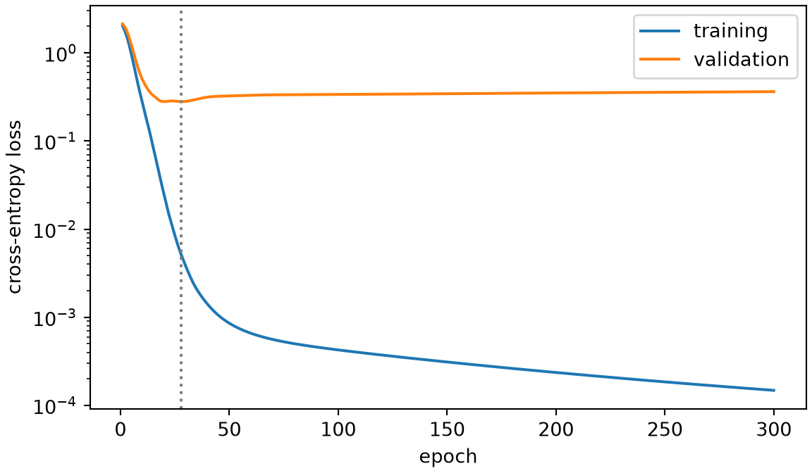
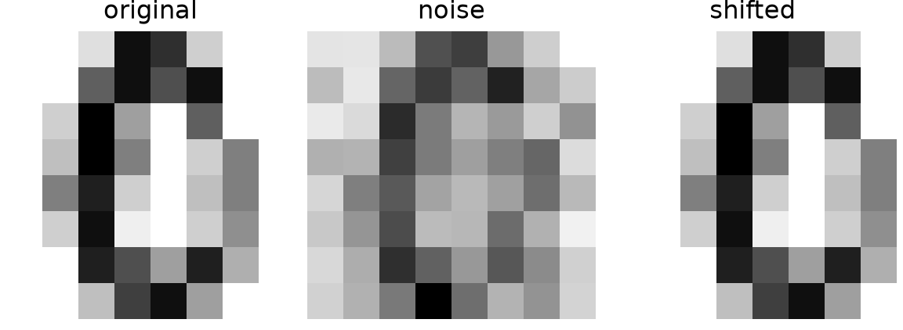

# Regularization

Code

- [Show All Code](javascript:void(0))
- [Hide All Code](javascript:void(0))

Published

Last modified: 2026-10-29

Show code

``` downlit
# The Python chunks on this page import these; reticulate provisions them.
# Attaching reticulate gives the inline R its `py` object.
library(reticulate)
source("../tools/use-torch.R")
use_torch(c("numpy", "pandas", "matplotlib"))
```

Brian Hutchinson’s CSCI 481/581 sets the order of topics in these notes, which follow it with his permission; this page covers the [regularization](https://morrison-lab.github.io/lds/chapters/big-ideas.html#def-regularization) part of his module on optimization and regularization. The exercises are new. This page’s methods follow *Deep Learning*, Chapter 7 [\[1\]](#ref-goodfellow2016deep).

# 1 Welcome

## 1.1 Plan for this lecture

The [optimization chapter](../chapters/optimization.llms.md) made training faster. This lecture is about what training finds: a network with many [parameters](https://morrison-lab.github.io/lds/chapters/big-ideas.html#def-parameter) can fit its [training set](https://morrison-lab.github.io/lds/chapters/big-ideas.html#def-training-set) far better than new images, and [regularization](https://morrison-lab.github.io/lds/chapters/big-ideas.html#def-regularization) trades some of that fit for better predictions. It covers

1.  watching a [validation set](https://morrison-lab.github.io/lds/chapters/big-ideas.html#def-validation-set) during training, and stopping at the best point;
2.  weight decay in PyTorch’s optimizers;
3.  randomly switching off [units](../chapters/feedforward-networks.llms.md#def-unit) during training;
4.  training on transformed copies of the training images.

## 1.2 The digits and the network

Show code

``` python
import copy

import numpy as np
import pandas as pd
import torch
from torch import nn
import matplotlib.pyplot as plt

_ = torch.manual_seed(481)
digits = pd.read_csv("data/optdigits-test.csv", header=None)
x = torch.tensor(digits.iloc[:, :64].to_numpy(), dtype=torch.float32) / 16
y = torch.tensor(digits[64].to_numpy())
n_train, n_val = 150, 400
order = torch.randperm(len(x))
train_idx = order[:n_train]
val_idx = order[n_train:n_train + n_val]
test_idx = order[n_train + n_val:]
x_train, y_train = x[train_idx], y[train_idx]
x_val, y_val = x[val_idx], y[val_idx]
x_test, y_test = x[test_idx], y[test_idx]
n_test = len(x_test)
loss_fn = nn.CrossEntropyLoss()


def make_net(seed=1):
    # 64 pixels, a hidden layer of 256 ReLU units, then 10 logits.
    torch.manual_seed(seed)
    return nn.Sequential(nn.Linear(64, 256), nn.ReLU(), nn.Linear(256, 10))


def accuracy(net, inputs, targets):
    # Share of `inputs` whose largest logit is the true digit.
    net.eval()
    with torch.no_grad():
        return (net(inputs).argmax(dim=1) == targets).float().mean().item()


def fit(net, n_epochs=300, weight_decay=0.0, transform=None, seed=0):
    # Full-batch AdamW on the training images.
    # Records both losses after every epoch, and keeps the parameters
    # from the epoch with the lowest validation loss.
    optimizer = torch.optim.AdamW(net.parameters(), lr=0.01, weight_decay=weight_decay)
    generator = torch.Generator().manual_seed(seed)
    history, best_state, best_val = [], None, float("inf")
    for epoch in range(1, n_epochs + 1):
        net.train()
        inputs = x_train if transform is None else transform(x_train, generator)
        optimizer.zero_grad()
        loss_fn(net(inputs), y_train).backward()
        optimizer.step()
        net.eval()
        with torch.no_grad():
            train_loss = loss_fn(net(x_train), y_train).item()
            val_loss = loss_fn(net(x_val), y_val).item()
        history.append({"epoch": epoch, "train": train_loss, "val": val_loss})
        if val_loss < best_val:
            best_val, best_state = val_loss, copy.deepcopy(net.state_dict())
    return pd.DataFrame(history), best_state


n_params = sum(p.numel() for p in make_net().parameters())
print(len(x_train), len(x_val), len(x_test), n_params)
```

    150 400 1247 19210

The exercises use the 1,797 digits of [`data/optdigits-test.csv`](data/optdigits-test.csv) [\[2\]](#ref-alpaydin1998optdigits). To make a network fit its training images too well, the [training set](https://morrison-lab.github.io/lds/chapters/big-ideas.html#def-training-set) here is small, 150 random images. Another 400 form a [validation set](https://morrison-lab.github.io/lds/chapters/big-ideas.html#def-validation-set), and the other 1,247 a [test set](https://morrison-lab.github.io/lds/chapters/big-ideas.html#def-test-set). `make_net()` builds an [MLP](../chapters/feedforward-networks.llms.md#def-feedforward-network) with one [hidden layer](../chapters/feedforward-networks.llms.md#def-hidden-layer) of 256 [ReLU](../chapters/feedforward-networks.llms.md#def-relu) [units](../chapters/feedforward-networks.llms.md#def-unit), which has 19,210 [parameters](https://morrison-lab.github.io/lds/chapters/big-ideas.html#def-parameter). `fit()` trains it by full-batch AdamW, PyTorch’s variant of [Adam](https://morrison-lab.github.io/lds/chapters/gradient-descent.html#def-adam) with weight decay, with [learning rate](https://morrison-lab.github.io/lds/chapters/gradient-descent.html#def-learning-rate) 0.01 and no weight decay unless asked. It records the training and validation losses after every [epoch](https://morrison-lab.github.io/lds/chapters/gradient-descent.html#def-epoch).

# 2 Stopping early

## 2.1 Watching the validation loss

> **NOTE:**
>
> **Exercise 1 (Watching the validation loss)** How do the training loss and the validation loss of `make_net()` change over 300 [epochs](https://morrison-lab.github.io/lds/chapters/gradient-descent.html#def-epoch) of `fit()`?

> **NOTE:**
>
> *Solution 1*.
>
> Show code
>
> ``` python
> plain_net = make_net()
> plain_history, plain_best_state = fit(plain_net)
> best_row = plain_history.loc[plain_history["val"].idxmin()]
> best_epoch = int(best_row["epoch"])
> best_val_loss = best_row["val"]
> final_row = plain_history.iloc[-1]
> fig, ax = plt.subplots(figsize=(6, 3.5), layout="constrained")
> ax.plot(plain_history["epoch"], plain_history["train"], label="training");
> ax.plot(plain_history["epoch"], plain_history["val"], label="validation");
> ax.axvline(best_epoch, color="gray", linestyle=":");
> ax.set_yscale("log");
> ax.set_xlabel("epoch");
> ax.set_ylabel("cross-entropy loss");
> ax.legend();
> plt.show()
> ```
>
> [](regularization_files/figure-html/unnamed-chunk-3-1.png)
>
> Show code
>
> ``` python
> print(best_epoch, best_val_loss, final_row["train"], final_row["val"])
> ```
>
>     28 0.2795121371746063 0.0001482013612985611 0.3629535436630249
>
> The training loss falls the whole time, to 1.5e-04 after 300 [epochs](https://morrison-lab.github.io/lds/chapters/gradient-descent.html#def-epoch). The validation loss falls to its lowest value, 0.280, at [epoch](https://morrison-lab.github.io/lds/chapters/gradient-descent.html#def-epoch) 28, marked by the dotted line, and then rises to 0.363. After epoch 28 the network goes on fitting the training images in ways that do not carry over to new images: it [overfits](https://morrison-lab.github.io/lds/chapters/big-ideas.html#def-overfitting).

## 2.2 Stopping at the best epoch

> **NOTE:**
>
> **Definition 1 (Early stopping)** **Early stopping** records the validation loss after every [epoch](https://morrison-lab.github.io/lds/chapters/gradient-descent.html#def-epoch) of training, and returns the [parameters](https://morrison-lab.github.io/lds/chapters/big-ideas.html#def-parameter) from the epoch with the lowest validation loss [\[1, Sec. 7.8\]](#ref-goodfellow2016deep).

> **NOTE:**
>
> **Example 1 (Stopping at the lowest validation loss)**  
>
> Show code
>
> ``` python
> stopped_net = make_net()
> _ = stopped_net.load_state_dict(plain_best_state)
> with torch.no_grad():
>     test_loss_stopped = loss_fn(stopped_net(x_test), y_test).item()
>     test_loss_final = loss_fn(plain_net(x_test), y_test).item()
> acc_stopped = accuracy(stopped_net, x_test, y_test)
> acc_final = accuracy(plain_net, x_test, y_test)
> print(test_loss_stopped, test_loss_final, acc_stopped, acc_final)
> ```
>
>     0.30516549944877625 0.38375675678253174 0.9238171577453613 0.9230152368545532
>
> `fit()` already does [early stopping](#def-early-stopping): it keeps the [parameters](https://morrison-lab.github.io/lds/chapters/big-ideas.html#def-parameter) of [epoch](https://morrison-lab.github.io/lds/chapters/gradient-descent.html#def-epoch) 28 of [Solution 1](#sol-overfit-curves). On the 1247 test images, those parameters have loss 0.305, against 0.384 after all 300 [epochs](https://morrison-lab.github.io/lds/chapters/gradient-descent.html#def-epoch). The test accuracies are 92.4% and 92.3%. The [accuracy](https://morrison-lab.github.io/lds/chapters/metrics.html#def-accuracy) moves much less than the loss, because the loss also measures how much probability the network gives the true digit, not only whether that digit gets the most. `fit()` runs all 300 epochs; an early-stopping loop can instead end training once the validation loss has not improved for a set number of epochs.

# 3 Weight decay

## 3.1 Weight decay in PyTorch

> **NOTE:**
>
> *Remark 1* (Weight decay in PyTorch). [lds defines weight decay](https://morrison-lab.github.io/lds/chapters/regularization.html#def-weight-decay) for gradient descent, with decay coefficient \\\lambda\_{\text{wd}}\\. PyTorch’s optimizers take an argument `weight_decay`, and its meaning depends on the optimizer. `torch.optim.SGD` and `torch.optim.Adam` add \\\lambda\_{\text{wd}} \theta\\ to the [gradient](https://morrison-lab.github.io/lds/chapters/linear-regression.html#def-gradient) of each [parameter](https://morrison-lab.github.io/lds/chapters/big-ideas.html#def-parameter) \\\theta\\ before they take their step, an L2 penalty [\[3\]](#ref-pytorch_sgd), [\[4\]](#ref-pytorch_adam). For plain gradient descent, adding \\\lambda\_{\text{wd}} \theta\\ shrinks every parameter by the same factor at each step, so the penalty is weight decay. [Adam](https://morrison-lab.github.io/lds/chapters/gradient-descent.html#def-adam) divides the added \\\lambda\_{\text{wd}} \theta\\ by its running scale of past [gradients](https://morrison-lab.github.io/lds/chapters/linear-regression.html#def-gradient), so the penalty shrinks [parameters](https://morrison-lab.github.io/lds/chapters/big-ideas.html#def-parameter) with small past gradients more than parameters with large ones [\[5\]](#ref-loshchilov2019decoupled). `torch.optim.AdamW` instead multiplies each parameter by \\1 - \learnrate \lambda\_{\text{wd}}\\ before Adam’s step [\[6\]](#ref-pytorch_adamw), PyTorch’s form of the decoupled weight decay of Loshchilov and Hutter [\[5\]](#ref-loshchilov2019decoupled). `fit()` uses AdamW. `weight_decay` applies to the biases too, unless the optimizer is given them as a separate group with `weight_decay=0`.

## 3.2 Choosing the weight decay

> **NOTE:**
>
> **Exercise 2 (Choosing the weight decay)** Which `weight_decay` among 0, 0.1, 1 and 10, passed to the AdamW of `fit()`, gives `make_net()` the lowest validation loss after 300 [epochs](https://morrison-lab.github.io/lds/chapters/gradient-descent.html#def-epoch)?

> **NOTE:**
>
> *Solution 2*.
>
> Show code
>
> ``` python
> def weight_norm(net):
>     # Euclidean norm of all the weights, leaving out the biases.
>     weights = [p.flatten() for name, p in net.named_parameters() if "weight" in name]
>     return torch.cat(weights).norm().item()
>
>
> decay_rows = []
> for weight_decay in [0, 0.1, 1, 10]:
>     decay_net = make_net()
>     decay_history, _ = fit(decay_net, weight_decay=weight_decay)
>     decay_rows.append({
>         "weight_decay": weight_decay,
>         "train_loss": decay_history["train"].iloc[-1],
>         "val_loss": decay_history["val"].iloc[-1],
>         "weight_norm": weight_norm(decay_net),
>     })
> decay_table = pd.DataFrame(decay_rows)
> best_decay = decay_table.loc[decay_table["val_loss"].idxmin()]
> print(decay_table.round(4))
> ```
>
>        weight_decay  train_loss  val_loss  weight_norm
>     0           0.0      0.0001    0.3630      22.9366
>     1           0.1      0.0007    0.3178      21.1010
>     2           1.0      0.0038    0.2760      15.5783
>     3          10.0      0.2164    0.4593       9.4242
>
> `weight_decay` \\= 1\\ ends with the lowest validation loss, 0.276, against 0.363 with no weight decay. Weight decay keeps the weights smaller: their norm after 300 [epochs](https://morrison-lab.github.io/lds/chapters/gradient-descent.html#def-epoch) falls from 22.9 with no weight decay to 9.4 with `weight_decay` \\= 10\\. At 10 the network no longer fits even its training images closely: its training loss is 0.216, against 1.5e-04 with no weight decay.

# 4 Switching off units at random

## 4.1 Not relying on any one unit

> **NOTE:**
>
> **Exercise 3 (Not relying on any one unit)** How could training stop a network from relying on any single [unit](../chapters/feedforward-networks.llms.md#def-unit) of its [hidden layer](../chapters/feedforward-networks.llms.md#def-hidden-layer)?

> **NOTE:**
>
> *Solution 3*. Switch off a random set of [unit](../chapters/feedforward-networks.llms.md#def-unit)s at each [training step](../chapters/pytorch-basics.llms.md#def-training-step). A [unit](../chapters/feedforward-networks.llms.md#def-unit) that may be missing at any step cannot carry a prediction on its own, so each prediction has to rest on many [unit](../chapters/feedforward-networks.llms.md#def-unit)s [\[7\]](#ref-srivastava2014dropout).

## 4.2 Definition

> **NOTE:**
>
> **Definition 2 (Dropout)** **Dropout** with rate \\p\\ sets each [unit](../chapters/feedforward-networks.llms.md#def-unit) of a layer to 0 independently with probability \\p\\ at each [training step](../chapters/pytorch-basics.llms.md#def-training-step), and multiplies the [unit](../chapters/feedforward-networks.llms.md#def-unit)s it keeps by \\1 / (1 - p)\\. When the network makes predictions, dropout leaves the layer unchanged [\[1, Sec. 7.12\]](#ref-goodfellow2016deep), [\[7\]](#ref-srivastava2014dropout). Srivastava et al. [\[7\]](#ref-srivastava2014dropout) write \\p\\ for the probability of keeping a unit, and multiply the weights out of the layer at prediction time instead, which gives the same expected values; PyTorch’s `nn.Dropout` scales during training [\[8\]](#ref-pytorch_dropout).

> **NOTE:**
>
> **Example 2 (`nn.Dropout` in training and in evaluation)**  
>
> Show code
>
> ``` python
> dropout = nn.Dropout(p=0.5)
> ones = torch.ones(8)
> _ = torch.manual_seed(0)
> _ = dropout.train()
> print(dropout(ones))
> ```
>
>     tensor([0., 0., 2., 0., 0., 0., 2., 2.])
>
> Show code
>
> ``` python
> _ = dropout.eval()
> print(dropout(ones))
> ```
>
>     tensor([1., 1., 1., 1., 1., 1., 1., 1.])
>
> In training mode, `nn.Dropout(p=0.5)` sets each entry of a vector of 8 ones to 0 with probability \\\frac{1}{2}\\, and multiplies the others by \\1 / (1 - \frac{1}{2}) = 2\\. After `.eval()` it returns its input unchanged. `net.train()` and `net.eval()` switch every [dropout](#def-dropout) layer of a network, which is why `fit()` and `accuracy()` call them.

## 4.3 Why scale the units that are kept?

> **NOTE:**
>
> **Exercise 4 (Why scale the units that are kept?)** Why does [dropout](#def-dropout) multiply the [units](../chapters/feedforward-networks.llms.md#def-unit) it keeps by \\1 / (1 - p)\\?

> **NOTE:**
>
> *Solution 4*. So that each [unit](../chapters/feedforward-networks.llms.md#def-unit)’s expected value during training equals its value at prediction time. A [unit](../chapters/feedforward-networks.llms.md#def-unit) with value \\h\\ becomes \\D = 0\\ with probability \\p\\, and \\D = h / (1 - p)\\ with probability \\1 - p\\, so its expected value is
>
> \\ \E{D} = p \cdot 0 + (1 - p) \cdot \frac{h}{1 - p} = h. \\
>
> The next layer then sees inputs of the same size on average in both modes.
>
> Show code
>
> ``` python
> _ = torch.manual_seed(0)
> _ = dropout.train()
> mean_kept = dropout(torch.ones(100_000)).mean().item()
> print(mean_kept)
> ```
>
>     0.9985799789428711
>
> Averaged over 100,000 ones, `nn.Dropout(p=0.5)` in training mode gives 0.999.

## 4.4 Dropout on the digits

> **NOTE:**
>
> **Exercise 5 (Dropout on the digits)** Suppose `make_net()` gets an `nn.Dropout(0.5)` after its [ReLU](../chapters/feedforward-networks.llms.md#def-relu) layer. Is its lowest validation loss under `fit()` lower than without [dropout](#def-dropout)?

> **NOTE:**
>
> *Solution 5*.
>
> Show code
>
> ``` python
> def make_dropout_net(p_drop=0.5, seed=1):
>     # make_net() with dropout after the hidden layer.
>     torch.manual_seed(seed)
>     return nn.Sequential(
>         nn.Linear(64, 256), nn.ReLU(), nn.Dropout(p_drop), nn.Linear(256, 10)
>     )
>
>
> drop_net = make_dropout_net()
> drop_history, _ = fit(drop_net)
> drop_best_val = drop_history["val"].min()
> drop_final_val = drop_history["val"].iloc[-1]
> print(drop_best_val, best_val_loss)
> ```
>
>     0.26976099610328674 0.2795121371746063
>
> Yes. With [dropout](#def-dropout) the lowest validation loss is 0.270, against 0.280 without it.

## 4.5 Dropout after 300 epochs

> **NOTE:**
>
> **Exercise 6 (Dropout after 300 epochs)** Is the validation loss of the network of [Solution 5](#sol-dropout-best) after all 300 [epochs](https://morrison-lab.github.io/lds/chapters/gradient-descent.html#def-epoch) lower than without [dropout](#def-dropout)?

> **NOTE:**
>
> *Solution 6*. No. After 300 [epochs](https://morrison-lab.github.io/lds/chapters/gradient-descent.html#def-epoch) its validation loss is 0.398, against 0.363 without [dropout](#def-dropout). So on these digits dropout does not replace [early stopping](#def-early-stopping): the validation loss still rises after its lowest point.

# 5 Transformed training images

## 5.1 More training images for free

> **NOTE:**
>
> **Exercise 7 (More training images for free)** The [training set](https://morrison-lab.github.io/lds/chapters/big-ideas.html#def-training-set) has only 150 images. How could training see more images of digits without anyone labelling new ones?

> **NOTE:**
>
> *Solution 7*. Change the training images in ways that leave the digit the same, such as adding a little noise or moving the digit slightly, and train on the changed copies with the original labels [\[1, Sec. 7.4\]](#ref-goodfellow2016deep).

## 5.2 Definition

> **NOTE:**
>
> **Definition 3 (Data augmentation)** **Data augmentation** trains on transformed copies of the training inputs, made by transformations that should not change the target [\[1, Sec. 7.4\]](#ref-goodfellow2016deep). Usually a new random transformation is drawn for each input at each [epoch](https://morrison-lab.github.io/lds/chapters/gradient-descent.html#def-epoch).

> **NOTE:**
>
> **Example 3 (Noise and shifts for the digits)**  
>
> Show code
>
> ``` python
> def add_noise(images, generator, sd=0.2):
>     # Add independent normal noise with standard deviation `sd` to every pixel.
>     return images + sd * torch.randn(images.shape, generator=generator)
>
>
> def shift_images(images, rows, cols):
>     # Move each 8-by-8 image by (rows, cols) pixels, filling the gap with 0.
>     grid = images.reshape(-1, 8, 8)
>     moved = torch.roll(grid, shifts=(rows, cols), dims=(1, 2))
>     if rows > 0:
>         moved[:, :rows, :] = 0
>     if rows < 0:
>         moved[:, rows:, :] = 0
>     if cols > 0:
>         moved[:, :, :cols] = 0
>     if cols < 0:
>         moved[:, :, cols:] = 0
>     return moved.reshape(-1, 64)
>
>
> example = x_train[:1]
> noisy = add_noise(example, torch.Generator().manual_seed(0))
> shifted = shift_images(example, 0, 1)
> fig, axes = plt.subplots(1, 3, figsize=(6, 2.2), layout="constrained")
> for ax, image, title in zip(axes, [example, noisy, shifted], ["original", "noise", "shifted"]):
>     ax.imshow(image.reshape(8, 8), cmap="gray_r");
>     ax.set_title(title);
>     ax.axis("off");
> plt.show()
> ```
>
> [](regularization_files/figure-html/unnamed-chunk-9-3.png)
>
> The first training image is a 0. Adding normal noise with standard deviation 0.2 to every pixel leaves it recognizable, and so does moving it one pixel to the right. Both are candidate transformations for [data augmentation](#def-data-augmentation) on the digits.

## 5.3 Noisy digits

> **NOTE:**
>
> **Exercise 8 (Training on noisy digits)** Suppose `fit()` is given `transform=add_noise`, so that it trains on new noisy copies of the training images at every [epoch](https://morrison-lab.github.io/lds/chapters/gradient-descent.html#def-epoch). Is the lowest validation loss of `make_net()` then lower than without noise?

> **NOTE:**
>
> *Solution 8*.
>
> Show code
>
> ``` python
> noise_net = make_net()
> noise_history, _ = fit(noise_net, transform=add_noise)
> noise_best_val = noise_history["val"].min()
> print(noise_best_val, best_val_loss)
> ```
>
>     0.2462419867515564 0.2795121371746063
>
> Yes. The lowest validation loss with noise is 0.246, against 0.280 without it. Noise added to the inputs is one of the regularizers *Deep Learning* discusses [\[1, Sec. 7.5\]](#ref-goodfellow2016deep).

## 5.4 Shifted digits

> **NOTE:**
>
> **Exercise 9 (Training on shifted digits)** Suppose instead each training image is moved at random by \\-1\\, 0 or 1 pixels in each direction at every [epoch](https://morrison-lab.github.io/lds/chapters/gradient-descent.html#def-epoch). Is the lowest validation loss of `make_net()` then lower than without shifts?

> **NOTE:**
>
> *Solution 9*.
>
> Show code
>
> ``` python
> def random_shift(images, generator):
>     # Move each image by its own random (rows, cols), each -1, 0 or 1.
>     moves = torch.randint(-1, 2, (len(images), 2), generator=generator)
>     out = images.clone()
>     for rows in [-1, 0, 1]:
>         for cols in [-1, 0, 1]:
>             chosen = (moves[:, 0] == rows) & (moves[:, 1] == cols)
>             out[chosen] = shift_images(images[chosen], rows, cols)
>     return out
>
>
> shift_net = make_net()
> shift_history, _ = fit(shift_net, transform=random_shift)
> shift_best_val = shift_history["val"].min()
> val_acc_plain = accuracy(stopped_net, x_val, y_val)
> val_acc_moved = accuracy(stopped_net, shift_images(x_val, 0, 1), y_val)
> print(shift_best_val, best_val_loss, val_acc_plain, val_acc_moved)
> ```
>
>     0.3100763261318207 0.2795121371746063 0.925000011920929 0.4300000071525574
>
> No. The lowest validation loss with shifts is 0.310, against 0.280 without them. A one-pixel move is not a small change for these images. Each pixel counts the ink in a 4-by-4 block of a 32-by-32 bitmap [\[2\]](#ref-alpaydin1998optdigits), so it moves the digit by 4 pixels of the original bitmap. The early-stopped network of [Example 1](#exm-early-stopping) classifies 92.5% of the validation images correctly, but only 43.0% of the same images moved one pixel to the right.

## 5.5 Further reading

> **NOTE:**
>
> *Deep Learning*’s [Chapter 7](https://www.deeplearningbook.org/contents/regularization.html) covers [early stopping](#def-early-stopping), weight decay, [dropout](#def-dropout) and [data augmentation](#def-data-augmentation) [\[1, Ch. 7\]](#ref-goodfellow2016deep). [lds’s chapter on regularization](https://morrison-lab.github.io/lds/chapters/regularization.html) covers penalties on the weights in linear models.

# 6 References

\[1\]

I. Goodfellow, Y. Bengio, and A. Courville, *Deep learning*. MIT Press, 2016. Available: <https://www.deeplearningbook.org/>

\[2\]

E. Alpaydin and C. Kaynak, “Optical recognition of handwritten digits.” UCI Machine Learning Repository, 1998. doi: [10.24432/C50P49](https://doi.org/10.24432/C50P49).

\[3\]

PyTorch Contributors, “Torch.optim.SGD.” PyTorch documentation, 2026. Available: <https://docs.pytorch.org/docs/stable/generated/torch.optim.SGD.html>

\[4\]

PyTorch Contributors, “Torch.optim.Adam.” PyTorch documentation, 2026. Available: <https://docs.pytorch.org/docs/stable/generated/torch.optim.Adam.html>

\[5\]

I. Loshchilov and F. Hutter, “Decoupled weight decay regularization,” in *7th international conference on learning representations*, 2019. doi: [10.48550/arXiv.1711.05101](https://doi.org/10.48550/arXiv.1711.05101).

\[6\]

PyTorch Contributors, “Torch.optim.AdamW.” PyTorch documentation, 2026. Available: <https://docs.pytorch.org/docs/stable/generated/torch.optim.AdamW.html>

\[7\]

N. Srivastava, G. Hinton, A. Krizhevsky, I. Sutskever, and R. Salakhutdinov, “Dropout: A simple way to prevent neural networks from overfitting,” *Journal of Machine Learning Research*, vol. 15, no. 56, pp. 1929–1958, 2014, Available: <https://jmlr.org/papers/v15/srivastava14a.html>

\[8\]

PyTorch Contributors, “Torch.nn.Dropout.” PyTorch documentation, 2026. Available: <https://docs.pytorch.org/docs/stable/generated/torch.nn.Dropout.html>

Back to top
