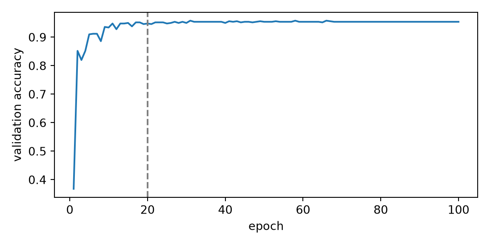

# Running Deep Learning Experiments

Code

- [Show All Code](javascript:void(0))
- [Hide All Code](javascript:void(0))

Published

Last modified: 2026-11-04

Show code

``` downlit
# The Python chunks on this page import these; reticulate provisions them.
# Attaching reticulate gives the inline R its `py` object.
library(reticulate)
source("../tools/use-torch.R")
use_torch(c("numpy", "pandas", "matplotlib"))
```

Brian Hutchinson’s CSCI 481/581 sets the order of topics in these notes, which follow it with his permission; this page covers his module on running [deep learning](../chapters/course-overview.llms.md#def-deep-learning) experiments. The exercises are new.

# 1 Welcome

## 1.1 Plan for this lecture

Earlier chapters trained networks with settings picked for them: a [learning rate](https://morrison-lab.github.io/lds/chapters/gradient-descent.html#def-learning-rate), a [width](https://morrison-lab.github.io/lds/chapters/neural-nets.html#def-width), a number of [epochs](https://morrison-lab.github.io/lds/chapters/gradient-descent.html#def-epoch). This lecture is about choosing such settings with experiments, and trusting what the experiments say:

1.  how much a score changes when only the random seed changes;
2.  how to compare two [widths](https://morrison-lab.github.io/lds/chapters/neural-nets.html#def-width) fairly when the best [learning rate](https://morrison-lab.github.io/lds/chapters/gradient-descent.html#def-learning-rate) depends on the [width](https://morrison-lab.github.io/lds/chapters/neural-nets.html#def-width);
3.  how to lay out a sweep of [learning rates](https://morrison-lab.github.io/lds/chapters/gradient-descent.html#def-learning-rate), and check that it was wide enough;
4.  when training longer would help;
5.  what it takes to run the same experiment twice and get the same numbers.

[lds’s chapter on machine learning experiments](https://morrison-lab.github.io/lds/chapters/ml-experimentation.html) covers the parts that hold for any model: the training, validation and [test sets](https://morrison-lab.github.io/lds/chapters/big-ideas.html#def-test-set), data snooping, and grid and random search. This lecture adds what is particular to training deep networks.

## 1.2 The digits

Show code

``` python
import pandas as pd
import torch
from torch import nn
import matplotlib.pyplot as plt

digits = pd.read_csv("data/optdigits-test.csv", header=None)
x = torch.tensor(digits.iloc[:, :64].to_numpy(), dtype=torch.float32) / 16
y = torch.tensor(digits[64].to_numpy())
order = torch.randperm(len(x), generator=torch.Generator().manual_seed(481))
train_idx, val_idx = order[:500], order[500:1000]
n_train, n_val = len(train_idx), len(val_idx)
n_unused = len(x) - n_train - n_val
loss_fn = nn.CrossEntropyLoss()


def train_and_score(width, lr, seed, n_epochs=20, batch_size=50):
    # One training run: an MLP with one hidden layer of `width` ReLU units,
    # trained by minibatch SGD. Returns the validation accuracy after each epoch.
    torch.manual_seed(seed)
    net = nn.Sequential(nn.Linear(64, width), nn.ReLU(), nn.Linear(width, 10))
    optimizer = torch.optim.SGD(net.parameters(), lr=lr)
    shuffler = torch.Generator().manual_seed(seed)
    scores = []
    for epoch in range(n_epochs):
        for batch in torch.randperm(len(train_idx), generator=shuffler).split(batch_size):
            rows = train_idx[batch]
            optimizer.zero_grad()
            loss_fn(net(x[rows]), y[rows]).backward()
            optimizer.step()
        with torch.no_grad():
            correct = net(x[val_idx]).argmax(dim=1) == y[val_idx]
        scores.append(correct.float().mean().item())
    return scores


print(n_train, n_val, n_unused)
```

    500 500 797

The exercises use the 1,797 digits of [`data/optdigits-test.csv`](data/optdigits-test.csv) [\[1\]](#ref-alpaydin1998optdigits), each an 8 by 8 image with 64 pixels. 500 random images form the [training set](https://morrison-lab.github.io/lds/chapters/big-ideas.html#def-training-set) and another 500 the [validation set](https://morrison-lab.github.io/lds/chapters/big-ideas.html#def-validation-set). The other 797 stay unused, as a [test set](https://morrison-lab.github.io/lds/chapters/big-ideas.html#def-test-set) would until the model is final. `train_and_score()` builds an [MLP](../chapters/feedforward-networks.llms.md#def-feedforward-network) with one [hidden layer](../chapters/feedforward-networks.llms.md#def-hidden-layer) of `width` [ReLU](../chapters/feedforward-networks.llms.md#def-relu) [units](../chapters/feedforward-networks.llms.md#def-unit). It trains the MLP by [minibatch](https://morrison-lab.github.io/lds/chapters/gradient-descent.html#def-minibatch) [SGD](https://morrison-lab.github.io/lds/chapters/gradient-descent.html#def-sgd) with [learning rate](https://morrison-lab.github.io/lds/chapters/gradient-descent.html#def-learning-rate) `lr`, 50 images to a minibatch, for 20 [epochs](https://morrison-lab.github.io/lds/chapters/gradient-descent.html#def-epoch) unless asked for more. It returns the [accuracy](https://morrison-lab.github.io/lds/chapters/metrics.html#def-accuracy) on the validation set after each [epoch](https://morrison-lab.github.io/lds/chapters/gradient-descent.html#def-epoch).

# 2 Settings and seeds

## 2.1 What training does not learn

> **NOTE:**
>
> **Exercise 1 (Settings that training does not learn)** List the numbers that `train_and_score()` uses but [SGD](https://morrison-lab.github.io/lds/chapters/gradient-descent.html#def-sgd) never changes.

> **NOTE:**
>
> *Solution 1*. [SGD](https://morrison-lab.github.io/lds/chapters/gradient-descent.html#def-sgd) changes only the weights and biases of the two `nn.Linear` layers. These numbers are set before training starts, and stay as set:
>
> - the [width](https://morrison-lab.github.io/lds/chapters/neural-nets.html#def-width) of the [hidden layer](../chapters/feedforward-networks.llms.md#def-hidden-layer), `width`;
> - the [learning rate](https://morrison-lab.github.io/lds/chapters/gradient-descent.html#def-learning-rate), `lr`;
> - the number of [epochs](https://morrison-lab.github.io/lds/chapters/gradient-descent.html#def-epoch), `n_epochs`;
> - the [minibatch](https://morrison-lab.github.io/lds/chapters/gradient-descent.html#def-minibatch) size, `batch_size`;
> - the random seed, `seed`;
> - the sizes of the training and [validation sets](https://morrison-lab.github.io/lds/chapters/big-ideas.html#def-validation-set), 500 and 500.
>
> The first four are [hyperparameters](https://morrison-lab.github.io/lds/chapters/model-selection.html#sec-hyperparameters): settings that we choose, rather than learn from the data. So are choices that are not numbers, such as SGD itself, the [ReLU](../chapters/feedforward-networks.llms.md#def-relu) activation and the single hidden layer. The seed is not a setting of that kind. No seed suits new data better than another, so a seed chosen for its validation score has been fitted to noise. The set sizes are a choice about the data, not the model.

## 2.2 The same settings, ten seeds

> **NOTE:**
>
> **Exercise 2 (Ten seeds)** Train a network of [width](https://morrison-lab.github.io/lds/chapters/neural-nets.html#def-width) 64 with [learning rate](https://morrison-lab.github.io/lds/chapters/gradient-descent.html#def-learning-rate) 0.1 once for each seed from 0 to 9. How much does the final validation [accuracy](https://morrison-lab.github.io/lds/chapters/metrics.html#def-accuracy) vary?

> **NOTE:**
>
> *Solution 2*.
>
> Show code
>
> ``` python
> wide_scores = torch.tensor([train_and_score(64, 0.1, seed)[-1] for seed in range(10)])
> seed_low, seed_high = wide_scores.min().item(), wide_scores.max().item()
> seed_sd = wide_scores.std().item()
> print(wide_scores)
> ```
>
>     tensor([0.8900, 0.8860, 0.8740, 0.8960, 0.8760, 0.8920, 0.9040, 0.8900, 0.8900,
>             0.8960])
>
> Show code
>
> ``` python
> print(seed_low, seed_high, seed_sd)
> ```
>
>     0.8740000128746033 0.9039999842643738 0.00904556643217802
>
> The ten validation [accuracies](https://morrison-lab.github.io/lds/chapters/metrics.html#def-accuracy) run from 0.874 to 0.904, with standard deviation 0.009. Only the seed changed between the runs. The seed sets the starting weights and the order of the [minibatches](https://morrison-lab.github.io/lds/chapters/gradient-descent.html#def-minibatch). So two runs can differ by about 0.03 in validation [accuracy](https://morrison-lab.github.io/lds/chapters/metrics.html#def-accuracy) with every [hyperparameter](https://morrison-lab.github.io/lds/chapters/model-selection.html#sec-hyperparameters) the same.

## 2.3 One run of each

> **NOTE:**
>
> **Exercise 3 (One run of each)**  
>
> Show code
>
> ``` python
> narrow_seed0 = train_and_score(32, 0.1, 0)[-1]
> wide_seed0 = wide_scores[0].item()
> print(narrow_seed0, wide_seed0)
> ```
>
>     0.8820000290870667 0.8899999856948853
>
> With seed 0 and [learning rate](https://morrison-lab.github.io/lds/chapters/gradient-descent.html#def-learning-rate) 0.1, a network of [width](https://morrison-lab.github.io/lds/chapters/neural-nets.html#def-width) 32 reaches validation [accuracy](https://morrison-lab.github.io/lds/chapters/metrics.html#def-accuracy) 0.882, and one of width 64 reaches 0.890. Does this show that width 64 is better at this learning rate?

> **NOTE:**
>
> *Solution 3*.
>
> Show code
>
> ``` python
> narrow_scores = torch.tensor([train_and_score(32, 0.1, seed)[-1] for seed in range(10)])
> mean_gap = (wide_scores.mean() - narrow_scores.mean()).item()
> gap_se = ((wide_scores.var() + narrow_scores.var()) / 10).sqrt().item()
> print(narrow_scores.mean().item(), wide_scores.mean().item(), mean_gap, gap_se)
> ```
>
>     0.8855999708175659 0.8894000053405762 0.003800034523010254 0.004646146669983864
>
> Show code
>
> ``` python
> # Stop the render if the prose below stops being true.
> assert abs(wide_seed0 - narrow_seed0) < seed_high - seed_low
> assert abs(mean_gap) < 2 * gap_se
> ```
>
> No. The two runs differ by 0.008, less than the 0.030 that the seed alone moved [width](https://morrison-lab.github.io/lds/chapters/neural-nets.html#def-width) 64 in [Solution 2](#sol-seed-spread). With ten seeds of each, the mean [accuracy](https://morrison-lab.github.io/lds/chapters/metrics.html#def-accuracy) of width 64 is higher by 0.0038. That difference has [standard error](https://morrison-lab.github.io/lds/chapters/linear-regression.html#def-standard-error) 0.0046, so it is less than two standard errors from 0, and ten seeds each do not settle the question either. A comparison of single runs measures the two seeds as much as the two [widths](https://morrison-lab.github.io/lds/chapters/neural-nets.html#def-width).

# 3 Comparing settings fairly

## 3.1 Two widths

> **NOTE:**
>
> **Exercise 4 (A fair comparison)** A classmate wants to know whether a network of [width](https://morrison-lab.github.io/lds/chapters/neural-nets.html#def-width) 512 classifies the digits better than one of width 8. They train one of each with [learning rate](https://morrison-lab.github.io/lds/chapters/gradient-descent.html#def-learning-rate) 0.1. What could make that comparison unfair?

> **NOTE:**
>
> *Solution 4*. Nothing says that one [learning rate](https://morrison-lab.github.io/lds/chapters/gradient-descent.html#def-learning-rate) is best for both [widths](https://morrison-lab.github.io/lds/chapters/neural-nets.html#def-width). If 0.1 suits [width](https://morrison-lab.github.io/lds/chapters/neural-nets.html#def-width) 512 and is too small for width 8, the comparison measures how well each width suits 0.1, as well as the width itself. A fair comparison tunes the learning rate for each width on its own, and compares each width at its own best rate. One run of each has the problem of [Solution 3](#sol-one-seed) too, so each setting gets several seeds.

## 3.2 A sweep for each width

> **NOTE:**
>
> **Exercise 5 (A learning-rate sweep)** For each [width](https://morrison-lab.github.io/lds/chapters/neural-nets.html#def-width), 8 and 512, train with each [learning rate](https://morrison-lab.github.io/lds/chapters/gradient-descent.html#def-learning-rate) in 0.003, 0.01, 0.03, 0.1, 0.3, 1 and 3, and with seeds 0, 1 and 2. How much higher is width 512’s mean validation [accuracy](https://morrison-lab.github.io/lds/chapters/metrics.html#def-accuracy) than width 8’s, when each width uses the learning rate that suits it best?

> **NOTE:**
>
> *Solution 5*.
>
> Show code
>
> ``` python
> rates = [0.003, 0.01, 0.03, 0.1, 0.3, 1, 3]
> sweep = pd.DataFrame(
>     [
>         {"width": width, "lr": lr, "seed": seed, "accuracy": train_and_score(width, lr, seed)[-1]}
>         for width in [8, 512]
>         for lr in rates
>         for seed in range(3)
>     ]
> )
> mean_accuracy = sweep.groupby(["width", "lr"])["accuracy"].mean().unstack("width")
> best_rate = mean_accuracy.idxmax()
> best_accuracy = mean_accuracy.max()
> best_rate_8, best_rate_512 = best_rate[8], best_rate[512]
> edge_accuracy_512 = mean_accuracy.loc[3, 512]
> gap_at_01 = mean_accuracy.loc[0.1, 512] - mean_accuracy.loc[0.1, 8]
> gap_at_best = best_accuracy[512] - best_accuracy[8]
> print(mean_accuracy.round(3))
> ```
>
>     width    8      512
>     lr                 
>     0.003  0.166  0.410
>     0.010  0.237  0.679
>     0.030  0.299  0.875
>     0.100  0.719  0.903
>     0.300  0.879  0.929
>     1.000  0.808  0.949
>     3.000  0.091  0.088
>
> Show code
>
> ``` python
> print(best_rate.to_dict(), gap_at_01, gap_at_best)
> ```
>
>     {8: 0.3, 512: 1.0} 0.18400001525878906 0.07066665093104052
>
> Show code
>
> ``` python
> # Stop the render if the prose below stops being true.
> assert best_rate[8] < best_rate[512] < max(rates)
> assert 2 * seed_sd < gap_at_best < gap_at_01
> # Stop the render if the figure's alt text stops being true.
> assert best_rate[8] == 0.3 and best_rate[512] == 1
> assert abs(best_accuracy[512] - 0.95) < 0.015
> assert abs(best_accuracy[8] - 0.88) < 0.015
> assert mean_accuracy.loc[3].max() < 0.15
> ```
>
> > **NOTE:**
> >
> > Show code
> >
> > ``` python
> > fig, ax = plt.subplots(figsize=(6, 3.5))
> > for width, marker in [(8, "o"), (512, "s")]:
> >     runs = sweep[sweep["width"] == width]
> >     ax.scatter(runs["lr"], runs["accuracy"], marker=marker, alpha=0.5, label=f"width {width}");
> >     ax.plot(mean_accuracy.index, mean_accuracy[width]);
> > ax.set_xscale("log");
> > ax.set_xlabel("learning rate");
> > ax.set_ylabel("validation accuracy");
> > ax.legend();
> > fig.tight_layout();
> > plt.show()
> > ```
> >
> > [](dl-experiments_files/figure-html/unnamed-chunk-7-1.png "Figure 1: Final validation accuracy of each run in the sweep, and the mean over the three seeds at each learning rate.")
> >
> > Figure 1: Final validation [accuracy](https://morrison-lab.github.io/lds/chapters/metrics.html#def-accuracy) of each run in the sweep, and the mean over the three seeds at each [learning rate](https://morrison-lab.github.io/lds/chapters/gradient-descent.html#def-learning-rate).
>
> [Width](https://morrison-lab.github.io/lds/chapters/neural-nets.html#def-width) 8 does best with [learning rate](https://morrison-lab.github.io/lds/chapters/gradient-descent.html#def-learning-rate) 0.3, and width 512 with 1. At learning rate 0.1, width 512’s mean [accuracy](https://morrison-lab.github.io/lds/chapters/metrics.html#def-accuracy) is higher by 0.184. With each width at its own best rate, width 512’s mean accuracy is higher by 0.071, 8 times the seed-to-seed standard deviation of [Solution 2](#sol-seed-spread). So the wider network does classify better, by 38% of what the comparison at one rate said.

## 3.3 Three roles

> **NOTE:**
>
> **Definition 1 (Scientific hyperparameter)** A **scientific hyperparameter** of an experiment is a [hyperparameter](https://morrison-lab.github.io/lds/chapters/model-selection.html#sec-hyperparameters) whose effect on the model’s performance the experiment is meant to measure [\[2\]](#ref-godbole2023playbook).

> **NOTE:**
>
> **Example 1 (The width in the sweep)** In [Solution 5](#sol-rate-sweep), the [width](https://morrison-lab.github.io/lds/chapters/neural-nets.html#def-width) is the [scientific hyperparameter](#def-scientific-hyperparameter): the sweep asks whether width 512 classifies the digits better than width 8.

> **NOTE:**
>
> **Definition 2 (Nuisance hyperparameter)** A **nuisance hyperparameter** of an experiment is a [hyperparameter](https://morrison-lab.github.io/lds/chapters/model-selection.html#sec-hyperparameters) that the experiment tunes for each value of its [scientific hyperparameter](#def-scientific-hyperparameter)s, so that those values are compared fairly [\[2\]](#ref-godbole2023playbook).

> **NOTE:**
>
> **Example 2 (The learning rate in the sweep)** In [Solution 5](#sol-rate-sweep), the [learning rate](https://morrison-lab.github.io/lds/chapters/gradient-descent.html#def-learning-rate) is a [nuisance hyperparameter](#def-nuisance-hyperparameter). The sweep tunes it for each [width](https://morrison-lab.github.io/lds/chapters/neural-nets.html#def-width), 8 and 512, and compares the [widths](https://morrison-lab.github.io/lds/chapters/neural-nets.html#def-width) at their own best rates.

> **NOTE:**
>
> **Definition 3 (Fixed hyperparameter)** A **fixed hyperparameter** of an experiment is a [hyperparameter](https://morrison-lab.github.io/lds/chapters/model-selection.html#sec-hyperparameters) that keeps one value throughout the experiment [\[2\]](#ref-godbole2023playbook). The experiment’s conclusions hold for that value, and may not hold for others.

> **NOTE:**
>
> **Example 3 (What the sweep held fixed)** In [Solution 5](#sol-rate-sweep), the [fixed hyperparameter](#def-fixed-hyperparameter)s include the [minibatch](https://morrison-lab.github.io/lds/chapters/gradient-descent.html#def-minibatch) size of 50, the 20 [epochs](https://morrison-lab.github.io/lds/chapters/gradient-descent.html#def-epoch), the single [hidden layer](../chapters/feedforward-networks.llms.md#def-hidden-layer) and the choice of [SGD](https://morrison-lab.github.io/lds/chapters/gradient-descent.html#def-sgd). So the sweep shows that [width](https://morrison-lab.github.io/lds/chapters/neural-nets.html#def-width) 512 beats width 8 after 20 epochs of SGD with [minibatches](https://morrison-lab.github.io/lds/chapters/gradient-descent.html#def-minibatch) of 50. It does not show it for 5 epochs, or for [Adam](https://morrison-lab.github.io/mds/optimization-gradient-descent.html#def-adam).

> **NOTE:**
>
> *Remark 1* (A role belongs to an experiment). One [hyperparameter](https://morrison-lab.github.io/lds/chapters/model-selection.html#sec-hyperparameters) can play a different role in each experiment [\[2\]](#ref-godbole2023playbook). The [learning rate](https://morrison-lab.github.io/lds/chapters/gradient-descent.html#def-learning-rate) is a [nuisance hyperparameter](#def-nuisance-hyperparameter) in [Solution 5](#sol-rate-sweep). An experiment that asks whether [learning-rate warmup](../chapters/optimization.llms.md#def-warmup) helps makes the [warmup](../chapters/optimization.llms.md#def-warmup)’s length a [scientific hyperparameter](#def-scientific-hyperparameter), and still tunes the learning rate as a nuisance. An experiment that cannot afford to tune the learning rate makes it a [fixed hyperparameter](#def-fixed-hyperparameter), and its conclusions then come with that caveat [\[2\]](#ref-godbole2023playbook).

# 4 Laying out a sweep

## 4.1 Spacing the rates

> **NOTE:**
>
> **Exercise 6 (Spacing the rates)** Each [learning rate](https://morrison-lab.github.io/lds/chapters/gradient-descent.html#def-learning-rate) in [Exercise 5](#exr-rate-sweep) is about 3 times the one before it. What would go wrong with seven rates spread evenly from 0.003 to 3?

> **NOTE:**
>
> *Solution 6*.
>
> Show code
>
> ``` python
> import numpy as np
>
> even_rates = np.linspace(0.003, 3, 7)
> print(even_rates.round(4))
> ```
>
>     [0.003  0.5025 1.002  1.5015 2.001  2.5005 3.    ]
>
> Evenly spread rates go up by 0.4995 at each step, so the second is already 0.5025. Nothing between 0.003 and 0.5025 would be tried, and that interval holds [width](https://morrison-lab.github.io/lds/chapters/neural-nets.html#def-width) 8’s best [learning rate](https://morrison-lab.github.io/lds/chapters/gradient-descent.html#def-learning-rate), 0.3, and every rate at which width 512 was still improving in [Figure 1](#fig-rate-sweep). Good [learning rates](https://morrison-lab.github.io/lds/chapters/gradient-descent.html#def-learning-rate) can differ by factors of 10 or more, so a sweep spaces them by a constant factor: evenly on a log scale. Random search draws a learning rate the same way, uniform on its logarithm ([lds](https://morrison-lab.github.io/lds/chapters/ml-experimentation.html#tuning)).

## 4.2 The edge of the sweep

> **NOTE:**
>
> **Exercise 7 (The edge of the sweep)** Suppose the sweep in [Solution 5](#sol-rate-sweep) had stopped at [learning rate](https://morrison-lab.github.io/lds/chapters/gradient-descent.html#def-learning-rate) 1. What would its result for [width](https://morrison-lab.github.io/lds/chapters/neural-nets.html#def-width) 512 leave unknown?

> **NOTE:**
>
> *Solution 7*. [Width](https://morrison-lab.github.io/lds/chapters/neural-nets.html#def-width) 512’s best [learning rate](https://morrison-lab.github.io/lds/chapters/gradient-descent.html#def-learning-rate) would then be the largest one tried. A larger rate might do better still, and the sweep could not say. When the best value sits at the edge of the range searched, the range is suspect, and the next step is to extend it in that direction [\[2\]](#ref-godbole2023playbook). The actual sweep went one step further, to 3, where width 512’s mean validation [accuracy](https://morrison-lab.github.io/lds/chapters/metrics.html#def-accuracy) drops to 0.088, about the 0.1 of guessing one digit of ten. So the rate that suits width 512 best lies between 0.3 and 3, and a finer sweep in that range could pin it down.

# 5 How long to train

## 5.1 More epochs

> **NOTE:**
>
> **Exercise 8 (More epochs)** Would [width](https://morrison-lab.github.io/lds/chapters/neural-nets.html#def-width) 512, at the [learning rate](https://morrison-lab.github.io/lds/chapters/gradient-descent.html#def-learning-rate) that suited it best in [Solution 5](#sol-rate-sweep), reach a higher validation [accuracy](https://morrison-lab.github.io/lds/chapters/metrics.html#def-accuracy) with 100 [epochs](https://morrison-lab.github.io/lds/chapters/gradient-descent.html#def-epoch) of training instead of 20?

> **NOTE:**
>
> *Solution 8*.
>
> Show code
>
> ``` python
> long_run = train_and_score(512, best_rate[512], 0, n_epochs=100)
> at_20, best_long = long_run[19], max(long_run)
> best_epoch = long_run.index(best_long) + 1
> print(at_20, best_long, best_epoch, long_run[-1])
> ```
>
>     0.9480000138282776 0.9580000042915344 31 0.9539999961853027
>
> Show code
>
> ``` python
> # Stop the render if the prose below stops being true.
> assert best_long - at_20 < seed_high - seed_low
> assert min(long_run[19:]) > at_20 - 0.01
> # Stop the render if the figure's alt text stops being true.
> assert abs(at_20 - 0.95) < 0.015
> assert all(abs(score - at_20) < 0.015 for score in long_run[19:])
> ```
>
> > **NOTE:**
> >
> > Show code
> >
> > ``` python
> > fig, ax = plt.subplots(figsize=(6, 3))
> > ax.plot(range(1, 101), long_run);
> > ax.axvline(20, linestyle="--", color="gray");
> > ax.set_xlabel("epoch");
> > ax.set_ylabel("validation accuracy");
> > fig.tight_layout();
> > plt.show()
> > ```
> >
> > [](dl-experiments_files/figure-html/unnamed-chunk-10-3.png "Figure 2: Validation accuracy after each epoch of one 100-epoch run of width 512 at learning rate 1; the dashed line marks epoch 20.")
> >
> > Figure 2: Validation [accuracy](https://morrison-lab.github.io/lds/chapters/metrics.html#def-accuracy) after each [epoch](https://morrison-lab.github.io/lds/chapters/gradient-descent.html#def-epoch) of one 100-epoch run of [width](https://morrison-lab.github.io/lds/chapters/neural-nets.html#def-width) 512 at [learning rate](https://morrison-lab.github.io/lds/chapters/gradient-descent.html#def-learning-rate) 1; the dashed line marks epoch 20.
>
> Hardly. After 20 [epochs](https://morrison-lab.github.io/lds/chapters/gradient-descent.html#def-epoch) the validation [accuracy](https://morrison-lab.github.io/lds/chapters/metrics.html#def-accuracy) is 0.948. Its highest value over 100 epochs is 0.958, at [epoch](https://morrison-lab.github.io/lds/chapters/gradient-descent.html#def-epoch) 31, less above the 20-epoch value than the seed alone moved [width](https://morrison-lab.github.io/lds/chapters/neural-nets.html#def-width) 64 in [Solution 2](#sol-seed-spread). With the [learning rate](https://morrison-lab.github.io/lds/chapters/gradient-descent.html#def-learning-rate) the sweep tuned for 20 epochs, training 5 times as long buys nothing that this experiment can detect.

> **NOTE:**
>
> **Definition 4 (Compute-bound)** Training is **compute-bound** when how long we are willing to train limits the model’s performance, rather than the amount of data or anything else [\[2\]](#ref-godbole2023playbook). Then training longer, with the [hyperparameters](https://morrison-lab.github.io/lds/chapters/model-selection.html#sec-hyperparameters) tuned for the longer run, improves the validation performance.

> **NOTE:**
>
> **Example 4 (A slow rate is not the problem)**  
>
> Show code
>
> ``` python
> slow_run = train_and_score(512, 0.03, 0, n_epochs=100)
> long_rates = [0.1, 0.3, 1]
> long_scores = [train_and_score(512, lr, 0, n_epochs=100)[-1] for lr in long_rates]
> best_long_tuned = max(long_scores)
> print(slow_run[19], slow_run[-1], long_scores)
> ```
>
>     0.8799999952316284 0.9139999747276306 [0.9459999799728394, 0.9440000057220459, 0.9539999961853027]
>
> Show code
>
> ``` python
> # Stop the render if the prose below stops being true.
> assert slow_run[-1] - slow_run[19] > seed_high - seed_low
> assert slow_run[-1] < at_20
> assert all(s < l for s, l in zip(slow_run[19:], long_run[19:]))
> assert best_long_tuned - at_20 < seed_high - seed_low
> # Stop the render if the figure's alt text stops being true.
> assert abs(slow_run[19] - 0.88) < 0.015
> assert abs(slow_run[-1] - 0.91) < 0.015
> ```
>
> > **NOTE:**
> >
> > Show code
> >
> > ``` python
> > fig, ax = plt.subplots(figsize=(6, 3))
> > ax.plot(range(1, 101), long_run, label=f"learning rate {best_rate[512]}");
> > ax.plot(range(1, 101), slow_run, label="learning rate 0.03");
> > ax.axvline(20, linestyle="--", color="gray");
> > ax.set_xlabel("epoch");
> > ax.set_ylabel("validation accuracy");
> > ax.legend();
> > fig.tight_layout();
> > plt.show()
> > ```
> >
> > [](dl-experiments_files/figure-html/unnamed-chunk-12-5.png "Figure 3: Validation accuracy after each epoch of 100-epoch runs of width 512 at two learning rates; the dashed line marks epoch 20.")
> >
> > Figure 3: Validation [accuracy](https://morrison-lab.github.io/lds/chapters/metrics.html#def-accuracy) after each [epoch](https://morrison-lab.github.io/lds/chapters/gradient-descent.html#def-epoch) of 100-epoch runs of [width](https://morrison-lab.github.io/lds/chapters/neural-nets.html#def-width) 512 at two [learning rates](https://morrison-lab.github.io/lds/chapters/gradient-descent.html#def-learning-rate); the dashed line marks epoch 20.
>
> At [learning rate](https://morrison-lab.github.io/lds/chapters/gradient-descent.html#def-learning-rate) 0.03, [width](https://morrison-lab.github.io/lds/chapters/neural-nets.html#def-width) 512’s validation [accuracy](https://morrison-lab.github.io/lds/chapters/metrics.html#def-accuracy) rises from 0.880 after 20 [epochs](https://morrison-lab.github.io/lds/chapters/gradient-descent.html#def-epoch) to 0.914 after 100. That run alone would suggest that 20 epochs hold the model back. But at its best learning rate the network gets 0.948 in 20 epochs, more than the slow run gets in 100. Tuned for 100 epochs instead, over [learning rates](https://morrison-lab.github.io/lds/chapters/gradient-descent.html#def-learning-rate) 0.1, 0.3 and 1, the best 100-epoch run reaches 0.954, less above the 20-epoch run than the seed alone moved width 64 in [Solution 2](#sol-seed-spread). Longer training does not help, so training this network on these 500 images is not [compute-bound](#def-compute-bound). Something other than training time limits it.

> **NOTE:**
>
> *Remark 2* (Spending a fixed budget). The sweep in [Solution 5](#sol-rate-sweep) trained 42 networks for 20 [epochs](https://morrison-lab.github.io/lds/chapters/gradient-descent.html#def-epoch) each, 840 epochs in all. One 100-epoch run of one network takes as many epochs as 5 of those trials. Here, where training is not [compute-bound](#def-compute-bound), the extra 80 epochs in [Solution 8](#sol-longer) bought nothing, and the same 80 epochs would have paid for 4 more trials of the same [width](https://morrison-lab.github.io/lds/chapters/neural-nets.html#def-width), such as more seeds or more [learning rates](https://morrison-lab.github.io/lds/chapters/gradient-descent.html#def-learning-rate). When training is compute-bound, Godbole et al. [\[2\]](#ref-godbole2023playbook) still advise against making every trial as long as the budget allows. They tune in rounds, starting with many short runs to find good settings and ending with a few long runs at the best of them.

# 6 Running it again

## 6.1 Where the randomness comes from

> **NOTE:**
>
> **Exercise 9 (Where the randomness comes from)** List every random draw that a run of `train_and_score()` depends on.

> **NOTE:**
>
> *Solution 9*.
>
> - **The starting weights.** `torch.manual_seed(seed)` seeds PyTorch’s global random number generator, and each `nn.Linear` draws its starting weights and biases from it.
> - **The order of the [minibatches](https://morrison-lab.github.io/lds/chapters/gradient-descent.html#def-minibatch).** `shuffler`, a generator of its own seeded with `seed`, draws a new order of the training images in each [epoch](https://morrison-lab.github.io/lds/chapters/gradient-descent.html#def-epoch).
> - **The split.** `order`, drawn once outside the function from a generator seeded with 481, decides which images are for training and which for validation. Every run shares it, so the runs differ in their seeds and settings but not in their data.
>
> A network with [dropout](../chapters/regularization.llms.md#def-dropout) would draw one more random mask at each step, from the global generator.

## 6.2 The same run twice

> **NOTE:**
>
> **Exercise 10 (The same run twice)** Does calling `train_and_score(64, 0.1, 0)` twice give the same validation [accuracies](https://morrison-lab.github.io/lds/chapters/metrics.html#def-accuracy)?

> **NOTE:**
>
> *Solution 10*.
>
> Show code
>
> ``` python
> first, second = train_and_score(64, 0.1, 0), train_and_score(64, 0.1, 0)
> print(first == second, first[-1])
> ```
>
>     True 0.8899999856948853
>
> Show code
>
> ``` python
> print(torch.__version__)
> ```
>
>     2.15.0+cu132
>
> Show code
>
> ``` python
> assert first == second
> ```
>
> Yes: all 20 validation [accuracies](https://morrison-lab.github.io/lds/chapters/metrics.html#def-accuracy) agree, because each call reseeds both generators of [Solution 9](#sol-random-draws) before it draws anything. That holds on one machine, with one version of each library. The printed `torch.__version__` is the PyTorch version that rendered this page.

> **NOTE:**
>
> *Remark 3* (Seeds are not enough). PyTorch’s documentation warns that completely reproducible results are not guaranteed across PyTorch releases or platforms, or between a CPU and a GPU, even with identical seeds [\[3\]](#ref-pytorch_randomness). Some GPU operations are nondeterministic, and `torch.use_deterministic_algorithms(True)` makes PyTorch choose deterministic ones, often more slowly, or raise an error where it has none [\[3\]](#ref-pytorch_randomness). So record more than the seed: the [hyperparameters](https://morrison-lab.github.io/lds/chapters/model-selection.html#sec-hyperparameters), the versions of the code, the data and the libraries, and the trained weights themselves. [lds’s section on tracking runs](https://morrison-lab.github.io/lds/chapters/ml-experimentation.html#tracking-runs) gives the habits that make a result traceable a month later.

## 6.3 Further reading

> **NOTE:**
>
> The [Deep Learning Tuning Playbook](https://github.com/google-research/tuning_playbook) [\[2\]](#ref-godbole2023playbook) is the source of this lecture’s vocabulary, and covers choosing a batch size and a starting configuration as well. *Deep Learning*’s [chapter 11](https://www.deeplearningbook.org/contents/guidelines.html) covers manual and automatic hyperparameter search [\[4, Sec. 11.4\]](#ref-goodfellow2016deep).

# 7 References

\[1\]

E. Alpaydin and C. Kaynak, “Optical recognition of handwritten digits.” UCI Machine Learning Repository, 1998. doi: [10.24432/C50P49](https://doi.org/10.24432/C50P49).

\[2\]

V. Godbole, G. E. Dahl, J. Gilmer, C. J. Shallue, and Z. Nado, “Deep learning tuning playbook.” GitHub repository, 2023. Available: <https://github.com/google-research/tuning_playbook>

\[3\]

PyTorch Contributors, “Reproducibility.” PyTorch documentation, 2026. Available: <https://docs.pytorch.org/docs/stable/notes/randomness.html>

\[4\]

I. Goodfellow, Y. Bengio, and A. Courville, *Deep learning*. MIT Press, 2016. Available: <https://www.deeplearningbook.org/>

Back to top
