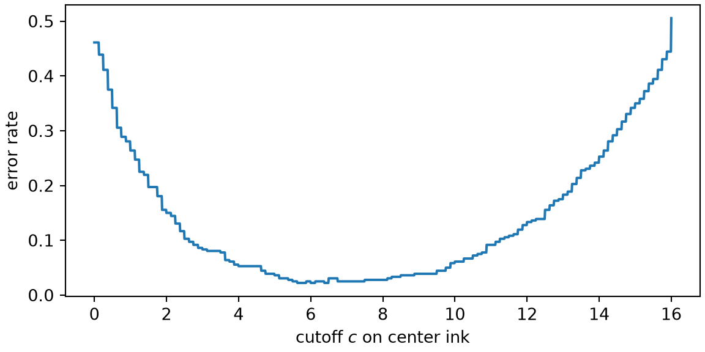
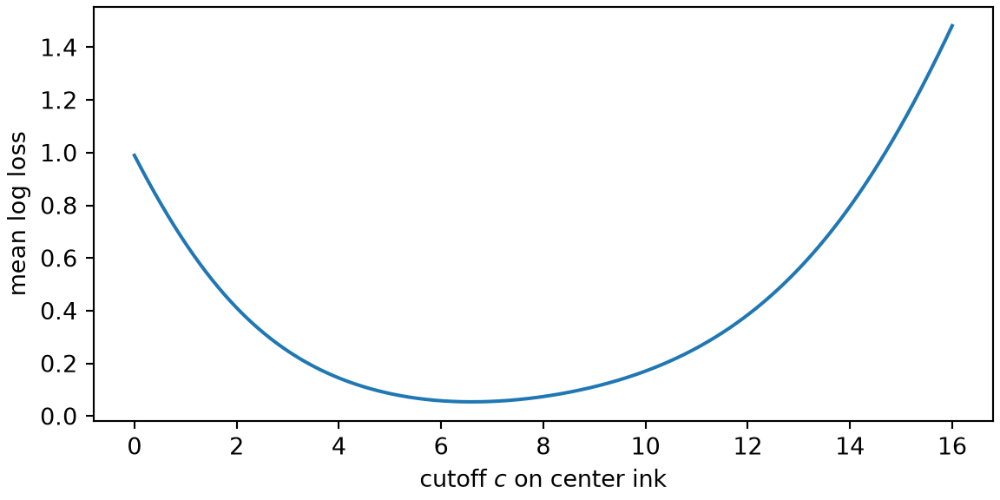

# Machine Learning Review

Code

- [Show All Code](javascript:void(0))
- [Hide All Code](javascript:void(0))

Published

Last modified: 2026-10-25

Show code

``` downlit
# The Python chunks on this page import these; reticulate provisions them.
# Attaching reticulate gives the inline R its `py` object.
library(reticulate)
py_require(c("numpy", "pandas", "matplotlib"))
```

The order of topics in these notes follows Brian Hutchinson’s CSCI 481/581, used with his permission; his [machine learning](https://morrison-lab.github.io/lds/chapters/course-overview.html#def-machine-learning) review module is condensed here into a page that links to lds. The exercises are new.

# 1 Welcome

## 1.1 Plan for this lecture

[Deep learning](../chapters/course-overview.llms.md#def-deep-learning) reuses the pieces of supervised learning from DATA 371 and DATA 471, which [lds](https://morrison-lab.github.io/lds/) covers in full. This lecture reviews four of them on the handwritten digits from the [course overview](../chapters/course-overview.llms.md):

1.  the parts of a learning problem: a [model family](https://morrison-lab.github.io/lds/chapters/big-ideas.html#def-model-family), its [parameters](https://morrison-lab.github.io/lds/chapters/big-ideas.html#def-parameter), and a [loss function](https://morrison-lab.github.io/lds/chapters/big-ideas.html#def-loss-function);
2.  why models are trained on a smooth loss rather than on their [error rate](https://morrison-lab.github.io/lds/chapters/metrics.html#def-error-rate);
3.  why a model is judged on data it was not fit to;
4.  how each piece reappears in [deep learning](../chapters/course-overview.llms.md#def-deep-learning).

## 1.2 The digits again

The exercises here use the 1,797 handwritten digits [\[1\]](#ref-alpaydin1998optdigits) and the center-ink [feature](https://morrison-lab.github.io/lds/chapters/course-overview.html#def-feature) from the [course overview](../chapters/course-overview.llms.md#sol-zero-or-one): the average ink in rows 2 to 5 and columns 3 and 4 of each 8 by 8 image. This chunk loads them again, with the left-ink feature from the same page.

``` python
import numpy as np
import pandas as pd
import matplotlib.pyplot as plt

digits = pd.read_csv("data/optdigits-test.csv", header=None)
pixels = digits.iloc[:, :64].to_numpy()
labels = digits[64].to_numpy()
images = pixels.reshape(-1, 8, 8)

center_ink = images[:, 2:6, 3:5].mean(axis=(1, 2))
left_ink = images[:, 2:6, 0:3].mean(axis=(1, 2))
print(images.shape, center_ink[:5], left_ink[:5])
```

    (1797, 8, 8) [ 0.375 15.875 11.375  8.25   9.125] [5.16666667 2.25       3.58333333 0.41666667 4.        ]

# 2 The parts of a learning problem

## 2.1 Model family, parameter, loss

> **NOTE:**
>
> **Exercise 1 (The parts of the 0-or-1 rule)** The course overview’s [rule for 0 or 1](../chapters/course-overview.llms.md#exr-zero-one-cutoff) calls an image a 1 when its center ink is above a cutoff, and found its cutoff by trying every value from 0 to 16 in steps of 0.5. Name:
>
> - its [model family](https://morrison-lab.github.io/lds/chapters/big-ideas.html#def-model-family),
> - its [parameter](https://morrison-lab.github.io/lds/chapters/big-ideas.html#def-parameter),
> - its [loss function](https://morrison-lab.github.io/lds/chapters/big-ideas.html#def-loss-function),
> - and how it was fit.

> **NOTE:**
>
> *Solution 1*.
>
> - The [model family](https://morrison-lab.github.io/lds/chapters/big-ideas.html#def-model-family) is every rule of the form “a 1 when the center ink is above \\c\\, and a 0 otherwise”, one rule for each number \\c\\.
> - The [parameter](https://morrison-lab.github.io/lds/chapters/big-ideas.html#def-parameter) is the cutoff \\c\\.
> - The [loss function](https://morrison-lab.github.io/lds/chapters/big-ideas.html#def-loss-function) is the 0-1 loss: 1 for a wrong label and 0 for a right one. Its average over the images is the rule’s [error rate](https://morrison-lab.github.io/lds/chapters/metrics.html#def-error-rate).
> - The rule was fit by [empirical risk minimization](https://morrison-lab.github.io/lds/chapters/big-ideas.html#def-empirical-risk-minimization): the search kept the cutoff with the lowest [empirical risk](https://morrison-lab.github.io/lds/chapters/big-ideas.html#def-empirical-risk), here the lowest error rate on the images.
>
> A deep network has the same four parts, with many [parameters](https://morrison-lab.github.io/lds/chapters/big-ideas.html#def-parameter) in place of one.

# 3 Losses to train on

## 3.1 The error rate

> **NOTE:**
>
> **Exercise 2 (Fitting by following the error rate)** Among the 0s and 1s, plot the [error rate](https://morrison-lab.github.io/lds/chapters/metrics.html#def-error-rate) of the 0-or-1 rule against its cutoff \\c\\, for every \\c\\ from 0 to 16 in steps of 0.01. Could [gradient descent](https://morrison-lab.github.io/lds/chapters/gradient-descent.html#the-algorithm) find the best cutoff by following this curve’s slope?

> **NOTE:**
>
> Show code
>
> ``` python
> is_01 = (labels == 0) | (labels == 1)
> ink_01 = center_ink[is_01]
> is_one = labels[is_01] == 1
>
> cutoffs = np.arange(0, 16.005, 0.01)
> error_rate = np.array([np.mean((ink_01 > c) != is_one) for c in cutoffs])
>
> fig, ax = plt.subplots(figsize=(6, 3), layout="constrained")
> ax.plot(cutoffs, error_rate)
> ax.set_xlabel("cutoff $c$ on center ink")
> ax.set_ylabel("error rate")
> plt.show()
> ```
>
> [](ml-review_files/figure-html/unnamed-chunk-3-1.png "Figure 1: The error rate of the 0-or-1 rule among the 360 images of 0s and 1s, against the cutoff c.")
>
> Figure 1: The [error rate](https://morrison-lab.github.io/lds/chapters/metrics.html#def-error-rate) of the 0-or-1 rule among the 360 images of 0s and 1s, against the cutoff \\c\\.

> **NOTE:**
>
> *Solution 2*.
>
> ``` python
> best_cutoffs = cutoffs[error_rate == error_rate.min()]
> print(error_rate.min(), best_cutoffs.min(), best_cutoffs.max())
> ```
>
>     0.022222222222222223 5.63 6.49
>
> ``` python
> print(len(np.unique(ink_01)))
> ```
>
>     99
>
> No. The curve in [Figure 1](#fig-error-rate-curve) is a staircase. The [error rate](https://morrison-lab.github.io/lds/chapters/metrics.html#def-error-rate) changes only where \\c\\ crosses one of the 99 values that the center ink takes, and it is flat everywhere in between, so its slope is 0 wherever the slope exists. Gradient descent would never move.
>
> The search found the lowest error rate, 2.2%, for every cutoff tried from 5.63 to 6.49, by trying each value in turn. That works for one [parameter](https://morrison-lab.github.io/lds/chapters/big-ideas.html#def-parameter), but trying every combination of values for a network with thousands of them is out of reach.

## 3.2 A smooth loss

> **NOTE:**
>
> **Exercise 3 (A rule with a smooth loss)** Swap the 0-or-1 rule for a soft version, which gives each image a probability of being a 1:
>
> \\p = \sigmoidf{x - c},\\
>
> where
>
> - \\x\\ is the image’s center ink,
> - \\c\\ is the cutoff, the rule’s one [parameter](https://morrison-lab.github.io/lds/chapters/big-ideas.html#def-parameter),
> - \\\sigmoid\\ is the [logistic function](https://morrison-lab.github.io/lds/chapters/logistic-regression.html#exm-logistic-function), \\\sigmoidf{z} = 1 / (1 + \expf{-z})\\,
> - and \\p\\ is the probability the rule gives that the image is a 1.
>
> Among the 0s and 1s, plot the mean [log loss](https://morrison-lab.github.io/lds/chapters/logistic-regression.html#def-log-loss) of this rule against \\c\\, over the cutoffs of [Exercise 2](#exr-train-on-errors). Could gradient descent find the best cutoff on this curve?

> **NOTE:**
>
> Show code
>
> ``` python
> def mean_log_loss(c):
>     """Mean log loss of the soft 0-or-1 rule with cutoff `c`."""
>     p = 1 / (1 + np.exp(-(ink_01 - c)))
>     return -np.mean(np.where(is_one, np.log(p), np.log(1 - p)))
>
> log_loss = np.array([mean_log_loss(c) for c in cutoffs])
>
> fig, ax = plt.subplots(figsize=(6, 3), layout="constrained")
> ax.plot(cutoffs, log_loss)
> ax.set_xlabel("cutoff $c$ on center ink")
> ax.set_ylabel("mean log loss")
> plt.show()
> ```
>
> [](ml-review_files/figure-html/unnamed-chunk-5-3.png "Figure 2: The mean log loss of the soft 0-or-1 rule among the images of 0s and 1s, against the cutoff c.")
>
> Figure 2: The mean [log loss](https://morrison-lab.github.io/lds/chapters/logistic-regression.html#def-log-loss) of the soft 0-or-1 rule among the images of 0s and 1s, against the cutoff \\c\\.

> **NOTE:**
>
> *Solution 3*.
>
> ``` python
> c_log = cutoffs[log_loss.argmin()]
> error_at_c_log = np.mean((ink_01 > c_log) != is_one)
> print(c_log, log_loss.min(), error_at_c_log)
> ```
>
>     6.6000000000000005 0.053815807670509946 0.030555555555555555
>
> Yes. The curve in [Figure 2](#fig-log-loss-curve) is smooth, with one lowest point, and its slope points downhill from every other cutoff, so gradient descent has a direction to follow.
>
> The lowest [log loss](https://morrison-lab.github.io/lds/chapters/logistic-regression.html#def-log-loss) is at \\c\\ = 6.60. The hard rule with that cutoff gets 3.1% of the 0s and 1s wrong, against the lowest possible 2.2% from [Solution 2](#sol-train-on-errors). Minimizing the log loss does not minimize the [error rate](https://morrison-lab.github.io/lds/chapters/metrics.html#def-error-rate) exactly, but it comes close, and it can be done by gradient descent.
>
> Deep networks are trained the same way: on a smooth loss such as the log loss, which is also called cross-entropy, while their error rate or accuracy is what gets reported.

# 4 Judging a model

## 4.1 Held-out data

> **NOTE:**
>
> **Exercise 4 (The digit-average rule on new images)** The course overview’s [digit-average rule](../chapters/course-overview.llms.md#sol-two-features-ten-digits) labels an image with the digit whose average (center ink, left ink) is nearest, and it was scored on the same images the averages came from. Split the 1,797 images at random into two halves, a [training set](https://morrison-lab.github.io/lds/chapters/big-ideas.html#def-training-set) and a [test set](https://morrison-lab.github.io/lds/chapters/big-ideas.html#def-test-set). Compute the digit averages from the training set only. What share of each set does the rule get right?

> **NOTE:**
>
> *Solution 4*.
>
> ``` python
> rng = np.random.default_rng(481)
> order = rng.permutation(len(labels))
> train, test = order[: len(labels) // 2], order[len(labels) // 2 :]
> hand_features = np.column_stack([center_ink, left_ink])
>
> def accuracy(predicted, actual):
>     return np.mean(predicted == actual)
>
> def nearest(points, references):
>     """Index of the nearest row of `references` to each row of `points`."""
>     distances = ((points[:, None, :] - references[None, :, :]) ** 2).sum(axis=2)
>     return distances.argmin(axis=1)
>
> means = np.array(
>     [hand_features[train][labels[train] == k].mean(axis=0) for k in range(10)]
> )
> acc_mean_train = accuracy(nearest(hand_features[train], means), labels[train])
> acc_mean_test = accuracy(nearest(hand_features[test], means), labels[test])
> print(len(train), len(test), round(acc_mean_train, 3), round(acc_mean_test, 3))
> ```
>
>     898 899 0.468 0.485
>
> The rule gets 46.8% of the [training set](https://morrison-lab.github.io/lds/chapters/big-ideas.html#def-training-set) right and 48.5% of the [test set](https://morrison-lab.github.io/lds/chapters/big-ideas.html#def-test-set). The two shares are close: ten digit averages, twenty numbers in all, leave the rule little room to fit the training set’s quirks, so its [training error](https://morrison-lab.github.io/lds/chapters/big-ideas.html#def-training-error) says roughly what its [test error](https://morrison-lab.github.io/lds/chapters/big-ideas.html#def-test-error) will be.

> **NOTE:**
>
> **Exercise 5 (A rule that memorizes)** Now make the rule far more flexible: label each image with the digit of the training image nearest to it in (center ink, left ink). This is [one-nearest-neighbor](https://morrison-lab.github.io/lds/chapters/non-parametric-models.html#k-nearest-neighbors) classification. Using the split from [Solution 4](#sol-held-out-averages), what share of the [training set](https://morrison-lab.github.io/lds/chapters/big-ideas.html#def-training-set) and of the [test set](https://morrison-lab.github.io/lds/chapters/big-ideas.html#def-test-set) does it get right?

> **NOTE:**
>
> *Solution 5*.
>
> ``` python
> train_features = hand_features[train]
> acc_nn_train = accuracy(
>     labels[train][nearest(train_features, train_features)], labels[train]
> )
> acc_nn_test = accuracy(
>     labels[train][nearest(hand_features[test], train_features)], labels[test]
> )
> print(round(acc_nn_train, 3), round(acc_nn_test, 3))
> ```
>
>     0.964 0.415
>
> The rule gets 96.4% of the [training set](https://morrison-lab.github.io/lds/chapters/big-ideas.html#def-training-set) right, but only 41.5% of the [test set](https://morrison-lab.github.io/lds/chapters/big-ideas.html#def-test-set), worse than the 48.5% of the digit-average rule in [Solution 4](#sol-held-out-averages). On the training set, each image’s nearest neighbor is usually itself, so the rule mostly recalls labels it has already seen. It falls short of 100% only where images of different digits share both [feature](https://morrison-lab.github.io/lds/chapters/course-overview.html#def-feature) values.
>
> A rule that fits its training set this much better than new data is [overfitting](https://morrison-lab.github.io/lds/chapters/big-ideas.html#def-overfitting). Deep networks are flexible enough to memorize their training sets too, so these notes judge every network on images it was not trained on.

# 5 What carries over

## 5.1 From one cutoff to a deep network

Each piece of the 0-or-1 rule has a counterpart in a deep network:

| Piece | The 0-or-1 rule | A deep network |
|----|----|----|
| [Model family](https://morrison-lab.github.io/lds/chapters/big-ideas.html#def-model-family) | Cutoff rules on one [feature](https://morrison-lab.github.io/lds/chapters/course-overview.html#def-feature) | Networks of one architecture |
| [Parameters](https://morrison-lab.github.io/lds/chapters/big-ideas.html#def-parameter) | The cutoff \\c\\ | The weights of every layer |
| Training loss | [Log loss](https://morrison-lab.github.io/lds/chapters/logistic-regression.html#def-log-loss) of the soft rule | Cross-entropy, the log loss of a [softmax](https://morrison-lab.github.io/lds/chapters/logistic-regression.html#sec-multiclass) output |
| Fitting | Gradient descent on the mean log loss | [Stochastic gradient descent](https://morrison-lab.github.io/lds/chapters/gradient-descent.html#sec-sgd) on minibatches |
| Judging | Accuracy on a held-out [test set](https://morrison-lab.github.io/lds/chapters/big-ideas.html#def-test-set) | The same |

The math these pieces rest on, derivatives and gradients, matrices, and probability, is reviewed in lds’s [math prerequisites](https://morrison-lab.github.io/lds/chapters/math-prereqs.html) and [probability](https://morrison-lab.github.io/lds/chapters/probability.html) chapters.

> **NOTE:**
>
> Chapter 5 of *Deep Learning*, [Machine Learning Basics](https://www.deeplearningbook.org/contents/ml.html), reviews these pieces at more length [\[2, Ch. 5\]](#ref-goodfellow2016deep).

# References

\[1\]

E. Alpaydin and C. Kaynak, “Optical recognition of handwritten digits.” UCI Machine Learning Repository, 1998. doi: [10.24432/C50P49](https://doi.org/10.24432/C50P49).

\[2\]

I. Goodfellow, Y. Bengio, and A. Courville, *Deep learning*. MIT Press, 2016. Available: <https://www.deeplearningbook.org/>

Back to top
